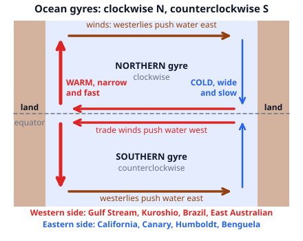
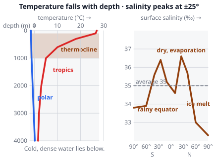
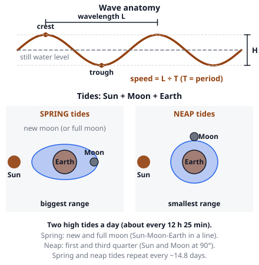
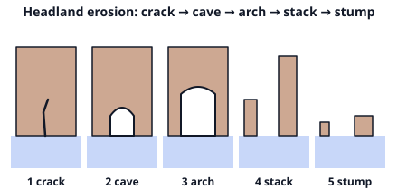

# 🟫 Oceans  ·  `earth.hydrosphere.oceans`
> 📅 Study date: Tue 20 Oct · ⏱️ ~12 min read · 📋 Syllabus: Heat fluxes, Temperature and salinity, Surface circulation, Overturning circulation, Waves and tides, Tsunamis, Coastal geology, Ocean sediments

## 🍳 Start with salty pasta water
Chefs say to salt the pasta water "until it tastes like the sea". Real seawater has about **35 g of salt in every kilogram**, roughly 2 tablespoons in a liter. That is much saltier than the pasta water in most recipes. The same salt, plus the Sun's heat, decides which water is heavy and which is light, and that decides where the ocean's currents go. This page covers the ocean from its heat and salt, through its currents and waves, to what the waves do to the coast.

## 🖼️ Big picture

## 💡 Core ideas
1. **Heat fluxes.** The ocean **gains** heat from sunlight (most of it absorbed in the top few meters) and **loses** heat by **evaporation** (the biggest loss: it takes latent heat), by long-wave radiation and by direct contact (conduction, small). The tropics gain more than they lose and high latitudes lose more than they gain, so **currents carry heat toward the poles**. Water has a huge heat capacity: the top **3 to 4 m** of the ocean can store as much heat as the whole atmosphere above it. That is why the sea warms and cools slowly and keeps coastal climates mild.
2. **Temperature and salinity.** **Salinity** is the grams of dissolved salt in 1 kg of seawater, written in ‰ (parts per thousand): the average is **35 ‰**. Chloride (Cl⁻, about 55 % of the salt) and sodium (Na⁺, about 31 %) make up most of it, and the ratios between the ions are the same everywhere. Salinity is highest around **25° latitude** (36 to 37 ‰) where evaporation beats rain, and lower at the rainy equator, near the poles (ice melt) and near river mouths. Seawater freezes at about **−1.9 °C**. Surface temperature goes from about 28 °C in the tropics to about −2 °C at the poles. Below a warm **mixed layer**, the temperature falls quickly between about 100 and 1000 m: the **thermocline**. Below that the water is cold (0 to 4 °C). Polar water is cold all the way down and has no thermocline. Cold and salty water is **dense**, and it sinks.
3. **Surface circulation.** Winds (trade winds and westerlies) drive big circles called **gyres**: **clockwise** in the Northern Hemisphere, **counterclockwise** in the Southern. On the **western side** of an ocean the current is **narrow, fast and warm** (Gulf Stream, Kuroshio, Brazil, East Australian). On the **eastern side** it is **broad, slow and cold** (California, Canary, Humboldt, Benguela). Along the equator the current flows **west**. Around Antarctica the **Antarctic Circumpolar Current** flows east and is the strongest of all. Where winds blow surface water away from a coast, cold, nutrient-rich water rises to replace it: **upwelling** (Peru). The **Indonesian Throughflow** carries warm Pacific water into the Indian Ocean through Indonesia.
4. **Overturning circulation.** Deep water moves because of **density** (temperature and salt), so it is also called the **thermohaline circulation** (thermo = heat, haline = salt). Surface water that turns very cold and salty sinks near **Greenland and Labrador** (North Atlantic Deep Water) and around **Antarctica** (Antarctic Bottom Water, the densest). That water creeps along the bottom for about **1000 years** and slowly rises back to the surface elsewhere, in a giant "conveyor belt".
5. **Waves, tides and tsunamis.** A wave has a **crest**, a **trough**, a **wavelength L** (crest to crest), a **height H** and a **period T** (seconds between crests). Its speed is **c = L ÷ T**. Wind makes waves; stronger, longer and over a longer distance (the **fetch**) means bigger waves. Near the shore the bottom drags on the wave: it slows, gets taller and **breaks**. **Tides** come from the Moon's (and the Sun's) gravity: there are usually **two high tides a day**, about 12 h 25 min apart. **Spring tides** (biggest range) happen at **new and full moon**, when the Sun, Earth and Moon line up. **Neap tides** (smallest range) happen at the **quarter moons**, when the Sun and Moon pull at right angles. A **tsunami** is a series of very long waves (wavelength 100 km or more) caused by a sudden jolt of the sea floor, usually a **subduction-zone earthquake** (also landslides and volcanoes). It is a *shallow-water* wave: **speed c = √(g × depth)**. At 4000 m deep that is about 200 m/s (over 700 km/h) but the wave is less than 1 m high. As the water gets shallow it slows down, piles up and can reach tens of meters. Sometimes the sea draws back first.
6. **Coasts and sediments.** Waves erode rock by **hydraulic action** (air and water forced into cracks), **abrasion** (rocks thrown at the cliff) and **attrition** (stones wearing each other). Headlands take the hits because waves bend toward them (**refraction**). A headland changes in a chain: **crack → cave → arch → stack → stump**. Waves arriving at an angle push sand up the beach at an angle but it rolls straight back down: the sand zigzags along the coast (**longshore drift**) and builds **spits**, **bars** and **barrier islands**. **Ocean sediments** by origin: **terrigenous** (from land: sand, silt, clay), **biogenous** (from living things: *calcareous ooze* of CaCO₃ shells, *siliceous ooze* of diatoms and radiolarians), **hydrogenous** (precipitated from the water: manganese nodules) and **cosmogenous** (space dust). Calcareous ooze dissolves below about **4 to 5 km** (the *carbonate compensation depth*), so the deepest plains are covered by **red clay** instead.

> 🍲 **Analogy:** the thermohaline circulation is like cold, heavy syrup sinking to the bottom of a glass of warm juice. **The difference:** in the ocean the "syrup" is cold *and* salty water, and it creeps along the bottom for centuries before it rises again somewhere else.

## 🧮 HUSO-style examples

**Example 1.** An undersea earthquake happens where the ocean is 4000 m deep. A coast is 1800 km away, and you may assume the depth stays 4000 m the whole way. Use g = 9.8 m/s². About how long does the tsunami take to arrive?

(A) 151 h  (B) 80 h  (C) 9.1 h  (D) 2.5 h  (E) 7.9 h

Steps:
1. A tsunami is a shallow-water wave, so c = √(g d) = √(9.8 × 4000) = √39 200 ≈ **198 m/s**.
2. Distance 1800 km = 1 800 000 m, so time = 1 800 000 ÷ 198 ≈ 9090 s.
3. 9090 s ÷ 3600 = **2.5 h**. **Answer: (D).**
4. Traps: (C) 9.1 h uses 1800 ÷ 198 and forgets that 198 is in m/s and 1800 is in km. (E) 7.9 h leaves out g. (B) 80 h puts the depth in km (4) in the formula. (A) 151 h is the time in minutes with the wrong unit.

**Example 2.** 🍳 A chef boils 1.0 kg of seawater (35 g of salt in 1000 g) until exactly 500 g of water has boiled away. What is the salinity of what is left in the pot?

(A) 17.5 g/kg  (B) 35 g/kg  (C) 52.5 g/kg  (D) 70 g/kg  (E) 140 g/kg

Steps:
1. The salt does not boil away. It stays: 35 g.
2. The mass left is 1000 − 500 = 500 g.
3. Salinity = 35 g ÷ 0.5 kg = **70 g/kg**. **Answer: (D).**
4. Traps: (B) 35 forgets that the water left. (A) 17.5 halves instead of doubling. (C) 52.5 adds half of 35 to 35. (E) 140 doubles twice.

## ⚠️ Common traps
- **Gyre direction.** Clockwise in the north, counterclockwise in the south. Mixing the two up flips every current.
- **"Warm currents are on the east side."** Warm, fast currents are on the *western* side of an ocean basin.
- **Tide timing.** There are about two highs a day, but they come about 50 minutes later each day, because the Moon moves on.
- **Spring tides are not "in spring".** They are the biggest tides, at new and full moon.
- **Tsunami ≠ tide.** A tsunami has nothing to do with tides, and it is not a wind wave. Its speed depends on the depth only.
- **Deep water and salinity.** Dense water forms where it is *cold and salty*. Warm salty water is not dense enough alone, and cold fresh water is lighter.

## ✏️ Redraw from memory
Close the page and draw in 5 minutes:
- [ ] One ocean basin with the north and south gyres, arrows, and where the warm fast and the cold slow currents are.
- [ ] A temperature-depth curve for the tropics with the thermocline marked, and a flat curve for the poles.
- [ ] A wave with crest, trough, L and H, and the formula c = L ÷ T.
- [ ] The Sun, Earth and Moon for a spring tide and for a neap tide.
- [ ] The five stages of a headland: crack, cave, arch, stack, stump.
- [ ] A line with the two places where deep water forms (North Atlantic and Antarctica).

Compare with the page and mark what you missed in red.

## 🎥 Watch / try
- [How do ocean currents work?](https://www.youtube.com/watch?v=p4pWafuvdrY) — TED-Ed · 4:34 · follow the surface gyres and the deep conveyor belt
- [Why are there two tides a day?](https://www.youtube.com/watch?v=mpRJhhbKLFc) — TED-Ed · 5:21 · look for the two bulges
- [How tsunamis work](https://www.youtube.com/watch?v=Wx9vPv-T51I) — TED-Ed · 3:37 · note what happens as the wave reaches shallow water

## ✅ Check your understanding (5 questions)
Do these without looking at the material. You are **READY** if you get at least 4 of 5 right.

**1.** Which statement about western boundary currents, such as the Gulf Stream, is true?

(A) They are wide, slow and cold.  (B) They flow from the poles toward the equator.  (C) They are narrow, fast and carry warm water toward the poles.  (D) They are caused by the tides.  (E) They exist only in the Atlantic Ocean.

**2.** 🏊 A swimmer floating in the sea watches a buoy. Wave crests pass the buoy every 8 s, and the crests are 100 m apart. How fast are the waves moving?

(A) 12.5 m/s  (B) 0.08 m/s  (C) 800 m/s  (D) 108 m/s  (E) 6.25 m/s

**3.** Spring tides, the tides with the biggest range, happen when

(A) the Moon is at its first or third quarter.  (B) the Moon is closest to Earth, whatever its phase.  (C) Earth is closest to the Sun.  (D) it is spring in the Northern Hemisphere.  (E) the Sun, Earth and Moon are in a line.

**4.** Cold, dense bottom water forms mainly where

(A) the equator is heated strongly by the Sun.  (B) polar surface water becomes very cold and salty, near Greenland and Antarctica.  (C) rivers pour fresh water into the sea.  (D) the trade winds push water westward.  (E) the Moon's pull is the strongest.

**5.** In what order do these features form as waves erode a rocky headland?

(A) stack → arch → cave → stump  (B) cave → stack → arch → stump  (C) arch → cave → stump → stack  (D) cave → arch → stack → stump  (E) stump → stack → arch → cave

Answer key & explanations

1. **(C).** Western boundary currents (Gulf Stream, Kuroshio) carry warm tropical water toward the poles in a narrow, fast stream. (A) describes the *eastern* boundary currents. (E) is wrong: every ocean basin has them (Kuroshio in the Pacific, Agulhas in the Indian Ocean).
2. **(A) 12.5 m/s.** Speed = wavelength ÷ period = 100 m ÷ 8 s = 12.5 m/s. (B) 0.08 m/s is 8 ÷ 100 (upside down). (C) 800 m/s multiplies. (D) 108 m/s adds. (E) 6.25 m/s divides by twice the period.
3. **(E).** At new and full moon the pulls of the Sun and Moon add up, giving the biggest range. (A) is neap tides. (B) describes *perigean* tides, which make tides a bit bigger, but they are not the definition of spring tides.
4. **(B).** Dense water needs to be cold and salty. In polar seas the surface cools and sea ice formation leaves salt behind, so the water becomes heavy and sinks. (A) makes light, warm water. (C) makes water *less* salty.
5. **(D) cave → arch → stack → stump.** A crack widens to a cave, the cave cuts through to an arch, the arch roof falls leaving a stack, and the stack erodes to a stump.

