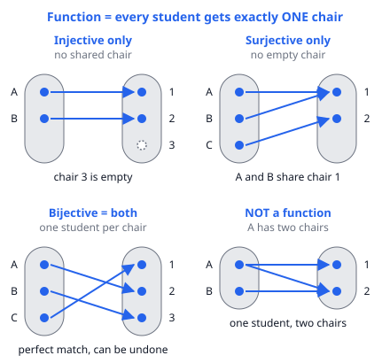
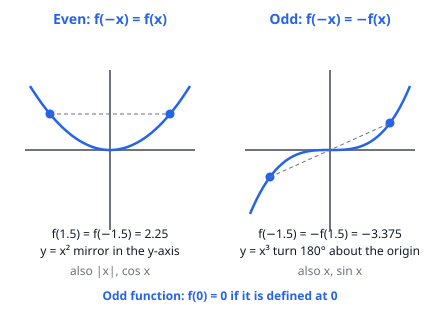
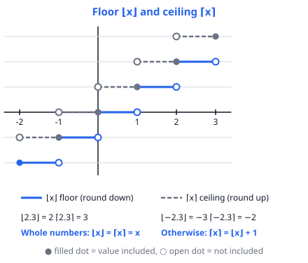

# 🟦 Functions  ·  `math.algebra.functions`
> 📅 Study date: Tue 13 Oct · ⏱️ ~12 min read · 📋 Syllabus: Injectivity, surjectivity, bijectivity, Functional equations, Odd and even functions, Floor and ceiling functions, Logarithmic functions, Trigonometric functions

## 🏊 Start with pool lengths
Your coach says: "Swim **130 m** today." The pool is **50 m** long. How many **complete** lengths is that? 130 ÷ 50 = 2.6, so **2 full lengths**. But to really cover at least 130 m you must swim **3** lengths, because you only turn at the wall. Rounding **down** and rounding **up** are both functions, and they have names: **floor** and **ceiling**. That is one of six small ideas about functions that you will meet today.

## 🖼️ Big picture

A **function** f is a rule that gives **exactly one output** for each input. Think of **inputs as students** and **outputs as chairs**. Each student sits on exactly one chair (but a chair may hold more than one student, or none).

**Not exactly like a classroom:** in a real room two students on one chair would be silly. In math it is allowed, and it is the whole point of "not injective".

## 💡 Core ideas
1. **Injective, surjective, bijective.**
   - **Injective** (one-to-one): no two inputs share an output, so no shared chairs.
   - **Surjective** (onto): every output is hit, so no empty chairs.
   - **Bijective:** both. Every student has their own chair and every chair is used, so you can run the rule backwards.
   - On two finite sets of the **same size**, injective and surjective come together.
2. **Odd and even.** **Even:** f(−x) = f(x), the graph is a **mirror** across the y-axis (x², |x|, cos x). **Odd:** f(−x) = −f(x), the graph **turns 180°** about the origin (x, x³, sin x), and f(0) = 0 if f(0) exists. Even × even = even, odd × odd = even, even × odd = odd.
3. **Floor and ceiling.** **⌊x⌋** is the greatest integer ≤ x (round down). **⌈x⌉** is the least integer ≥ x (round up). ⌊2.3⌋ = 2, ⌈2.3⌉ = 3, but **⌊−2.3⌋ = −3** and ⌈−2.3⌉ = −2. For a whole number they are equal to x; otherwise **⌈x⌉ = ⌊x⌋ + 1**. Always: ⌊x⌋ ≤ x < ⌊x⌋ + 1.
4. **Logarithms.** log_b x = y means **b^y = x** (for b > 0, b ≠ 1, x > 0). So log₂ 8 = 3. Rules: **log(xy) = log x + log y**, **log(x/y) = log x − log y**, **log(x^k) = k · log x**, log_b b = 1, log_b 1 = 0. A log undoes an exponent.
5. **Trigonometry (basics).** In a right triangle: sin = opposite ÷ hypotenuse, cos = adjacent ÷ hypotenuse, tan = sin ÷ cos. **sin² θ + cos² θ = 1** and **cos θ = sin(90° − θ)**. Values to know:

   | θ | 0° | 30° | 45° | 60° | 90° |
   |---|---|---|---|---|---|
   | sin | 0 | ½ | √2⁄2 | √3⁄2 | 1 |
   | cos | 1 | √3⁄2 | √2⁄2 | ½ | 0 |
   | tan | 0 | √3⁄3 | 1 | √3 | none |

6. **Functional equations** are puzzles like "f(x) + 2f(1 − x) = x² for all x". The method: **plug in special values** (0, 1, x = y, 1 − x), get several equations, and solve them like a system. Then **check** your answer in the original equation.

## 🧮 HUSO-style examples

**Example 1.** A pool is 25 m long. A swimmer wants to swim at least 410 m and always finishes at a wall. How many meters does she swim in total?

(A) 400  (B) 410  (C) 425  (D) 435  (E) 450

Steps:
1. Lengths needed: 410 ÷ 25 = 16.4.
2. She cannot swim 0.4 of a length and stop at a wall, so she rounds **up**: ⌈16.4⌉ = 17 lengths.
3. Distance = 17 × 25 = **425 m**. **Answer: (C).**
4. Traps: (A) 400 rounds down (16 lengths is only 400 m, too short). (E) 450 is 18 lengths, one too many.

**Example 2.** A function f satisfies f(x) + 2f(1 − x) = x² for every real number x. What is f(0)?

(A) −1/3  (B) 0  (C) 1/3  (D) 2/3  (E) 1

Steps:
1. Put x = 0: f(0) + 2f(1) = 0.
2. Put x = 1: f(1) + 2f(0) = 1.
3. From step 1: f(0) = −2f(1). Put it in step 2: f(1) − 4f(1) = 1, so f(1) = −1/3.
4. Then f(0) = −2 · (−1/3) = **2/3**. **Answer: (D).**
5. Check: f(0) + 2f(1) = 2/3 − 2/3 = 0 ✓ and f(1) + 2f(0) = −1/3 + 4/3 = 1 ✓. (A) −1/3 is f(1), not f(0).

## ⚠️ Common traps
- **Floor of a negative number:** ⌊−2.3⌋ is **−3**, not −2. "Round down" means toward −∞, not toward zero.
- **A function that looks one-to-one may not be onto.** On the integers, f(x) = x³ never gives 2, so it is injective but **not surjective**. Always say which numbers are allowed as inputs and outputs.
- **Log rules need positive numbers.** log(x + y) is **not** log x + log y. And log(−3) does not exist.
- **Functional equations:** do not stop after finding something that works. Substitute back in, and watch out for answers that only work for some x.

## ✏️ Redraw from memory
Close this page and draw in 5 minutes:
- [ ] Four "student to chair" pictures: injective only, surjective only, bijective, not a function.
- [ ] The floor and ceiling staircases between −2 and 3 with filled and open dots.
- [ ] y = x² and y = x³ with the mirror and the half turn.
- [ ] The trig table for 30°, 45°, 60° (sin, cos, tan).
- [ ] The three log rules and one example such as log₂ 8 = 3.

Compare with the page and circle what you missed in red.

## 🎥 Watch / try
- [Art of Problem Solving: Floor and Ceiling Functions](https://www.youtube.com/watch?v=NkiOw87hjNI) — Art of Problem Solving · 6:10 · watch how negative numbers and fractions are rounded
- [Injective, Surjective, and Bijective Mappings Explained](https://www.youtube.com/watch?v=ETkONvI_z0k) — Let's Get Complex · 8:54 · watch the arrow pictures like ours
- [Introduction to logarithm properties](https://www.youtube.com/watch?v=PupNgv49_WY) — Khan Academy · 9:15 · watch where the product and power rules come from

## ✅ Check your understanding (5 questions)
Do them without looking at the page. You are **READY** if you get at least 4 of 5.

**1.** Each of the following functions has the integers as inputs and as possible outputs. Which one is a bijection (both injective and surjective)?

(A) f(x) = 2x  (B) f(x) = x²  (C) f(x) = x³  (D) f(x) = |x|  (E) f(x) = x + 3

**2.** The function f is odd and the function g is even. If f(2) = 5 and g(2) = 3, what is f(−2) + g(−2)?

(A) −8  (B) −2  (C) 0  (D) 2  (E) 8

**3.** 🍳 A café needs 100 eggs. Eggs are sold only in cartons of 6. Let c be the smallest number of cartons that gives at least 100 eggs, and let e be the number of extra eggs left over. What is c + e?

(A) 16  (B) 17  (C) 18  (D) 19  (E) 20

**4.** What is the value of log₂(cos 60°) + log₃ 27?

(A) 2  (B) 3  (C) 4  (D) 8  (E) ½

**5.** A function f satisfies f(x + 1) = 2f(x) for every real x, and f(0) = 3. What is f(4)?

(A) 11  (B) 12  (C) 24  (D) 48  (E) 96

Answer key & explanations

1. **(E) f(x) = x + 3.** It hits every integer exactly once (the input is y − 3). (A) 2x misses odd numbers. (B) x² and (D) |x| give the same output for x and −x, and miss negatives. (C) x³ is injective, but it never gives 2 (not a cube), so it is not onto.
2. **(B) −2.** Odd: f(−2) = −f(2) = −5. Even: g(−2) = g(2) = 3. Sum = −5 + 3 = −2. (A) −8 treats g as odd. (D) 2 treats f as even.
3. **(D) 19.** 100 ÷ 6 = 16.67, so c = ⌈16.67⌉ = 17 cartons. That is 102 eggs, so e = 2. c + e = 19. (A) 16 rounds down. (E) 20 uses 16 cartons and the 4 eggs left over from them.
4. **(A) 2.** cos 60° = ½, and log₂(½) = −1 because 2⁻¹ = ½. Also log₃ 27 = 3 because 3³ = 27. Sum = −1 + 3 = 2. (C) 4 gets the sign of log₂(½) wrong. (B) 3 forgets the first part.
5. **(D) 48.** Each step doubles: f(1) = 6, f(2) = 12, f(3) = 24, f(4) = 48. (B) 12 is f(2) and (C) 24 is f(3): you stopped early. (A) 11 adds instead of multiplying.

