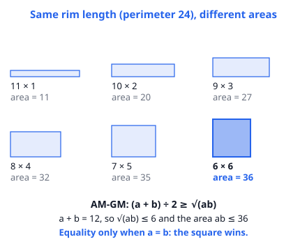
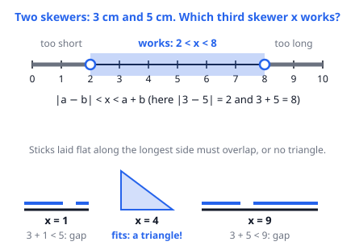

# 🟦 Inequalities  ·  `math.algebra.inequalities`
> 📅 Study date: Tue 13 Oct · ⏱️ ~12 min read · 📋 Syllabus: Trivial inequality, AM-GM-HM inequalities, Triangle inequality

## 🍳 Start with a baking tray
You are making a rectangular cake tray from a metal strip that is exactly **24 cm** long, so the rim is fixed. You can bend it into 11 × 1, 9 × 3, 8 × 4 … Which shape holds the **most batter** (biggest area)? Try a few and you will see the areas climb: 11, 27, 32 … and the winner is the **6 × 6 square**, with area 36. Why does the square always win? That is **AM-GM**, and it is the star of today.

**Not exactly like real baking:** a real tray also has a height. Here we only look at the flat floor.

## 🖼️ Big picture

An **inequality** says one thing is bigger than another (≥ means "bigger than or equal"). Three tools for today: the **trivial inequality** (squares are never negative), **AM-GM-HM** (three kinds of "average" always come in the same order) and the **triangle inequality** (when three sticks can make a triangle).

## 💡 Core ideas
1. **Trivial inequality:** for any real number x, **x² ≥ 0**, and x² = 0 only when x = 0. This simple fact proves a lot: **(a − b)² ≥ 0** gives **a² + b² ≥ 2ab**. Also: the smallest value of x² − 6x + 11 = (x − 3)² + 2 is 2.
2. **AM-GM for two numbers** (a, b **positive**): **(a + b) ÷ 2 ≥ √(ab)**. The left side is the **arithmetic mean** (AM), the right side is the **geometric mean** (GM). They are equal **only when a = b**.
3. **What AM-GM is used for:** if the **sum is fixed**, the **product is biggest** when the numbers are equal (the tray). If the **product is fixed**, the **sum is smallest** when the numbers are equal. With more numbers: the average of n positive numbers ≥ the n-th root of their product.
4. **Harmonic mean (HM)** of a and b: **2ab ÷ (a + b)**, which is 2 divided by (1/a + 1/b). The order is always **HM ≤ GM ≤ AM**, with equality only if all numbers are equal. HM is the right "average" for **speeds over equal distances**.
5. **Triangle inequality:** sides a, b, c form a triangle only if **each side is shorter than the sum of the other two**. For two known sides a and b, the third side x satisfies **|a − b| < x < a + b**. If x equals the sum, the triangle is flat (not allowed).
6. **Before you use AM-GM, check two things:** the numbers are **positive**, and equality can actually happen (can you really make a = b?).

> 🏊 **Speed example for HM:** swim one 50 m length at 1 m/s and come back at 1.5 m/s. Total time = 50 + 33.3 = 83.3 s, so the average speed is 100 ÷ 83.3 = **1.2 m/s**. That is the HM of 1 and 1.5, not the AM (1.25). **Why:** you spend more time at the slow speed, so the slow speed counts more.

## 🧮 HUSO-style examples

**Example 1.** A cook has a 120 cm metal strip. She bends it into three sides of a rectangular dough tray. The fourth side is the kitchen wall. What is the largest possible area of the tray, in cm²?

(A) 900  (B) 1,600  (C) 1,800  (D) 2,400  (E) 3,600

Steps:
1. Let each short side be x and the side along the wall be y. The strip gives 2x + y = 120.
2. Area = x · y = ½ · (2x) · y.
3. AM-GM on the two numbers 2x and y (their sum is fixed at 120): 2x · y ≤ (120 ÷ 2)² = 3600.
4. So the area ≤ ½ · 3600 = **1800**. Equality when 2x = y = 60, so x = 30 and y = 60. **Answer: (C).**
5. Traps: (A) 900 treats it as a square (30 × 30). (B) 1,600 makes all three strips equal (40 × 40). (E) 3,600 forgets the ½.

**Example 2.** A cook has two skewers, 7 cm and 12 cm long. She cuts a third skewer, whose length is a whole number of cm, to make a triangle with them. How many different lengths work?

(A) 11  (B) 12  (C) 13  (D) 15  (E) 19

Steps:
1. Triangle inequality: 12 − 7 < x < 12 + 7, so **5 < x < 19**.
2. Whole numbers from 6 to 18: that is 18 − 6 + 1 = **13**. **Answer: (C).**
3. (D) 15 wrongly includes x = 5 and x = 19 (flat triangles).

## ⚠️ Common traps
- **AM-GM needs positive numbers.** For a = b = −1 the left side is −1 and the right side is 1, so the "inequality" fails.
- **Equality must be reachable.** If you find a bound but the numbers can never be equal, the bound is not the real minimum or maximum. Always find the x that makes equality true.
- **The triangle inequality is strict.** x = a + b gives a flat line, not a triangle. Use < not ≤.
- **HM, not AM, for average speed** over equal distances. And HM ≤ GM ≤ AM, never the other way round.

## ✏️ Redraw from memory
Close this page and draw in 5 minutes:
- [ ] Rectangles with the same perimeter and their areas, with the winner marked.
- [ ] The AM-GM statement with its equality condition.
- [ ] The number line for the triangle inequality with sticks 3 and 5 (open circles at 2 and 8).
- [ ] The order HM ≤ GM ≤ AM with the numbers for a = 2, b = 8.
- [ ] One example of why (a − b)² ≥ 0 gives a² + b² ≥ 2ab.

Compare with the page and circle what you missed in red.

## 🎥 Watch / try
- [The AM-GM Inequality](https://www.youtube.com/watch?v=br05-gIAk2s) — Art of Problem Solving · 4:53 · watch how the equality case a = b decides the answer
- [Triangle inequality theorem](https://www.youtube.com/watch?v=KlKYvbigBqs) — Khan Academy · 5:52 · watch how the two shorter sides must be longer than the third
- [RMS-AM-GM-HM Inequality](https://www.youtube.com/watch?v=_gTClIbHreI) — MindYourDecisions · 8:24 · watch the whole chain of means and where it is used

## ✅ Check your understanding (5 questions)
Do them without looking at the page. You are **READY** if you get at least 4 of 5.

**1.** What is the minimum value of x² − 6x + 11 for real x?

(A) −9  (B) 0  (C) 2  (D) 5  (E) 11

**2.** For x > 0, what is the minimum value of 4x + 9/x?

(A) 6  (B) 12  (C) 13  (D) 18  (E) 36

**3.** 🏊 A swimmer swims one 50 m length at 1 m/s and swims back at 1.5 m/s. What is her average speed over the whole 100 m, in m/s?

(A) 1.0  (B) 1.1  (C) 1.2  (D) 1.25  (E) 1.5

**4.** Two sides of a triangle with whole-number side lengths are 4 and 9. What is the smallest possible perimeter?

(A) 18  (B) 19  (C) 21  (D) 25  (E) 26

**5.** Which of the following is **not** true for every pair of real numbers a and b for which both sides make sense?

(A) a² + b² ≥ 2ab  (B) (a + b)² ≥ 4ab  (C) a² + 1 ≥ 2a  (D) (a + b) ÷ 2 ≥ √(ab)  (E) a² + b² ≥ −2ab

Answer key & explanations

1. **(C) 2.** x² − 6x + 11 = (x − 3)² + 2, and (x − 3)² ≥ 0, so the minimum is 2 at x = 3. (A) −9 forgets to add the 11. (B) 0 pretends the square part is the whole thing.
2. **(B) 12.** AM-GM on 4x and 9/x (both positive): 4x + 9/x ≥ 2√(4x · 9/x) = 2√36 = 12. Equality when 4x = 9/x, so x = 3/2. (C) 13 is just x = 1.
3. **(C) 1.2.** Time = 50/1 + 50/1.5 = 50 + 33.33 = 83.33 s. Average = 100 ÷ 83.33 = 1.2 m/s (the harmonic mean). (D) 1.25 is the plain average, which is wrong here.
4. **(B) 19.** The third side x must satisfy 9 − 4 < x < 9 + 4, so x ≥ 6 and the smallest perimeter is 4 + 9 + 6 = 19. (A) 18 uses x = 5, a flat triangle. (D) 25 uses the largest x = 12.
5. **(D).** If a = b = −1, then (a + b) ÷ 2 = −1 but √(ab) = 1, so −1 ≥ 1 is false. AM-GM only works for positive numbers. The others are all true because they come from (a − b)² ≥ 0, (a + b)² ≥ 0 or (a − 1)² ≥ 0.

