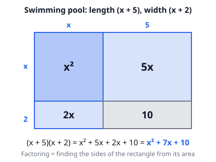
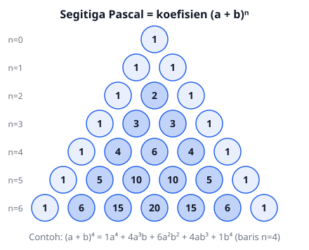

# 🟦 Polynomials  ·  `math.algebra.polynomials`
> 📅 Study date: Tue 13 Oct · ⏱️ ~12 min read · 📋 Syllabus: Divisibility and factorization of polynomials, Vieta's formulas, Binomial theorem, Rational root theorem

## 🏊 Start with the swimming pool
The training pool at your school is a rectangle. Its length is **(x + 5)** metres and its width is **(x + 2)** metres. What is its area?

Draw the tiles and the area appears by itself: **x² + 7x + 10**. Now run it backwards: if someone only tells you the area is **x² + 7x + 10**, you can work out the sides of the pool. That is **factoring**. A polynomial is like the pool: you have the total area, and you have the sides that build it.

## 🖼️ Big picture

Four tools live in this topic: the **Remainder and Factor Theorems**, **Vieta's formulas**, the **Rational Root Theorem**, and the **Binomial Theorem**.

## 💡 Core ideas
1. **Remainder Theorem:** when P(x) is divided by (x − a), the **remainder is P(a)**. If P(a) = 0, then **(x − a) is a factor** of P(x) (the Factor Theorem).
2. **Factoring patterns to know by heart:**
   - a² − b² = (a − b)(a + b)
   - a² ± 2ab + b² = (a ± b)²
   - a³ + b³ = (a + b)(a² − ab + b²) and a³ − b³ = (a − b)(a² + ab + b²)
   - For x² + bx + c: find two numbers that **multiply to c** and **add to b** (the pool tiles above).
3. **Vieta's formulas:**
   - For ax² + bx + c = 0 with roots p and q: **p + q = −b/a** and **p·q = c/a**.
   - For ax³ + bx² + cx + d = 0 with roots p, q, r: **p + q + r = −b/a**, **pq + qr + rp = c/a**, **pqr = −d/a**.
   - Use them to work with the roots **without finding the roots**. Example: p² + q² = (p + q)² − 2pq.
4. **Rational Root Theorem:** if the coefficients are integers and the fraction **m/n** (in lowest terms) is a root, then **m divides the constant term** and **n divides the leading coefficient**. It gives a list of *candidates*; not every candidate is a root.
5. **Binomial Theorem:** (a + b)ⁿ = Σ C(n, k) · aⁿ⁻ᵏ · bᵏ, for k = 0 to n. The coefficients are the rows of **Pascal's triangle**.
6. **Two quick tricks:** the sum of all coefficients of P(x) is **P(1)**, and the constant term is **P(0)**.

> 🍕 **Topping analogy:** you have 5 pizza toppings. The number of ways to pick exactly k toppings is C(5, k), and these numbers are row n = 5 of Pascal's triangle: 1, 5, 10, 10, 5, 1. **The difference:** in the binomial theorem each term also carries powers of a and b, not only the number of ways to choose.

## 🧮 HUSO-style examples

**Example 1.** The roots of x³ − 7x² + 14x − 8 = 0 are r, s, and t. What is r² + s² + t²?

(A) 7  (B) 14  (C) 21  (D) 35  (E) 49

Solution:
1. Vieta gives r + s + t = 7 and rs + st + tr = 14.
2. Square the sum: (r + s + t)² = r² + s² + t² + 2(rs + st + tr).
3. So r² + s² + t² = 7² − 2·14 = 49 − 28 = **21**. **Answer: (C).**
4. Check: the roots are 1, 2, 4 → 1 + 4 + 16 = 21 ✓.

**Example 2.** What is the coefficient of x⁴ in the expansion of (x + 2)⁶?

(A) 15  (B) 30  (C) 45  (D) 60  (E) 120

Solution:
1. An x⁴ term means that out of 6 factors you take x four times and take **2 twice**.
2. Number of ways: C(6, 4) = 15 (row n = 6 of Pascal: 1, 6, **15**, 20, 15, 6, 1).
3. Value of each way: 2² = 4. Coefficient = 15 · 4 = **60**. **Answer: (D).**

## ⚠️ Common traps
- **Vieta signs:** the sum of the roots is **−b/a** (there is a minus). People forget it, especially for the cubic: pqr = **−d/a**.
- **Forgetting to divide by a** when the leading coefficient is not 1: for 2x² − 10x + 12, p + q = 10/2 = 5, not 10.
- **Rational roots:** the candidate list is not a guarantee. You must **test** each candidate by substituting. The denominator must divide the leading coefficient (for example ⅔ is impossible for 2x³ − …).
- **Binomial:** the power of b counts too. The coefficient of x² in (x + 3)⁵ is C(5, 2)·3³, not C(5, 2)·3².

## ✏️ Redraw from memory
Close this page, take a sheet of paper, and draw in 5 minutes:
- [ ] The pool area model for (x + 5)(x + 2) with its 4 tiles and labels.
- [ ] Vieta's formulas for the quadratic **and** the cubic (get the signs right!).
- [ ] Pascal's triangle up to row n = 5.
- [ ] The Remainder Theorem in one sentence with a number example.
- [ ] The rule for rational-root candidates (m divides what, n divides what).

Compare with the page and mark anything you missed in red.

## 🎥 Watch / try
- [Polynomial remainder theorem](https://www.youtube.com/watch?v=MwG6QD352yc) — Khan Academy · 6:42 · see why dividing by (x − a) always leaves P(a)
- [Art of Problem Solving: Vieta for Quadratics Part 1](https://www.youtube.com/watch?v=3sOSIFLHz-s) — Art of Problem Solving · 9:16 · see how the sum and product of roots are used without finding the roots
- [Pascal's triangle for binomial expansion](https://www.youtube.com/watch?v=v9Evg2tBdRk) — Khan Academy · 8:20 · see how to read the coefficients from one row of the triangle

## ✅ Check your understanding (5 questions)
Do these without looking at the page. You are **READY** if you get at least 4 out of 5.

**1.** What is the remainder when x³ − 3x² + 2x + 5 is divided by x − 3?

(A) 5  (B) 6  (C) 11  (D) 17  (E) 27

**2.** 🏊 A rectangular swimming pool has area x² − 7x + 10 square metres and length (x − 2) metres. If x = 9, what is the width of the pool, in metres?

(A) 2  (B) 4  (C) 7  (D) 10  (E) 28

**3.** Which of the following can **not** be a rational root of 2x³ − 3x² + 5x − 6 = 0?

(A) 3/2  (B) 1/2  (C) 6  (D) 2/3  (E) −3

**4.** What is the coefficient of x² in the expansion of (x + 3)⁵?

(A) 90  (B) 135  (C) 180  (D) 270  (E) 405

**5.** The roots of 2x² − 10x + 12 = 0 are p and q. What is 1/p + 1/q?

(A) 1/6  (B) 5/6  (C) 6/5  (D) 5  (E) 11/6

Answer key & explanations

1. **(C) 11.** The remainder is P(3) = 27 − 27 + 6 + 5 = 11. Choice (B) 6 appears if you forget the constant 5; (A) 5 is P(1), the remainder for x − 1.
2. **(B) 4.** For x = 9: area = 81 − 63 + 10 = 28 and length = 7, so width = 28 / 7 = 4. Factoring way: x² − 7x + 10 = (x − 2)(x − 5), so width = x − 5 = 4.
3. **(D) 2/3.** Candidates m/n: m divides 6 (±1, ±2, ±3, ±6) and n divides 2 (1 or 2). The denominator 3 does not divide 2, so 2/3 is impossible. All the other choices are possible candidates.
4. **(D) 270.** The x² term is C(5, 2) · x² · 3³ = 10 · 27 = 270. Choice (A) 90 appears if you wrongly use 3².
5. **(B) 5/6.** 1/p + 1/q = (p + q)/(pq). Vieta: p + q = 10/2 = 5 and pq = 12/2 = 6. So the answer is 5/6. Check: the roots are 2 and 3 → 1/2 + 1/3 = 5/6.

