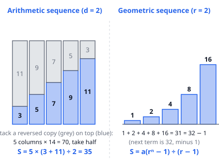
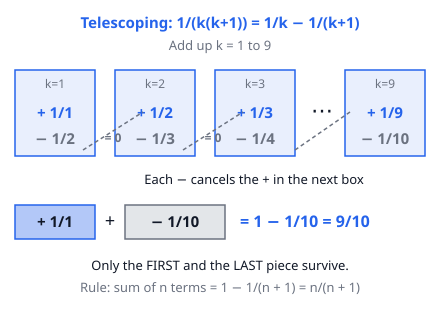

# 🟦 Sequences & Series  ·  `math.algebra.sequences`
> 📅 Study date: Tue 13 Oct · ⏱️ ~12 min read · 📋 Syllabus: Arithmetic series, Geometric series, Telescoping series

## 🎮 Start with the Valorant economy
Imagine your team keeps losing rounds. Suppose the loss bonus starts at **1000 credits** and goes up by **500** every extra loss in a row: 1000, 1500, 2000, 2500, … How much bonus money did you collect after 8 losses? Adding one by one is slow. There is a shortcut, and it is today's topic: **sequences and series**. (These numbers are made up. The real game has its own numbers, and they change.)

**Not the same as the game:** the real game stops the bonus at a cap. In math we pretend it grows forever.

## 🖼️ Big picture

A **sequence** is a list of numbers in order. A **series** is what you get when you **add** them. Three kinds matter today: **arithmetic** (add the same number each step), **geometric** (multiply by the same number each step) and **telescoping** (a sum where most pieces cancel).

## 💡 Core ideas
1. **Arithmetic sequence:** each term is the one before plus a fixed **difference d**. The n-th term is **aₙ = a₁ + (n − 1)d**. To count the terms, use **n = (last − first) ÷ d + 1**.
2. **Arithmetic series (Gauss's trick):** **S = n × (first + last) ÷ 2**. Picture it: write the staircase twice, one upside down. Together they form a rectangle n wide and (first + last) tall, and you want half of it (see the left picture).
3. **Geometric sequence:** each term is the one before times a fixed **ratio r**. The n-th term is **aₙ = a₁ · rⁿ⁻¹**.
4. **Geometric series:** **S = a₁(rⁿ − 1) ÷ (r − 1)** for r ≠ 1. Quick check with 1 + 2 + 4 + 8 + 16 = 32 − 1 = 31. If |r| < 1, the **infinite** sum exists: **S = a₁ ÷ (1 − r)**. Example: 1 + ½ + ¼ + … = 2.
5. **Telescoping series:** rewrite each term as a difference so neighbors cancel, like a folding telescope. The key one is **1/(k(k + 1)) = 1/k − 1/(k + 1)**. Only the **first** and **last** pieces survive.
6. **Handy tricks:** three numbers in an arithmetic sequence: the middle one is the **average** of the other two. Three numbers in a geometric sequence: **b² = a · c**.

## 🧮 HUSO-style examples

**Example 1.** Suppose a team's loss bonus is 1000 credits after the first loss and rises by 500 with each further loss in a row. What is the total bonus after 8 losses in a row?

(A) 11,000  (B) 22,000  (C) 27,000  (D) 36,000  (E) 44,000

Steps:
1. This is arithmetic: first term 1000, difference 500, 8 terms.
2. Last term = 1000 + 7 × 500 = 4500.
3. Sum = 8 × (1000 + 4500) ÷ 2 = 8 × 2750 = **22,000**. **Answer: (B).**
4. Check the traps: forgetting "÷ 2" gives 44,000 (E). Using 8 × 4500 gives 36,000 (D). Using 9 terms gives 27,000 (C).

**Example 2.** What is 1/(1·2) + 1/(2·3) + 1/(3·4) + … + 1/(99·100)?

(A) 1/100  (B) 49/50  (C) 99/100  (D) 100/101  (E) 1

Steps:
1. Split each term: 1/(k(k + 1)) = 1/k − 1/(k + 1).
2. The sum becomes (1 − ½) + (½ − ⅓) + … + (1/99 − 1/100).
3. Everything in the middle cancels. Left: 1 − 1/100 = **99/100**. **Answer: (C).**
4. Check with a small case: up to 1/(2·3) the sum is ½ + 1/6 = 2/3 = 1 − 1/3 ✓.

## ⚠️ Common traps
- **Counting terms wrong.** From 5 to 59 in steps of 3 there are (59 − 5) ÷ 3 + **1** = 19 terms, not 18. This is the "fence post" mistake: always add 1.
- **Forgetting the ÷ 2** in the arithmetic sum, or mixing up n and n − 1 in the geometric formulas (the last term has rⁿ⁻¹, but the sum has rⁿ).
- **Infinite geometric sums** only work when |r| < 1. For r = 2 the sum just explodes.
- **Telescoping:** do not assume everything cancels. Write the first two and last two pieces to see exactly what is left.

## ✏️ Redraw from memory
Close this page and, on paper, draw in 5 minutes:
- [ ] The staircase plus upside-down copy rectangle, and the formula S = n(first + last) ÷ 2.
- [ ] The bars 1, 2, 4, 8, 16 and why they add to 32 − 1.
- [ ] A row of telescoping boxes with the cancelling arrows.
- [ ] The three formulas: aₙ, geometric sum, infinite sum (with its condition).
- [ ] The fence-post rule for counting terms.

Compare with the page and circle what you missed in red.

## 🎥 Watch / try
- [Formula for arithmetic series](https://www.youtube.com/watch?v=Uy_L8tnihDM) — Khan Academy · 7:46 · watch how the pairing trick gives the formula
- [Formula for a finite geometric series](https://www.youtube.com/watch?v=i8THsl3AYFI) — Khan Academy · 9:38 · watch how multiplying by r and subtracting makes most terms vanish
- [5 telescoping series in 5 minutes](https://www.youtube.com/watch?v=IokDRtD1TkM) — bprp calculus basics · 4:55 · watch how each term is split into a difference (ignore the limit ideas at the end)

## ✅ Check your understanding (5 questions)
Do them without looking at the page. You are **READY** if you get at least 4 of 5.

**1.** What is the value of 5 + 8 + 11 + … + 59?

(A) 576  (B) 608  (C) 627  (D) 640  (E) 1216

**2.** 🍳 A bakery bakes 1 loaf on day 1 and then doubles the number of loaves every day. How many loaves does it bake in the first 10 days altogether?

(A) 511  (B) 512  (C) 1023  (D) 1024  (E) 2046

**3.** 🏊 A swimmer does 4 laps on day 1 of a training week. Each following day she does 2 more laps than the day before. How many laps does she swim in the first 10 days?

(A) 65  (B) 130  (C) 150  (D) 154  (E) 260

**4.** What is the value of 1/(1·3) + 1/(3·5) + 1/(5·7) + … + 1/(97·99)?

(A) 1/99  (B) 49/99  (C) 50/99  (D) 97/99  (E) 98/99

**5.** An infinite geometric series has first term 12 and sum 18. What is its common ratio?

(A) −1/3  (B) 1/6  (C) 2/3  (D) 3/2  (E) 1/3

Answer key & explanations

1. **(B) 608.** Terms: (59 − 5) ÷ 3 + 1 = 19. Sum = 19 × (5 + 59) ÷ 2 = 19 × 32 = 608. (A) 576 uses 18 terms. (D) 640 uses 20 terms. (E) 1216 forgets the ÷ 2.
2. **(C) 1023.** Geometric: 1 + 2 + 4 + … + 512 (ten terms) = 2¹⁰ − 1 = 1023. (D) 1024 forgets the − 1. (B) 512 is only the last day. (A) 511 stops after 9 days.
3. **(B) 130.** Laps on day 10 = 4 + 9 × 2 = 22. Sum = 10 × (4 + 22) ÷ 2 = 130. (E) 260 forgets the ÷ 2. (C) 150 uses 6 + … + 24 (it starts one step too late).
4. **(B) 49/99.** 1/((2k − 1)(2k + 1)) = ½ · (1/(2k − 1) − 1/(2k + 1)). The sum telescopes to ½ · (1 − 1/99) = ½ · 98/99 = 49/99. (E) 98/99 forgets the ½.
5. **(E) 1/3.** 12 ÷ (1 − r) = 18, so 1 − r = 12/18 = 2/3 and r = 1/3. (C) 2/3 is the value of 1 − r, not r. (D) 3/2 flips the fraction.

