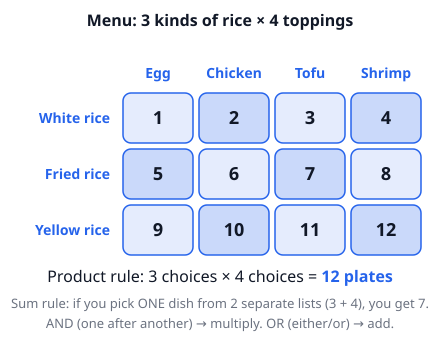
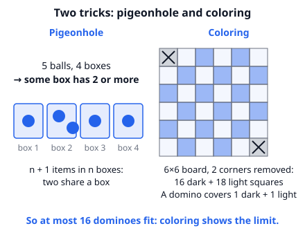
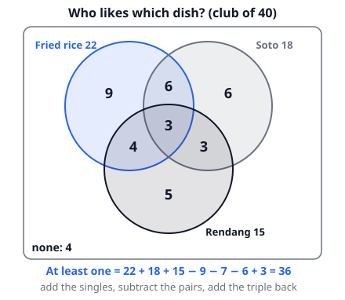

# 🟦 Counting Principles  ·  `math.combinatorics.counting-principles`
> 📅 Study date: Tue 13 Oct · ⏱️ ~12 min read · 📋 Syllabus: Rule of product and rule of sum, Inclusion-exclusion, Pigeonhole principle, Invariance principle, Extremal principle, Coloring principle

## 🍳 Start with the menu
A food stall sells **3 kinds of rice** and **4 toppings**. You pick one rice and one topping. How many different plates can you order?

You could write all of them down, but there is a faster way: 3 rows, 4 columns, so **3 × 4 = 12**. Counting without listing is the whole game in this topic. Later we add some clever tricks for the cases where listing is too slow, or where the question asks "is it even possible?".

## 🖼️ Big picture

Six tools in this topic: the **product rule**, the **sum rule**, **inclusion-exclusion**, the **pigeonhole principle**, and three "proof-style" ideas: **invariance**, **extremal** and **coloring**.

## 💡 Core ideas
1. **Product and sum rules.** Do step 1 **AND** then step 2: **multiply** the number of choices. Pick this **OR** that (two lists that do not overlap): **add**. Example: 4 kinds of rice × 3 toppings = 12 plates, but 4 kinds of rice + 3 toppings = 7 single items to choose from.
2. **Inclusion-exclusion.** When groups overlap, adding double counts the overlap. For two sets: |A ∪ B| = |A| + |B| − |A ∩ B|. For three sets: add the singles, **subtract the pairs, add the triple back**: |A ∪ B ∪ C| = |A| + |B| + |C| − |A∩B| − |A∩C| − |B∩C| + |A∩B∩C|.
3. **Pigeonhole principle.** Put more than n items into n boxes and **some box gets at least 2**. Stronger version: N items in n boxes means some box gets at least **⌈N/n⌉** (N ÷ n rounded **up**). To *guarantee* something, think about the **worst case** first, then add 1.
4. **Invariance principle.** Find something that **never changes** (an invariant), such as "the number of lit lamps is even". If the goal has a different value, it is **impossible**. Example: 7 lamps are off. Each move flips exactly 2 lamps. Each move changes the number of lit lamps by −2, 0 or +2, so it stays even. Having all 7 lit (odd) can never happen.
5. **Extremal principle.** Look at the **biggest or smallest** thing. Example: can a finite list of positive numbers have the property that every number is the sum of two *other* numbers in the list? Look at the **smallest** number. A sum of two others is at least twice as big, so it cannot be the smallest. Impossible.
6. **Coloring principle.** Color the board like a chessboard. A domino (1×2) always covers **one dark and one light** square. So a shape with unequal numbers of dark and light squares cannot be tiled completely.

> 🎈 **Analogy:** inclusion-exclusion is like counting people in a room by adding up the guest lists of three parties. Someone who went to two parties is on two lists, so you must subtract the repeats. **Where it differs:** with three sets, subtracting the pairs removes the triple-party people too many times, so you add them back once.

## 🧮 HUSO-style examples

**Example 1.** A cooking club has 40 members. 22 like fried rice, 18 like soto and 15 like rendang. 9 like fried rice and soto, 7 like fried rice and rendang, 6 like soto and rendang, and 3 like all three. How many members like **none** of the three dishes?

(A) 3  (B) 4  (C) 7  (D) 20  (E) 36

Steps:
1. Count members who like **at least one dish** with inclusion-exclusion: 22 + 18 + 15 = 55.
2. Subtract the pairs: 55 − 9 − 7 − 6 = 33.
3. Add the triple back: 33 + 3 = 36.
4. None of the three: 40 − 36 = **4**. **Answer: (B).**
5. Check with the picture: 9 + 6 + 5 (only one dish) + 6 + 4 + 3 (exactly two) + 3 (all) = 36 ✓.

**Example 2.** A drawer holds lots of wooden spoons in 4 colors. You pull spoons out in the dark. What is the smallest number you must take out to be **sure** that 3 of them have the same color?

(A) 5  (B) 8  (C) 9  (D) 10  (E) 12

Steps:
1. Think of the **worst case**: you get as many as possible without 3 of one color.
2. That is 2 spoons of each color: 4 × 2 = 8 spoons, and still no color has 3.
3. The **next** spoon must make 3 of some color. So you need 8 + 1 = **9**. **Answer: (C).**
4. Pigeonhole check: 9 spoons in 4 colors gives ⌈9/4⌉ = 3 ✓.

## ⚠️ Common traps
- **Adding when you should multiply** (or the other way round). Ask: do I do *both* things (multiply) or *one or the other* (add)?
- **Inclusion-exclusion with three sets:** forgetting to **add the triple back** (that gives 33 instead of 36 above).
- **Pigeonhole "worst case + 1":** people answer 8 (the worst case) and forget the +1.
- **Invariance:** you must find something that really *never* changes in every move. Trying a few moves and failing proves nothing.

## ✏️ Redraw from memory
Close the page and draw in 5 minutes:
- [ ] A rice × topping table showing why the product rule gives 12.
- [ ] A three-circle Venn diagram with the formula "singles − pairs + triple".
- [ ] 5 balls in 4 boxes, with the sentence "some box has at least 2".
- [ ] A 6×6 chessboard with two opposite corners crossed out, and the dark and light counts.
- [ ] One sentence each for invariance and extremal principle.

Compare with the page and mark what you missed in red.

## 🎥 Watch / try
- [Principle of Inclusion-Exclusion](https://www.youtube.com/watch?v=wq6PJxNso30) — Mustang Math · 3:09 · watch how the overlap is subtracted, then check it with your own Venn diagram
- [3.5.1 The Pigeonhole Principle](https://www.youtube.com/watch?v=4Dz4vNUxnZM) — MIT OpenCourseWare · 4:14 · notice how the "boxes" are chosen in each example
- [Can you solve the dominoes on a chessboard puzzle?](https://www.youtube.com/watch?v=iWHfrVIfpX0) — Puzzles Explained · 3:25 · watch for the coloring idea

## ✅ Check your understanding (5 questions)
Do these without looking at the material. You are **READY** if you get at least 4 of 5 right.

**1.** 🍳 A food stall lets you choose 1 of 4 kinds of rice, 1 of 3 toppings, and either 1 of 2 drinks or no drink at all. How many different orders are possible?

(A) 10  (B) 12  (C) 36  (D) 24  (E) 9

**2.** How many integers from 1 to 60 are multiples of 4 or multiples of 6 (or both)?

(A) 5  (B) 15  (C) 20  (D) 25  (E) 30

**3.** In a group of 50 students, what is the largest number k for which we can be sure that at least k of them were born in the same month of the year?

(A) 4  (B) 5  (C) 6  (D) 12  (E) 13

**4.** The numbers 1, 2, 3, …, 10 are written on a board. A move erases two numbers a and b and writes |a − b| instead. After 9 moves one number is left. Which of these could it be?

(A) 0  (B) 2  (C) 4  (D) 5  (E) 8

**5.** 🏊 The floor around a pool is a 6 × 6 grid of square tiles. The two tiles in opposite corners are covered by lifeguard chairs. You lay 1 × 2 tiles (each covers two neighboring squares) with no overlaps. What is the largest number of 1 × 2 tiles you can place?

(A) 15  (B) 16  (C) 17  (D) 18  (E) 34

Answer key & explanations

1. **(C) 36.** The drink step has 2 + 1 = 3 options ("no drink" counts as one). So 4 × 3 × 3 = 36. (D) 24 forgets "no drink". (B) 12 ignores drinks. (A) 10 and (E) 9 add instead of multiplying.
2. **(C) 20.** Multiples of 4: 15. Multiples of 6: 10. Multiples of both (multiples of 12): 5. So 15 + 10 − 5 = 20. (D) 25 forgets to subtract the overlap.
3. **(B) 5.** Worst case: spread students as evenly as possible. 12 months × 4 = 48 < 50, so some month has at least ⌈50/12⌉ = 5. (A) 4 is rounding down. Five is guaranteed, and six is not (a spread of 5 and 4 uses all 50 students).
4. **(D) 5.** The sum 1 + … + 10 = 55 is odd. Replacing a, b by |a − b| changes the sum by 2·min(a, b), an even number, so the sum stays odd. The last number is odd, so only 5 is possible (and it can really happen).
5. **(B) 16.** Color like a chessboard. The two removed corners have the same color, so there are 16 of one color and 18 of the other. Each tile covers one of each, so at most 16 tiles fit. (C) 17 is the trap: 34 squares ÷ 2 = 17 ignores colors. (E) 34 counts squares, not tiles. 16 tiles can really be laid.

