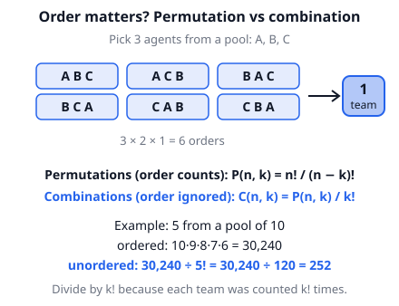
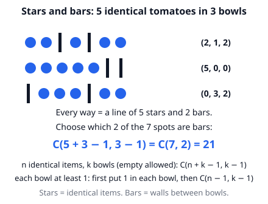
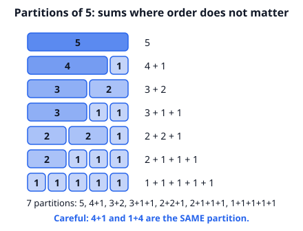

# 🟦 Enumerative Combinatorics  ·  `math.combinatorics.enumerative`
> 📅 Study date: Tue 13 Oct · ⏱️ ~12 min read · 📋 Syllabus: Permutations, combinations, partitions, Pascal's triangle, Stars and bars

## 🎮 Start with the squad
Suppose a game lets you build a team of **5 agents** from a pool of 10. Does the **order** in which you pick them matter? If you only care *who is on the team*, no. If you also give each agent a role in a fixed order (1st, 2nd, …), then yes.

That one question splits counting into two families: **permutations** (order matters) and **combinations** (order does not matter). This topic is about telling them apart and counting each fast.

## 🖼️ Big picture

## 💡 Core ideas
1. **Permutations (order matters).** n! = n × (n−1) × … × 1 counts ways to line up n different things. Choosing and lining up k of n: **P(n, k) = n! / (n − k)!** = n × (n−1) × … (k factors).
2. **Combinations (order ignored).** Each team of k people was counted k! times in P(n, k), so **C(n, k) = n! / (k! (n − k)!)**. Also C(n, k) = C(n, n − k): choosing the people who are *in* equals choosing the people who are *out*.
3. **Repeated letters.** Arrange n things where some are identical: divide by the factorial of each repeat. Letters of BOOK: 4! / 2! = 12. In general n! / (a! b! …).
4. **Partitions.** *Splitting people into groups*: first count the labelled version (n! / (a! b! …)). If groups of the **same size** have no names, divide by the number of ways to swap them. *Integer partitions*: ways to write a number as a sum where **order does not matter** (4 + 1 and 1 + 4 are the same). The number 5 has 7 partitions.
5. **Pascal's triangle.** Row n lists C(n, 0), C(n, 1), …, C(n, n). Each number is the **sum of the two above it**: C(n, k) = C(n−1, k−1) + C(n−1, k). Row n adds up to **2ⁿ** (every subset of n things is counted once).
6. **Stars and bars.** Split n **identical** items into k **different** bowls (empty allowed): **C(n + k − 1, k − 1)**. If each bowl needs at least 1: put 1 in each bowl first, so the count is **C(n − 1, k − 1)**.

> 🍳 **Analogy:** stars and bars is like putting identical meatballs into 3 different bowls. The stars are the meatballs, the bars are the walls between bowls. **Where it differs:** it only works when the items are **identical**. If every meatball is different, each one has 3 bowls to choose from instead.

## 🧮 HUSO-style examples

**Example 1.** 🎮 A team of 5 is chosen from a pool of 8 agents. Then one of the five is picked as the team leader. How many different (team, leader) choices are there?

(A) 56  (B) 280  (C) 336  (D) 1,680  (E) 6,720

Steps:
1. Choose the team first. Order does not matter: C(8, 5) = C(8, 3) = 56.
2. Choose the leader among the 5: 5 ways.
3. Multiply (step 1 **and** step 2): 56 × 5 = **280**. **Answer: (B).**
4. Check another way: leader first (8 ways), then the other 4 team members from the remaining 7: 8 × C(7, 4) = 8 × 35 = 280 ✓.

**Example 2.** 🍳 A cook puts 10 identical tomatoes into 3 different bowls. Every bowl gets at least 1 tomato. In how many ways can this be done?

(A) 30  (B) 36  (C) 45  (D) 66  (E) 120

Steps:
1. Tomatoes are **identical** and bowls are **different**: this is stars and bars.
2. "At least 1 each": put 1 tomato in each bowl first. 7 tomatoes are left to share, with empty bowls now allowed.
3. Count = C(7 + 3 − 1, 2) = C(9, 2) = 9 × 8 / 2 = **36**. **Answer: (B).**
4. Check: C(n − 1, k − 1) = C(10 − 1, 3 − 1) = C(9, 2) = 36 ✓. (66 is the answer if empty bowls were allowed.)

## ⚠️ Common traps
- **Order or no order?** "Choose a team" is a combination; "choose a captain, a vice-captain and a coach" is a permutation. Ask: if I swap two people, is it a *different* result?
- **Forgetting to divide** for repeated letters (PANCAKE has two A's) or for **unlabelled** equal groups (two teams with no names).
- **Stars and bars with the wrong "at least"**: "at least 1 each" and "empty allowed" give different formulas. Check which one the question says.
- **Pascal row numbers start at 0**: the row 1, 3, 3, 1 is row n = 3, not row 4.

## ✏️ Redraw from memory
Close the page and draw in 5 minutes:
- [ ] Agents A, B, C in all 6 orders, grouped into **1** team.
- [ ] Both formulas, P(n, k) and C(n, k), and how they are related.
- [ ] Pascal's triangle down to row 5 with the "add the two above" rule.
- [ ] 5 stars and 2 bars in a line, and the formula C(7, 2).
- [ ] The 7 integer partitions of 5 as bars.

Compare with the page and mark what you missed in red.

## 🎥 Watch / try
- [Introduction to combinations](https://www.youtube.com/watch?v=iKy-d5_erhI) — Khan Academy · 6:17 · watch why we divide by k!
- [Permutation formula](https://www.youtube.com/watch?v=DROZVHObeko) — Khan Academy · 7:34 · notice how n!/(n − k)! comes from the "slots" method
- [Stars and Bars in 4 Minutes](https://www.youtube.com/watch?v=rReL87TXpIM) — Math For You · 3:57 · watch how a split of items becomes a row of stars and bars

## ✅ Check your understanding (5 questions)
Do these without looking at the material. You are **READY** if you get at least 4 of 5 right.

**1.** 🏊 A relay team has 4 swimmers chosen from a squad of 6, and the 4 swim in a fixed order (leg 1 to leg 4). How many different relay line-ups are possible?

(A) 15  (B) 24  (C) 360  (D) 720  (E) 1,296

**2.** How many different arrangements are there of all the letters of the word PANCAKE?

(A) 21  (B) 720  (C) 1,260  (D) 2,520  (E) 5,040

**3.** What is the value of C(10, 3) + C(10, 4)?

(A) 252  (B) 330  (C) 462  (D) 792  (E) 1,024

**4.** How many non-negative integer solutions does a + b + c + d = 7 have?

(A) 20  (B) 35  (C) 84  (D) 120  (E) 210

**5.** 🎮 Six friends split into two teams of 3 for a custom match. The two teams have no names and no sides (only who plays with whom matters). In how many ways can they split?

(A) 10  (B) 20  (C) 60  (D) 90  (E) 120

Answer key & explanations

1. **(C) 360.** Order matters (leg 1 ≠ leg 2): P(6, 4) = 6 × 5 × 4 × 3 = 360. (A) 15 is C(6, 4), which ignores order. (D) 720 = 6!, lining up all 6.
2. **(D) 2,520.** PANCAKE has 7 letters with the letter A twice: 7! / 2! = 5040 / 2 = 2520. (E) 5040 forgets to divide.
3. **(B) 330.** C(10, 3) = 120 and C(10, 4) = 210, so the sum is 330. Pascal shortcut: C(10, 3) + C(10, 4) = C(11, 4) = 330. (A) 252 is C(10, 5).
4. **(D) 120.** Stars and bars with 7 stars and 3 bars: C(7 + 4 − 1, 3) = C(10, 3) = 120. (A) 20 is the answer if every variable had to be at least 1: C(6, 3). (E) 210 is C(10, 4), the wrong choose.
5. **(A) 10.** First pick the 3 players for "team 1": C(6, 3) = 20. But swapping the two teams gives the same split, so divide by 2: 10. (B) 20 treats the teams as labelled.

