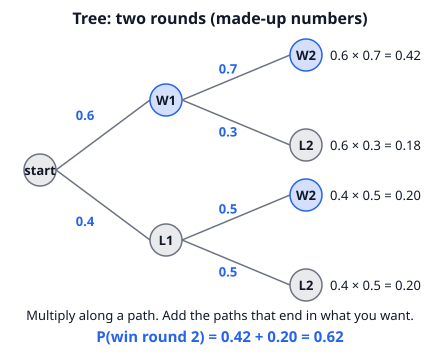
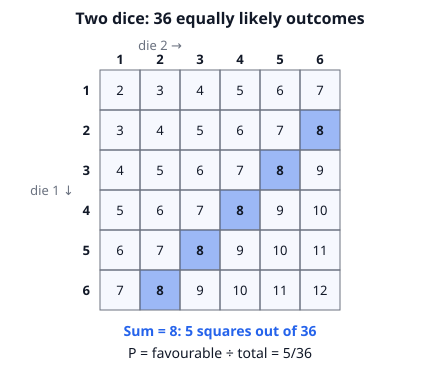
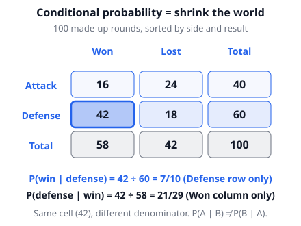

# 🟦 Probability  ·  `math.combinatorics.probability`
> 📅 Study date: Wed 14 Oct · ⏱️ ~12 min read · 📋 Syllabus: Unconditional probability, Conditional probability

## 🎮 Start with a duel
Suppose you win a duel in a game with probability **0.6** (made-up number). After a win you feel confident, so you win the next duel with probability **0.7**. After a loss you are a bit nervous: only **0.5**. What is the chance you win the *second* duel?

You cannot just pick 0.7 or 0.5, because the second duel **depends on the first**. A **probability tree** solves this: draw every possible story, multiply along each story, then add up the stories you like.

## 🖼️ Big picture

## 💡 Core ideas
1. **Basic probability.** If all outcomes are equally likely: **P(A) = (outcomes in A) ÷ (all outcomes)**. It is always between 0 (impossible) and 1 (certain). Two dice: 5 of the 36 outcomes give sum 8, so P(sum 8) = 5/36.
2. **Complement.** P(not A) = **1 − P(A)**. Great for "at least one": P(at least one hit) = 1 − P(no hits).
3. **"Or" and "and".** P(A or B) = P(A) + P(B) − P(A and B) (subtract the overlap, like inclusion-exclusion). If A and B **cannot happen together**, the overlap is 0 and you just add. If A and B are **independent** (one does not change the other), **P(A and B) = P(A) × P(B)**.
4. **Probability tree.** Each branch has a probability. **Multiply along a path**, **add the paths** that end in what you want. Branch probabilities after the first step are *conditional*.
5. **Conditional probability.** P(A | B) means "the chance of A **given that B happened**". Shrink the world to B: **P(A | B) = P(A and B) ÷ P(B)**. In a two-way table, look only at the row or column of B.
6. **Without replacement.** If you take items out and do not put them back, the second draw depends on the first. Use a tree with changing numbers, or count with combinations: P = (favorable choices) ÷ (all choices).

> 🎲 **Analogy:** conditional probability is like zooming in on one row of a table. You forget everything else and ask "within this group, what share are also …?" **Where it differs:** P(A | B) and P(B | A) use the same cell of the table but divide by *different* totals, so they are usually different numbers.

## 🧮 HUSO-style examples

**Example 1.** 🎮 In a made-up match, a player wins round 1 with probability 0.6. If she wins round 1, she wins round 2 with probability 0.7. If she loses round 1, she wins round 2 with probability 0.5. What is the probability that she wins round 2?

(A) 0.2  (B) 0.42  (C) 0.6  (D) 0.62  (E) 0.7

Steps:
1. Draw the tree (see the picture). Two paths end with "win round 2".
2. Win, win: 0.6 × 0.7 = 0.42.
3. Lose, win: 0.4 × 0.5 = 0.20.
4. Add the two paths: 0.42 + 0.20 = **0.62**. **Answer: (D).**
5. Bonus question: *given* she won round 2, how likely did she win round 1? That is 0.42 ÷ 0.62 = 21/31, which is not 0.6. Knowing the result of round 2 changes our belief about round 1.

**Example 2.** 🍳 A tray has 5 chocolate cookies and 3 plain cookies. Two cookies are taken at random. Given that **at least one** of them is chocolate, what is the probability that **both** are chocolate?

(A) 5/14  (B) 2/5  (C) 1/2  (D) 3/4  (E) 25/28

Steps:
1. Count all pairs: C(8, 2) = 28.
2. "At least one chocolate" is the complement of "both plain": 28 − C(3, 2) = 28 − 3 = 25 pairs. **This is the shrunken world.**
3. Both chocolate: C(5, 2) = 10 pairs (all of them are inside the shrunken world).
4. P = 10 ÷ 25 = **2/5**. **Answer: (B).**
5. Trap: 10 ÷ 28 = 5/14 is the answer *without* the condition. (E) 25/28 is the chance of "at least one chocolate" itself.

## ⚠️ Common traps
- **Adding when events overlap.** P(A or B) = P(A) + P(B) only works if they cannot both happen. Otherwise subtract P(A and B).
- **Multiplying when events depend on each other.** Drawing without replacement is *not* independent. The second probability changes.
- **Mixing up P(A | B) and P(B | A).** In the table picture, 42/60 and 42/58 are different questions.
- **Forgetting to shrink the world.** For a conditional question, the denominator is the size of the condition (B), not the whole sample space.

## ✏️ Redraw from memory
Close the page and draw in 5 minutes:
- [ ] A two-round tree with the branch probabilities and the four path products.
- [ ] A 6 × 6 table of two-dice sums with the "sum = 8" cells shaded.
- [ ] A two-way table with row and column totals, and circle the row you use for P(A | B).
- [ ] The three formulas: complement, P(A or B), and P(A | B).
- [ ] One sentence: when do we multiply, and when do we add?

Compare with the page and mark what you missed in red.

## 🎥 Watch / try
- [Calculating conditional probability](https://www.youtube.com/watch?v=6xPkG2pA-TU) — Khan Academy · 6:43 · watch how the table is shrunk to the given group
- [Conditional probability tree diagram example](https://www.youtube.com/watch?v=hxEdXUB_IdQ) — Khan Academy · 10:44 · notice that the second-step branches are conditional probabilities

## ✅ Check your understanding (5 questions)
Do these without looking at the material. You are **READY** if you get at least 4 of 5 right.

**1.** Two fair six-sided dice are rolled. What is the probability that the sum is 8?

(A) 1/12  (B) 1/9  (C) 5/36  (D) 1/6  (E) 7/36

**2.** 🎮 Suppose a player hits each shot independently with probability 0.4 (made-up). She fires 3 shots. What is the probability that she hits **at least one**?

(A) 0.064  (B) 0.216  (C) 0.4  (D) 0.784  (E) 0.936

**3.** A number is chosen at random from 1, 2, 3, …, 20. What is the probability that it is a multiple of 3 or a multiple of 4 (or both)?

(A) 3/10  (B) 2/5  (C) 1/2  (D) 11/20  (E) 3/5

**4.** 🏊 In a squad of 50 swimmers, 30 swim freestyle, 25 swim backstroke and 10 swim both. A swimmer who swims freestyle is chosen at random. What is the probability that this swimmer also swims backstroke?

(A) 1/5  (B) 1/3  (C) 2/5  (D) 1/2  (E) 3/5

**5.** 🍳 A jar has 3 red chillies and 2 green chillies. Two chillies are taken out at random without replacement. What is the probability that they have the same color?

(A) 3/10  (B) 2/5  (C) 1/2  (D) 13/25  (E) 3/5

Answer key & explanations

1. **(C) 5/36.** The pairs with sum 8 are (2,6), (3,5), (4,4), (5,3), (6,2): 5 of 36. (D) 1/6 = 6/36 is the chance of sum 7.
2. **(D) 0.784.** Complement: P(no hits) = 0.6³ = 0.216, so P(at least one) = 1 − 0.216 = 0.784. (A) 0.064 is 0.4³ (all three hit). (B) 0.216 is P(no hits).
3. **(C) 1/2.** Multiples of 3: 6. Multiples of 4: 5. Multiples of both (12): 1. So 6 + 5 − 1 = 10 numbers, and 10/20 = 1/2. (D) 11/20 forgets to subtract the overlap.
4. **(B) 1/3.** Shrink the world to the 30 freestylers. 10 of them also swim backstroke: 10/30 = 1/3. (A) 1/5 = 10/50 forgets the condition. (C) 2/5 = 10/25 conditions on the wrong group.
5. **(B) 2/5.** Two reds: 3/5 × 2/4 = 6/20. Two greens: 2/5 × 1/4 = 2/20. Total 8/20 = 2/5. (D) 13/25 is the answer if you put the chilli back (with replacement): 9/25 + 4/25.

