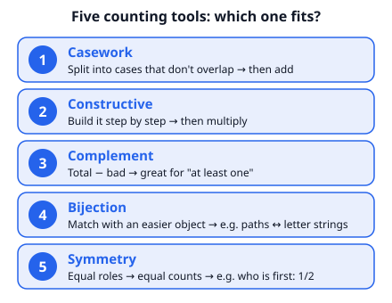
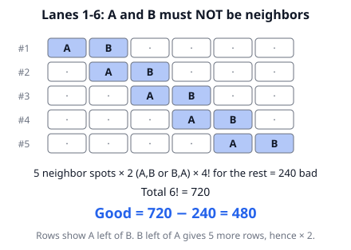
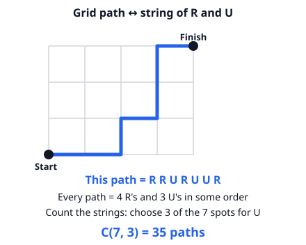

# 🟦 Counting Strategies  ·  `math.combinatorics.strategies`
> 📅 Study date: Wed 14 Oct · ⏱️ ~12 min read · 📋 Syllabus: Casework, Constructive counting, Complementary counting, Finding bijections, Symmetry

## 🏊 Start with the lanes
Six swimmers will be put into lanes 1 to 6, one swimmer per lane. Two of them are rivals and the coach wants them **not in neighboring lanes**. How many line-ups work?

Counting the "not neighbors" ones directly is messy. Counting the **neighbors** ones is easy, and then you subtract from all line-ups. Good counters do not just calculate: first they **choose the right tool**. This topic gives you five of them.

## 🖼️ Big picture

## 💡 Core ideas
1. **Casework.** Split the problem into cases that **do not overlap** and **cover everything**, count each case, then **add**. Example: ways to pay 10 cents with 1¢, 5¢ and 10¢ coins. Cases by the number of 5¢ coins: two 5¢ (1 way), one 5¢ (1 way, with five 1¢ coins), none (1 way, ten 1¢ coins), plus the single 10¢ coin: 4 ways.
2. **Constructive counting.** Build the object **step by step** and multiply the choices. If one step has a restriction, **do the restricted step first**. Example: a 3-digit even number from digits 1–9 without repeats: choose the last digit first (4 even digits), then the other two.
3. **Complementary counting.** Count **everything minus the bad ones**. Ideal for words like **"at least one"** and **"not next to each other"**. Total − bad = good.
4. **Finding bijections.** A **bijection** is a perfect one-to-one matching between your objects and an **easier** set of objects that you can count. Example: a path across a grid using steps Right and Up matches a string of R's and U's. A subset of n items matches a string of n yes/no answers, so there are 2ⁿ subsets.
5. **Symmetry.** If objects play **equal roles**, they get **equal shares**. In a random line-up of 3 people, each is equally likely to be first, so P(A is first) = 1/3. For two people, A is ahead of B in exactly **half** of all line-ups.
6. **Choosing a tool.** "At least one" or "not together"? Try the complement. Many separate situations? Casework. A grid or a path? Bijection with strings. "Which is first?" or "who is bigger?" Symmetry. Otherwise, build it step by step.

> 🧩 **Analogy:** choosing a counting tool is like choosing a stroke in swimming. Freestyle is fastest in most races, but sometimes you must use another stroke. **Where it differs:** in counting, every correct tool gives the **same answer**. So a second method is a free way to check yourself.

## 🧮 HUSO-style examples

**Example 1.** 🏊 Six swimmers A, B, C, D, E, F are put into lanes 1 to 6, one per lane. Swimmers A and B must **not** be in neighboring lanes. How many assignments are possible?

(A) 120  (B) 240  (C) 360  (D) 480  (E) 600

Steps:
1. Complement idea: good = total − bad. Total line-ups: 6! = 720.
2. Bad = A and B are neighbors. Pick the neighboring pair of lanes: (1,2), (2,3), (3,4), (4,5), (5,6) = 5 choices.
3. Put A and B in those two lanes in either order: 2 ways.
4. Line up the other 4 swimmers in the 4 other lanes: 4! = 24 ways.
5. Bad = 5 × 2 × 24 = 240. Good = 720 − 240 = **480**. **Answer: (D).**
6. Check by symmetry: P(neighbors) = 240/720 = 1/3. Two random lanes out of 6: 5 neighboring pairs out of C(6, 2) = 15 pairs, and 5/15 = 1/3 ✓. (E) 600 forgets the factor 2 for the order of A and B.

**Example 2.** How many paths go from the bottom-left corner to the top-right corner of a grid that is 4 squares wide and 3 squares tall, if each step is one unit Right or one unit Up?

(A) 12  (B) 21  (C) 35  (D) 70  (E) 128

Steps:
1. Every path needs **4 R steps and 3 U steps**, 7 steps in total.
2. **Bijection:** each path matches one string of 4 R's and 3 U's, and each such string is one path.
3. A string is decided by which 3 of the 7 positions are U: C(7, 3) = **35**. **Answer: (C).**
4. Check: C(7, 4) = 35 as well (choose the R positions instead). (D) 70 is C(8, 4), which has one extra step.

## ⚠️ Common traps
- **Overlapping cases in casework.** Make sure each outcome falls into **exactly one** case. If cases overlap, you double count.
- **Complement: wrong "bad".** The opposite of "at least one 7" is "**no** 7s" (not "exactly one 7").
- **Restricted step last.** If you pick the free steps first, the restricted step may depend on what you picked. Start with the restricted one.
- **Symmetry misuse.** Symmetry only works when the roles really are equal. If lane 1 is special (say, the fastest swimmer must be there), you cannot use it.

## ✏️ Redraw from memory
Close the page and draw in 5 minutes:
- [ ] The toolbox: five tools with one hint for each.
- [ ] Lanes 1–6 with A and B side by side, and the calculation 720 − 240.
- [ ] A 4 × 3 grid with one path and its string of R's and U's.
- [ ] A tree split into cases that add up to the whole.
- [ ] One sentence: when is complementary counting a good idea?

Compare with the page and mark what you missed in red.

## 🎥 Watch / try
- [Art of Problem Solving: Complementary Counting Part 1](https://www.youtube.com/watch?v=tb9jwxr0HyU) — Art of Problem Solving · 6:55 · watch how "total minus bad" turns a long count into a short one
- [Art of Problem Solving: Constructive Counting](https://www.youtube.com/watch?v=cDlUyFm9u8Q) — Art of Problem Solving · 9:03 · notice how each example is built one choice at a time

## ✅ Check your understanding (5 questions)
Do these without looking at the material. You are **READY** if you get at least 4 of 5 right.

**1.** How many 4-digit positive integers (from 1000 to 9999) contain at least one digit 7?

(A) 2,439  (B) 3,168  (C) 3,600  (D) 4,000  (E) 5,832

**2.** In how many ways can you make exactly 20 cents using any number of 1¢, 5¢ and 10¢ coins? (Only the number of each coin matters, not the order.)

(A) 5  (B) 7  (C) 8  (D) 9  (E) 10

**3.** How many binary strings of length 8 (made of 0s and 1s) have exactly three 1s, with no two 1s next to each other?

(A) 6  (B) 10  (C) 20  (D) 35  (E) 56

**4.** 🏊 Eight swimmers A, B, C, D, E, F, G, H are put into lanes 1 to 8 in random order (all line-ups equally likely). What is the probability that A is in a lower-numbered lane than both B and C?

(A) 1/6  (B) 1/4  (C) 1/3  (D) 3/8  (E) 1/2

**5.** 🍳 A chef labels jars with a 4-digit code using the digits 1 to 7. No digit may be repeated, and the code must be an even number. How many codes are possible?

(A) 240  (B) 360  (C) 420  (D) 480  (E) 840

Answer key & explanations

1. **(B) 3,168.** Complement. There are 9,000 four-digit numbers. With **no** 7: first digit 8 choices (1–9 except 7), each other digit 9 choices (0–9 except 7): 8 × 9 × 9 × 9 = 5,832. So 9,000 − 5,832 = 3,168. (E) 5,832 is the "no 7" count. (D) 4,000 adds "a 7 in position 1, 2, 3 or 4" (4 × 1000) and double counts numbers with several 7s.
2. **(D) 9.** Casework on the number of 10¢ coins. None: the 5¢ coins can be 0, 1, 2, 3 or 4 (pennies fill the rest): 5 ways. One 10¢: 10¢ left, 5¢ coins 0, 1 or 2: 3 ways. Two 10¢: 1 way. Total 5 + 3 + 1 = 9.
3. **(C) 20.** Bijection. Take a valid string and delete one 0 right after each of the first two 1s. This gives a string of length 6 with three 1s, and every such string comes from exactly one valid string. So the count is C(6, 3) = 20. (E) 56 = C(8, 3) forgets the "not next to each other" rule.
4. **(C) 1/3.** Look only at the lane order of A, B and C. By symmetry each of the three is equally likely to be in the lowest lane, so P = 1/3. The other 5 swimmers do not matter.
5. **(B) 360.** Constructive, restricted step first. The last digit must be even: 2, 4 or 6, so 3 choices. Then the first digit: 6 left, the second: 5, the third: 4. Total 3 × 6 × 5 × 4 = 360. (E) 840 = 7 × 6 × 5 × 4 ignores "even".

