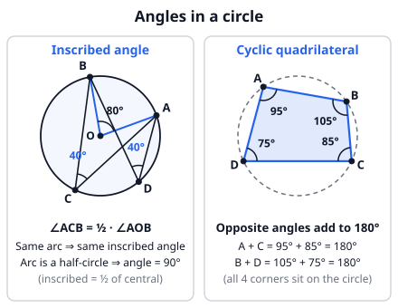
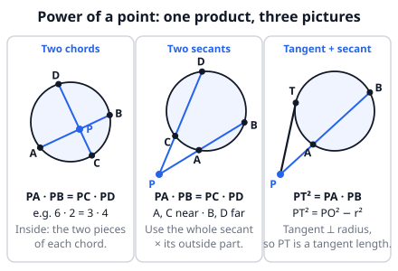
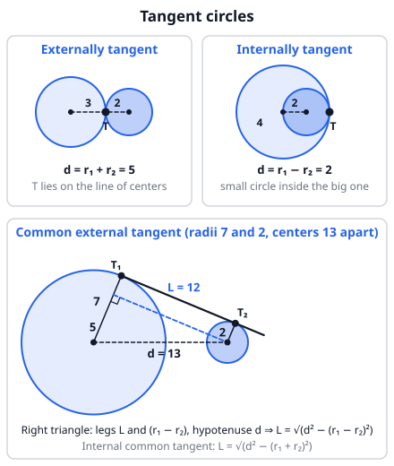

# 🟦 Circles  ·  `math.geometry.circles`
> 📅 Study date: Wed 14 Oct · ⏱️ ~12 min read · 📋 Syllabus: Tangent circles, Power of a point, Cyclic quadrilaterals, Inscribed angles

## 🎮 Start with a smoke on the map
Imagine a smoke ability that makes a perfect circle on the map. Suppose (made-up numbers!) the cloud has a **radius of 5 m** and you stand **13 m from its center**. A line of sight that just *touches* the edge of the cloud is a **tangent**. How long is it from you to the touching point? Draw the right triangle: center, touching point, you. Then 13² − 5² = 144, so the line of sight is **12 m**.

Now look through the cloud instead: your line of sight goes in at A and out at B. Here is the surprise: the two distances PA and PB, multiplied together, always give **the same number (144)**, whichever direction you look. That is the **power of a point**, and it is one of the best tools for circle questions.

## 🖼️ Big picture

## 💡 Core ideas
1. **Inscribed angle theorem.** An **inscribed angle** has its corner *on* the circle. It is **half** of the central angle that looks at the same arc. So an 80° central angle means a 40° inscribed angle. **All inscribed angles on the same arc are equal.** An angle that looks at a **half-circle (a diameter)** is **90°**.
2. **Cyclic quadrilateral** = a four-sided shape whose 4 corners all lie on one circle. Its **opposite angles add up to 180°** (A + C = 180° and B + D = 180°). The reverse also works: if opposite angles add to 180°, the corners lie on a circle. Also, an *exterior* angle equals the *opposite interior* angle.
3. **Tangent facts.** A tangent touches the circle at one point and is **perpendicular to the radius** at that point. That gives you a right triangle (use Pythagoras!). Two tangents drawn from the same outside point have **equal length**.
4. **Power of a point** (P is any point, the products are equal):
   - **P inside, two chords:** PA · PB = PC · PD.
   - **P outside, two secants** (lines that cut the circle twice): PA · PB = PC · PD, where A, C are the near points and B, D the far points.
   - **P outside, tangent + secant:** PT² = PA · PB.
   - The common number is PO² − r² (O is the center, r the radius) for an outside point.
5. **Tangent circles.** Two circles with radii r₁, r₂ and centers d apart. **Externally tangent:** d = r₁ + r₂. **Internally tangent:** d = r₁ − r₂ (the smaller is inside the bigger one). The touching point always lies **on the line through both centers**.
6. **Common tangent length.** For two circles with centers d apart, the segment of a **common external tangent** between the touching points has length **√(d² − (r₁ − r₂)²)**. For a **common internal tangent** it is **√(d² − (r₁ + r₂)²)**. Both come from one right triangle (see the picture).

> 🧠 **Do not mix them up:** the angle at the *center* is the **big** one (80°), the angle at the *edge* is the **small** one (40°). Edge = half of center.

## 🧮 HUSO-style examples

**Example 1.** 🎮 A smoke is a circle with center O and radius 5 m. You stand at P, 13 m from O. A line of sight from P enters the smoke at A and leaves at B, with PA = 9 m. How long is the part AB of the line of sight that is inside the smoke, in meters?

(A) 5  (B) 7  (C) 9  (D) 12  (E) 16

Steps:
1. P is outside the circle, so use the power of a point: PA · PB = PO² − r² = 13² − 5² = 144.
2. PB = 144 / 9 = 16.
3. The part inside is AB = PB − PA = 16 − 9 = **7**. **Answer: (B).**
4. Check: the tangent length is √144 = 12, and a secant must have PA < 12 < PB. Here 9 < 12 < 16 ✓. (E) 16 is PB, not AB.

**Example 2.** Quadrilateral ABCD is inscribed in a circle. The arc AC that contains D measures 140°. What is ∠ADC?

(A) 70  (B) 90  (C) 100  (D) 110  (E) 140

Steps:
1. ∠ADC is an inscribed angle at D. It looks at the *other* arc AC, the one that does **not** contain D.
2. That arc is 360° − 140° = 220°.
3. Inscribed angle = half of its arc, so ∠ADC = 220° / 2 = **110°**. **Answer: (D).**
4. Check with the cyclic rule: B is on the 220° arc, so ∠ABC looks at the 140° arc and equals 70°. Then 70° + 110° = 180° ✓. (A) 70 is ∠ABC.

## ⚠️ Common traps
- **Which arc?** An inscribed angle looks at the arc *inside* the angle (opposite the corner). A corner on the other side of the chord gives the **supplementary** angle (180° minus).
- **Half, not double:** inscribed = ½ · central. Do not double the wrong way.
- **Secant products:** use the **whole** secant (from P to the far point) times the **outside part** (from P to the near point). Never use only the chord inside the circle.
- **Tangent length:** you need the radius ⟂ tangent to get the right angle. Without it Pythagoras does not apply.
- **Opposite, not adjacent:** in a cyclic quadrilateral, A + C = 180°, but A + B is **not** 180° in general.

## ✏️ Redraw from memory
Close this page, take a sheet of paper, and draw in 5 minutes:
- [ ] A circle with a **central angle** and an **inscribed angle** on the same arc (label 80° and 40°).
- [ ] A **cyclic quadrilateral** with its four angles and the rule for opposite angles.
- [ ] The **three power-of-a-point pictures** and their formulas.
- [ ] A tangent line with the radius to the touching point and the right-angle mark.
- [ ] Two **externally tangent** circles and two **internally tangent** circles with d marked.

Compare with the pictures above and mark anything you missed in red.

## 🎥 Watch / try
- [Inscribed angle theorem (example and proof)](https://www.youtube.com/watch?v=SuS3lQpcWXM) — bprp math basics · 8:47 · watch how the central angle is split into two isosceles triangles
- [Cyclic Quadrilateral Properties](https://www.youtube.com/watch?v=IIXLmg_6zKc) — Eddie Woo · 5:20 · watch why opposite angles add up to 180°
- [Power of a Point Theorem in Geometry](https://www.youtube.com/watch?v=NhrPI7utUrQ) — Existsforall Academy · 6:57 · watch the three cases and when to use each

## ✅ Check your understanding (5 questions)
Do these without looking at the material. You are **ready** if you get at least 4 of 5 right.

**1.** An arc of a circle has a central angle of 86°. What is the size of an inscribed angle that looks at the same arc?

(A) 43°  (B) 47°  (C) 86°  (D) 137°  (E) 172°

**2.** 🎮 A smoke is a circle of radius 6 m. You stand 10 m from its center. A line of sight from you just touches the edge of the smoke. How long is this line of sight from you to the touching point, in meters?

(A) 4  (B) 6  (C) 8  (D) 10  (E) 16

**3.** Two chords AB and CD of a circle meet at a point P inside the circle. AP = 4, PB = 9 and CP = 2. What is PD?

(A) 6  (B) 11  (C) 13  (D) 16  (E) 18

**4.** 🍳 Four points A, B, C, D lie in this order on the round crust of a pizza. ∠BAD = 112° and ∠ABC = 78°. What is ∠BCD?

(A) 34°  (B) 68°  (C) 78°  (D) 102°  (E) 112°

**5.** Two circles with radii 9 and 4 touch each other externally. What is the length of a common external tangent segment between its two touching points?

(A) 5  (B) 6  (C) 8  (D) 12  (E) 13

Answer key & explanations

1. **(A) 43°.** An inscribed angle is half of the central angle on the same arc: 86° / 2 = 43°. (C) 86 is the central angle itself; (B) 47 and (D) 137 come from 90° − 43° and 180° − 43°.
2. **(C) 8.** The line of sight is a tangent, so it is perpendicular to the radius at the touching point. Right triangle with legs 6 and PT, hypotenuse 10: PT = √(10² − 6²) = √64 = 8. (A) 4 is 10 − 6; (E) 16 is 10 + 6.
3. **(E) 18.** Power of a point (chords): AP · PB = CP · PD, so 4 · 9 = 2 · PD and PD = 36 / 2 = 18. (C) 13 comes from adding 4 + 9 instead of multiplying.
4. **(B) 68°.** A, B, C, D are on a circle, so opposite angles add up to 180°: ∠BCD = 180° − ∠BAD = 180° − 112° = 68°. (D) 102° is 180° − 78°, which is ∠ADC, the other pair.
5. **(D) 12.** The centers are d = 9 + 4 = 13 apart (external tangency). Common external tangent: L = √(d² − (r₁ − r₂)²) = √(13² − 5²) = √144 = 12. (A) 5 is r₁ − r₂; (E) 13 is d.

