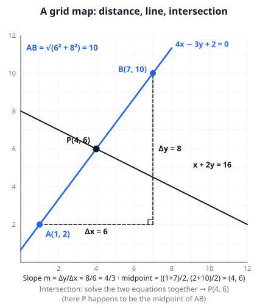
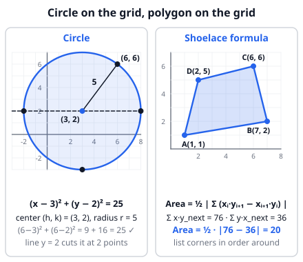

# 🟦 Coordinate geometry  ·  `math.geometry.coordinate`
> 📅 Study date: Wed 14 Oct · ⏱️ ~12 min read · 📋 Syllabus: Equations of lines, Intersections of lines, Equations of circles, Shoelace formula, Distance formula

## 🎮 Start with a grid map
Every tactical game map can be put on a **grid**: each spot has an (x, y) address. Suppose (made-up numbers) a callout "A Site" is at (1, 2) and "B Site" is at (7, 10), measured in meters. How far apart are they? Walk 6 steps right and 8 steps up, and the straight shortcut is the diagonal of a right triangle: √(6² + 8²) = **10 m**.

That one idea, "turn a map problem into a right triangle", is the **distance formula**. Add a few more tools (lines, circles, areas) and you can solve most map questions with pure algebra, without drawing anything perfectly.

## 🖼️ Big picture

## 💡 Core ideas
1. **Distance and midpoint.** The distance between (x₁, y₁) and (x₂, y₂) is **d = √((x₂ − x₁)² + (y₂ − y₁)²)**. The midpoint is the **average**: ((x₁ + x₂)/2, (y₁ + y₂)/2).
2. **Equations of lines.** **Slope** m = Δy / Δx = (y₂ − y₁)/(x₂ − x₁). Forms: **y = mx + b** (b is the y-intercept), **point-slope** y − y₁ = m(x − x₁), and **ax + by + c = 0**. A vertical line is x = k (no slope). **Parallel** lines have equal slopes. **Perpendicular** lines have slopes with product **−1** (flip and change the sign: 2/3 and −3/2).
3. **Intersection of two lines.** Solve the two equations together: **substitution** (get y from one, put it in the other) or **elimination** (add or subtract the equations). No solution means the lines are parallel; infinitely many means they are the same line.
4. **Equation of a circle.** Center (h, k), radius r: **(x − h)² + (y − k)² = r²**. If you see x² + y² + Dx + Ey + F = 0, **complete the square** to find the center and radius. A point is **on** the circle if it makes the equation true. To see where a line meets a circle, substitute the line into the circle: you get a quadratic with 2, 1 or 0 solutions (cut, touch, miss).
5. **Shoelace formula** (area of a polygon from its corners). List the corners **in order around** the polygon: (x₁, y₁), (x₂, y₂), …, (xₙ, yₙ) and back to the first. **Area = ½ · | Σ xᵢ · yᵢ₊₁ − Σ yᵢ · xᵢ₊₁ |**. Multiply "down-right" and add; multiply "down-left" and add; subtract; halve.
6. **Tip:** a quick sketch tells you if an answer makes sense (is the area near what the grid suggests? is the distance longer than each leg?).

> 🧠 **The name:** write the corners in two columns and draw the products as crossing lines. It looks like a shoelace on a shoe. The shoelace formula works for **any** simple polygon, not just triangles.

## 🧮 HUSO-style examples

**Example 1.** 🎮 On a grid map, A Site is at A(1, 2) and B Site is at B(7, 10). A teammate runs along the line x + 2y = 16, which crosses the line through A and B at the point P. How far is P from A Site?

(A) 3  (B) 4  (C) 5  (D) 6  (E) 10

Steps:
1. Slope of AB = (10 − 2)/(7 − 1) = 8/6 = 4/3. Point-slope: y − 2 = (4/3)(x − 1), so **4x − 3y + 2 = 0**.
2. Intersect with x + 2y = 16: from the second line x = 16 − 2y.
3. Substitute: 4(16 − 2y) − 3y + 2 = 0, so 66 − 11y = 0 and **y = 6**, then x = 16 − 12 = **4**. So P = (4, 6).
4. AP = √((4 − 1)² + (6 − 2)²) = √(9 + 16) = **5**. **Answer: (C).**
5. Check: P is exactly the midpoint of AB, so AP should be half of AB = 10 / 2 = 5 ✓. (E) 10 is the whole distance AB.

**Example 2.** What is the area of the quadrilateral with vertices (1, 1), (7, 2), (6, 6) and (2, 5), in this order?

(A) 18  (B) 20  (C) 22  (D) 24  (E) 40

Steps:
1. Down-right products: 1·2 + 7·6 + 6·5 + 2·1 = 2 + 42 + 30 + 2 = 76.
2. Down-left products: 1·7 + 2·6 + 6·2 + 5·1 = 7 + 12 + 12 + 5 = 36.
3. Area = ½ · |76 − 36| = ½ · 40 = **20**. **Answer: (B).**
4. (E) 40 forgets the ½. The picture gives a quick sanity check: the shape fits inside a 6 × 5 box (area 30), so 20 is believable.

## ⚠️ Common traps
- **Shoelace needs the corners in order** (around the shape). A random order gives a bow-tie and the wrong area. Do not forget the **½** and the **absolute value**.
- **Perpendicular slopes:** it is the **negative reciprocal** (−1/m), not just the reciprocal and not just the negative.
- **Circle equation signs:** (x − 3)² means the center is at x = **+3**. And r² is on the right side: (x − 3)² + (y − 2)² = 25 has radius **5**, not 25.
- **Distance formula:** square the differences, **add**, then take the root. √(a² + b²) is not a + b.
- **Intersections:** after you find x, put it back into an equation to get y. Check the point in **both** equations.

## ✏️ Redraw from memory
Close this page, take a sheet of paper, and draw in 5 minutes:
- [ ] A grid with two points and the **right triangle** that gives the distance.
- [ ] A line with its slope triangle (Δx, Δy) and the form y = mx + b.
- [ ] Two lines crossing at a point, with the algebra to find it (one line of substitution).
- [ ] A circle with center (h, k) and radius r, with its equation.
- [ ] A 4-corner polygon with the shoelace calculation written as two sums.

Compare with the pictures above and mark anything you missed in red.

## 🎥 Watch / try
- [Distance formula | Analytic geometry](https://www.youtube.com/watch?v=nyZuite17Pc) — Khan Academy · 9:39 · watch how the formula is just Pythagoras on a grid
- [Equation of a Circle](https://www.youtube.com/watch?v=wevlcglqJDw) — 1st Class Math · 9:00 · watch how the center and radius are read from the equation
- [The Shoelace Formula (area of a triangle given coordinates)](https://www.youtube.com/watch?v=UJajKBMtpxE) — Mathsy · 1:53 · watch the crossing products and why we take the absolute value

## ✅ Check your understanding (5 questions)
Do these without looking at the material. You are **READY** if you get at least 4 of 5 right.

**1.** What is the distance between the points (−1, −2) and (4, 10)?

(A) 5  (B) 7  (C) 12  (D) 13  (E) 17

**2.** 🎮 A smoke covers all points within 5 units of its center (3, 2). Which of the following points is exactly on the edge of the smoke?

(A) (6, 6)  (B) (1, 5)  (C) (5, 4)  (D) (7, 3)  (E) (4, 6)

**3.** A line passes through (2, −1) and is perpendicular to the line 3x + 2y = 6. Where does it cross the y-axis?

(A) y = −4  (B) y = −7/3  (C) y = 1/3  (D) y = 2  (E) y = 7/3

**4.** The lines y = x + 1 and y = −x + 5 and the x-axis form a triangle. What is its area?

(A) 3  (B) 4.5  (C) 6  (D) 9  (E) 18

**5.** 🏊 On a plan (in meters), a triangular warm-up pool has corners at (1, 1), (9, 3) and (5, 8). What is its area, in square meters?

(A) 20  (B) 24  (C) 28  (D) 48  (E) 56

Answer key & explanations

1. **(D) 13.** Δx = 5 and Δy = 12, so d = √(25 + 144) = √169 = 13 (a 5-12-13 triangle). (A) is only Δx; (C) is only Δy; (E) is 5 + 12, which wrongly adds the legs.
2. **(A) (6, 6).** The edge is the circle (x − 3)² + (y − 2)² = 25. For (6, 6): 3² + 4² = 9 + 16 = 25 ✓. The others give 13, 8, 17 and 17, so they are inside or outside the edge.
3. **(B) −7/3.** The line 3x + 2y = 6 has slope −3/2, so the perpendicular slope is 2/3. Then y + 1 = (2/3)(x − 2), so y = (2/3)x − 7/3, and the y-intercept is −7/3. (D) 2 uses the *parallel* slope −3/2; (C) 1/3 uses −2/3; (A) −4 uses 3/2.
4. **(D) 9.** The lines meet the x-axis at (−1, 0) and (5, 0), so the base is 6. They meet each other where x + 1 = −x + 5, so x = 2 and y = 3 (height 3). Area = ½ · 6 · 3 = 9. (E) 18 forgets the ½.
5. **(B) 24.** Down-right: 1·3 + 9·8 + 5·1 = 80. Down-left: 1·9 + 3·5 + 8·1 = 32. Area = ½ · |80 − 32| = 24. (D) 48 forgets the ½.

