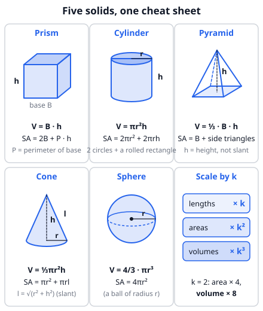
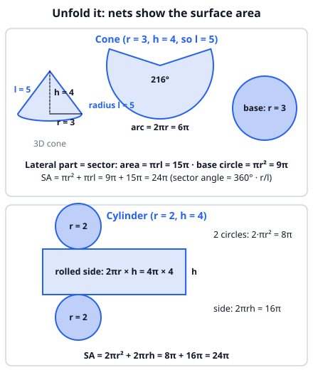

# 🟦 Solid geometry  ·  `math.geometry.solid`
> 📅 Study date: Wed 14 Oct · ⏱️ ~12 min read · 📋 Syllabus: Volumes of prisms, pyramids, cones, cylinders, spheres, Surface areas of prisms, pyramids, cones, cylinders, spheres

## 🍳 Start with the kitchen shelf
Look at your kitchen: a **can** of tomatoes (cylinder), a **box** of pasta (prism), a **funnel** (cone), an ice-cream cone, and a round **melon** (sphere). Here is a fun fact to try with water: a cone and a cylinder with the **same base and the same height** are related. If you fill the cone and pour it into the cylinder, you need **3 cones** to fill the cylinder. So a cone holds **⅓** of the cylinder.

**Careful:** this "exactly 3 cones" rule only works when the base *and* the height are the same. A tall thin cone next to a short wide pot is a different story!

Volume tells you how much fits **inside** (soup, water). Surface area tells you how much **wrapping** you need (foil, paint, label). This topic is just two lists of formulas, plus one picture of how to *see* them.

## 🖼️ Big picture

| Solid | Volume | Surface area |
|---|---|---|
| Prism (base area B, base perimeter P, height h) | **V = B · h** | **2B + P · h** |
| Cylinder | **V = πr²h** | **2πr² + 2πrh** |
| Pyramid | **V = ⅓ · B · h** | **B + the side triangles** |
| Cone (slant height l = √(r² + h²)) | **V = ⅓πr²h** | **πr² + πrl** |
| Sphere | **V = 4/3 · πr³** | **4πr²** |

## 💡 Core ideas
1. **Prism and cylinder: "base × height".** The volume is the **area of the base B** times the **height h**. For a cylinder the base is a circle, so V = πr²h. A box is a prism: V = length · width · height.
2. **Pyramid and cone: "⅓ × base × height".** They are one third of the prism or cylinder with the same base and height. The **height h** is the straight-up distance from the tip to the base. It is **not** the slanted side.
3. **Slant height.** For a cone, the slanted side l comes from Pythagoras: **l = √(r² + h²)**. For a regular pyramid, each side face is a triangle whose height is the slant height (not h either).
4. **Surface area = add the faces.** Cylinder: 2 circles + one rolled-up rectangle (width 2πr, height h). Cone: 1 circle + a **sector** with area **πrl**. Pyramid: the base + the side triangles. Sphere: **4πr²** (exactly 4 times a circle of the same radius).
5. **Sphere:** V = 4/3 · πr³ and SA = 4πr². Remember: volume has r³ (three lengths), area has r² (two lengths).
6. **Scaling:** if every length is multiplied by **k**, then all lengths × k, **areas × k²**, **volumes × k³**. Double the size, and the volume becomes 8 times bigger.

> 🧠 **A neat fact (Archimedes):** a sphere that fits snugly inside a cylinder (touching the sides, top and bottom) has volume exactly **⅔** of the cylinder.

## 🧮 HUSO-style examples

**Example 1.** 🍳 A cone-shaped funnel has radius 6 cm and height 8 cm. It is filled to the top with water. All the water is poured into a cylindrical pot with radius 4 cm. How high does the water reach in the pot, in cm?

(A) 4  (B) 6  (C) 8  (D) 12  (E) 18

Steps:
1. Volume of the cone: V = ⅓ · π · 6² · 8 = ⅓ · π · 36 · 8 = **96π**.
2. Water in the pot: V = π · 4² · h = 16π · h.
3. Set equal: 16π · h = 96π, so h = **6**. **Answer: (B).**
4. Common mistake: forgetting the ⅓ gives 288π / 16π = 18, which is answer (E).

**Example 2.** A sphere of radius r fits exactly inside a cylinder: it touches the top, the bottom and the curved side. What is the ratio (volume of the sphere) : (volume of the cylinder)?

(A) 1/3  (B) 1/2  (C) 2/3  (D) 3/4  (E) π/4

Steps:
1. The cylinder has radius r and height 2r (the sphere's diameter).
2. Cylinder: V = πr² · 2r = 2πr³.
3. Sphere: V = 4/3 · πr³.
4. Ratio = (4/3 · πr³) / (2πr³) = 4/6 = **2/3**. **Answer: (C).**

## ⚠️ Common traps
- **Forgetting the ⅓** for pyramids and cones. Ask yourself: "does it come to a point?" If yes, ⅓.
- **Height vs slant height:** volumes use the **height h** (straight up). Surface area of a cone or pyramid uses the **slant height l**. Use Pythagoras to move between them.
- **Surface area ≠ volume units:** area is in cm², volume in cm³. A "volume" answer with square units is a red flag.
- **Sphere formulas mixed up:** V has 4/3 and r³; SA has 4 and r². Check: radius 3 gives SA = 36π and V = 36π (a lucky match, not a rule).
- **Scaling:** doubling the radius makes the volume **8 times** bigger, not 2 times.
- **Closed or open?** A can with a lid has 2 circles; an open pot has only 1 circle. Read the question.

## ✏️ Redraw from memory
Close this page, take a sheet of paper, and draw in 5 minutes:
- [ ] A **cylinder** with r and h marked, and its two formulas.
- [ ] A **cone** with r, h and the slanted side l, and the Pythagoras link.
- [ ] A **pyramid** with its height drawn straight down from the tip.
- [ ] A **sphere** with its radius and both formulas.
- [ ] The **net of a cone** (a sector plus a circle).

Compare with the pictures above and mark anything you missed in red.

## 🎥 Watch / try
- [Volume of Pyramids, Cones, and Spheres](https://www.youtube.com/watch?v=G_TpX0STxP0) — Goforth and Do Math · 5:58 · watch where the ⅓ appears and what stays the same
- [Surface Area of Cylinders, Cones, and Spheres](https://www.youtube.com/watch?v=UF-jeeTRHlo) — Goforth and Do Math · 10:13 · watch how each surface is unrolled into flat shapes

## ✅ Check your understanding (5 questions)
Do these without looking at the material. You are **READY** if you get at least 4 of 5 right.

**1.** 🍳 A closed box of stock cubes measures 3 cm by 4 cm by 5 cm. How much paper is needed to cover the whole outside of the box, in cm²?

(A) 47  (B) 60  (C) 94  (D) 120  (E) 188

**2.** What is the volume of a cone with radius 3 and height 4?

(A) 9π  (B) 12π  (C) 15π  (D) 16π  (E) 36π

**3.** A sphere has surface area 36π. What is its volume?

(A) 9π  (B) 12π  (C) 27π  (D) 36π  (E) 108π

**4.** 🏊 A scale model of a paddling pool is built with every length 1/10 of the real pool. The model holds 2 liters of water. How many liters does the real pool hold?

(A) 20  (B) 200  (C) 2,000  (D) 20,000  (E) 200,000

**5.** A pyramid has a square base with side 6 and height 4. Its four side faces are identical triangles. What is its total surface area (the base plus the four side faces)?

(A) 48  (B) 60  (C) 84  (D) 96  (E) 120

Answer key & explanations

1. **(C) 94.** Three pairs of faces: 2 · (3·4) + 2 · (3·5) + 2 · (4·5) = 24 + 30 + 40 = 94. (A) 47 is only half of that (each face counted once); (B) 60 is the volume, not the area.
2. **(B) 12π.** V = ⅓ · π · 3² · 4 = ⅓ · 36π = 12π. (E) 36π forgets the ⅓; (C) 15π is the side area πrl; (A) 9π is just the base.
3. **(D) 36π.** SA = 4πr² = 36π gives r² = 9, so r = 3. V = 4/3 · π · 3³ = 4/3 · 27π = 36π. (E) 108π forgets the 1/3 (4π · 27).
4. **(C) 2,000.** Lengths are 10 times bigger, so volume is 10³ = 1000 times bigger: 2 · 1000 = 2000 liters. (A) 20 multiplies by 10; (B) 200 multiplies by 100.
5. **(D) 96.** Base = 6² = 36. Each side triangle has base 6 and a **slant** height √(3² + 4²) = 5 (half the base is 3, and the height is 4). One triangle = ½ · 6 · 5 = 15, four triangles = 60. Total = 36 + 60 = 96. (C) 84 uses the height 4 instead of the slant height 5; (B) 60 forgets the base.

