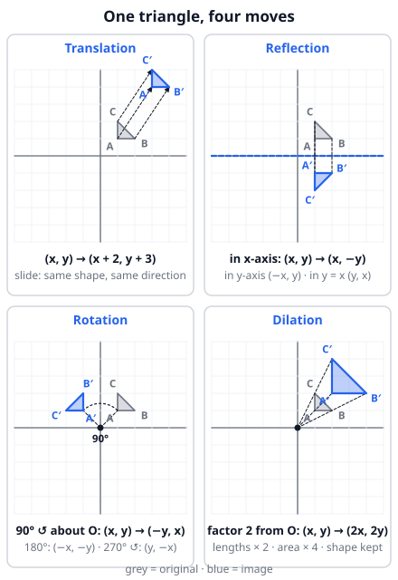

# 🟦 Plane transformations  ·  `math.geometry.transformations`
> 📅 Study date: Wed 14 Oct · ⏱️ ~12 min read · 📋 Syllabus: Rotation, Reflection, Translation, Dilation

## 🏊 Start with the flip turn
When you do a flip turn, you push off the wall and head back the way you came. Picture the wall as a **mirror**: the path you swam and the path you swim back are mirror images of each other. That is a **reflection**. The lane ropes are the same shape again and again, side by side: that is a **translation** (a slide). A lap around a circular pool is a **rotation**, and zooming a pool plan on a screen is a **dilation** (a resize).

A **transformation** is a rule that moves every point of a figure to a new place. In this topic there are exactly four moves, and each one has a short coordinate rule.

## 🖼️ Big picture

The grey triangle is the **original** and the blue triangle is the **image** (written with a prime: A → A′).

## 💡 Core ideas
1. **Translation** (slide): add the same vector to every point. **(x, y) → (x + a, y + b)**. Shape, size and direction all stay the same.
2. **Reflection** (flip) in a mirror line: the mirror is the **perpendicular bisector** of every segment PP′. Rules: in the x-axis **(x, −y)**; in the y-axis **(−x, y)**; in the line y = x **(y, x)**; in the line y = −x **(−y, −x)**. In a vertical line x = k: **(2k − x, y)**. A reflection **reverses the order** of the corners (clockwise becomes counterclockwise).
3. **Rotation** about the origin, counterclockwise: **90°: (x, y) → (−y, x)**; **180°: (−x, −y)**; **270°: (y, −x)** (same as 90° clockwise). To rotate about another center C, shift so C is the origin, rotate, and shift back.
4. **Dilation** (resize) with center C and factor k: **P′ = C + k · (P − C)**. About the origin: **(x, y) → (kx, ky)**. Lengths × |k|, **area × k²**, angles unchanged. If k is negative, the image is on the *other* side of the center.
5. **What stays the same?** Translation, reflection and rotation keep every length and angle (the image is **congruent**). A dilation keeps angles but changes sizes (the image is **similar**).
6. **Combinations:** the **order matters** (do the first move first!). Two reflections in **parallel** mirrors make a **translation** (twice the distance between the mirrors). Two reflections in mirrors that **cross** make a **rotation** (twice the angle between the mirrors).

> 🧠 **Memory trick for rotation:** put your finger at (1, 0). A 90° turn counterclockwise takes it to (0, 1). So (1, 0) → (0, 1) and (0, 1) → (−1, 0): that is exactly (x, y) → (−y, x).

## 🧮 HUSO-style examples

**Example 1.** The point P(3, −2) is rotated 90° counterclockwise about the origin, then reflected in the line y = x, and then translated by the vector (4, 1). What are the final coordinates?

(A) (1, −1)  (B) (3, 7)  (C) (7, 1)  (D) (7, 3)  (E) (2, 4)

Steps:
1. Rotate 90° counterclockwise: (x, y) → (−y, x), so (3, −2) → (2, 3).
2. Reflect in y = x: swap the coordinates, so (2, 3) → (3, 2).
3. Translate by (4, 1): (3 + 4, 2 + 1) = **(7, 3)**. **Answer: (D).**
4. Common mistakes: rotating clockwise gives (A); doing the translation first gives (C); reflecting in the y-axis by accident gives (E).

**Example 2.** The dilation with center C(2, 1) and scale factor 3 sends the point A(4, 3) to A′. What is the distance AA′?

(A) 2√2  (B) 4  (C) 4√2  (D) 6√2  (E) 8

Steps:
1. A′ = C + 3 · (A − C) = (2, 1) + 3 · (2, 2) = (8, 7).
2. AA′ = √((8 − 4)² + (7 − 3)²) = √32 = **4√2**. **Answer: (C).**
3. Check: CA = √8 = 2√2, and CA′ = 3 · CA = 6√2. The gap between them is 6√2 − 2√2 = 4√2 ✓. (A) is CA and (D) is CA′.

## ⚠️ Common traps
- **Rotation direction:** "90°" with no word means **counterclockwise**. Clockwise 90° is (x, y) → (y, −x).
- **Reflection in y = x** swaps the coordinates; in y = −x it swaps **and** changes both signs. Do not mix them up.
- **Dilation not about the origin:** use P′ = C + k(P − C). Multiplying the coordinates by k only works when the center is (0, 0).
- **Area × k², not × k.** A factor-3 enlargement makes the area 9 times bigger.
- **Order of moves:** "reflect, then translate" is usually *not* the same as "translate, then reflect". Do the moves in the order given.

## ✏️ Redraw from memory
Close this page, take a sheet of paper, and draw in 5 minutes:
- [ ] A small triangle on a grid and its **translation** by (2, 3) with arrows.
- [ ] The same triangle **reflected** in the x-axis and the line y = x.
- [ ] The triangle **rotated 90°** about the origin, with the rule (x, y) → (−y, x).
- [ ] The triangle **dilated by 2** from the origin, with lines through the origin.
- [ ] A line that says which moves keep size (3) and which one does not (1).

Compare with the picture above and mark anything you missed in red.

## 🎥 Watch / try
- [Transformations: Translations, Reflections, and Rotations](https://www.youtube.com/watch?v=YD3HIMUae_4) — Math Defined · 4:04 · watch how each move changes the coordinates
- [Dilations: Geometry Transformations Explained!](https://www.youtube.com/watch?v=BCllaARDOWI) — Mashup Math · 6:31 · watch the center of dilation and what happens when it is not the origin

## ✅ Check your understanding (5 questions)
Do these without looking at the material. You are **ready** if you get at least 4 of 5 right.

**1.** The point (4, −7) is reflected in the line y = x. What are the coordinates of its image?

(A) (−7, 4)  (B) (−4, 7)  (C) (4, 7)  (D) (7, −4)  (E) (−4, −7)

**2.** 🏊 On a map of the pool, a swimmer starts at (2, 5). The end wall is the line x = 10. The coach marks the "mirror start" by reflecting (2, 5) in the wall. What are its coordinates?

(A) (−2, 5)  (B) (8, 5)  (C) (12, 5)  (D) (18, 5)  (E) (2, 15)

**3.** The point (2, −3) is rotated 90° clockwise about the origin. What are the coordinates of its image?

(A) (3, 2)  (B) (−3, −2)  (C) (−2, 3)  (D) (2, 3)  (E) (−3, 2)

**4.** 🍳 A recipe card is a rectangle 4 cm by 3 cm. A copier enlarges it by a dilation with scale factor 2.5. What is the area of the enlarged card, in cm²?

(A) 30  (B) 60  (C) 72  (D) 75  (E) 90

**5.** The point (1, 2) is reflected in the line x = 3 and the image is then reflected in the line x = 7. What are the final coordinates?

(A) (5, 2)  (B) (7, 2)  (C) (9, 2)  (D) (13, 2)  (E) (17, 2)

Answer key & explanations

1. **(A) (−7, 4).** Reflection in y = x swaps the coordinates: (4, −7) → (−7, 4). (D) (7, −4) is the reflection in y = −x; (B) is the 180° rotation; (C) is the reflection in the x-axis; (E) is the reflection in the y-axis.
2. **(D) (18, 5).** Reflection in x = k: (x, y) → (2k − x, y) = (20 − 2, 5) = (18, 5). The swimmer is 8 m from the wall, so the mirror image is 8 m past it: 10 + 8 = 18. (A) is the reflection in the y-axis; (E) is the reflection in the horizontal line y = 10.
3. **(B) (−3, −2).** Clockwise 90°: (x, y) → (y, −x) = (−3, −2). (A) (3, 2) is the counterclockwise turn; (C) is 180°; (D) is a reflection in the x-axis.
4. **(D) 75.** Area scales by k² = 2.5² = 6.25. The original area is 12, so 12 · 6.25 = 75. (A) 30 multiplies by 2.5 only; (B) 60 multiplies by 5.
5. **(C) (9, 2).** First mirror: 2 · 3 − 1 = 5, so (5, 2). Second mirror: 2 · 7 − 5 = 9, so (9, 2). Shortcut: two parallel mirrors make a translation of 2 · (7 − 3) = 8, and 1 + 8 = 9. (A) is the answer after only one reflection.

