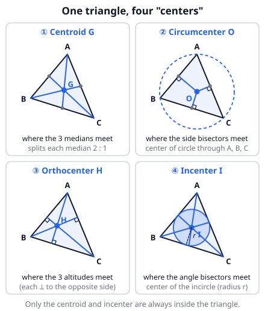
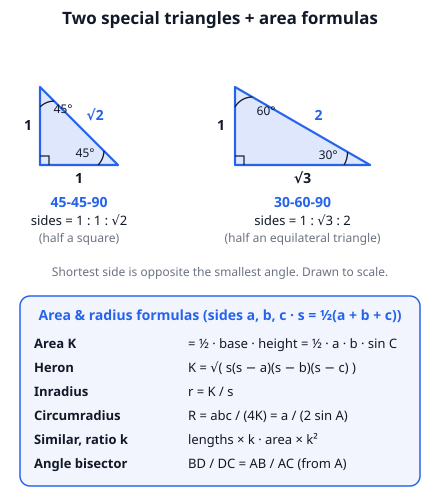
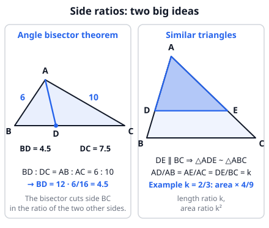

# 🟦 Triangles  ·  `math.geometry.triangles`
> 📅 Study date: Wed 14 Oct · ⏱️ ~12 min read · 📋 Syllabus: Centroid, Circumcenter, Orthocenter, Incenter, Heron's formula, Inradius formula, Circumradius formula, Sine area formula, Similar triangles, Congruent triangles, Angle bisector theorem, 30-60-90 triangle, 45-45-90 triangle

## 🏊 Start with the swimming pool
A pool is 24 m long and 7 m wide. A coach asks you to swim straight from one corner to the opposite corner. How far is that? Draw the diagonal and you get a **right triangle**: 7² + 24² = 49 + 576 = 625, so the diagonal is **25 m**. That is a famous triple (7, 24, 25).

Triangles hide everywhere: lane ropes, pool corners, a flag's shadow. In this topic you learn the few tools that solve almost every triangle question: special triangles, areas, similar triangles, and four special "center" points. Every tool is **one formula + one picture + one moment to use it**.

## 🖼️ Big picture

## 💡 Core ideas
1. **The four centers.** **Centroid G** = where the 3 medians meet (a median goes from a vertex to the midpoint of the opposite side). It cuts every median **2 : 1** and has coordinates = the *average* of the three vertices. **Circumcenter O** = where the perpendicular bisectors of the sides meet; it is the center of the circle through A, B, C. **Orthocenter H** = where the 3 altitudes meet. **Incenter I** = where the angle bisectors meet; it is the center of the circle that touches all three sides. In an obtuse triangle, O and H fall *outside* the triangle.
2. **Areas.** Area K = ½ · base · height = **½ · a · b · sin C** (two sides and the angle between them). **Heron's formula:** if s = ½(a + b + c), then K = √( s(s − a)(s − b)(s − c) ). Use Heron when you only know the three sides.
3. **Two radii.** **Inradius** r = **K / s** (inscribed circle). **Circumradius** R = **abc / (4K)** (also R = a / (2 sin A)). In a right triangle, the circumcenter is the **midpoint of the hypotenuse**, so R = hypotenuse / 2.
4. **Congruent** triangles are exact copies. They match by **SSS, SAS, ASA, AAS**, or **HL** (right triangles: hypotenuse and one leg). **Similar** triangles have the same shape: **AA** (two equal angles) is enough. If the length ratio is **k**, then all lengths × k, **areas × k²**. A line parallel to one side (DE ∥ BC) cuts off a smaller triangle similar to the big one.
5. **Angle bisector theorem.** If AD bisects angle A and D is on BC, then **BD / DC = AB / AC**. The bisector splits the opposite side in the ratio of the two sides next to it.
6. **Special right triangles.** **45-45-90:** sides **1 : 1 : √2** (half a square). **30-60-90:** sides **1 : √3 : 2** (half an equilateral triangle). The shortest side is opposite 30°, the middle side (√3) is opposite 60°.

> 🧠 **Memory trick:** the longest side is opposite the biggest angle. In 30-60-90 the order 1 < √3 < 2 matches 30° < 60° < 90°.

## 🧮 HUSO-style examples

**Example 1.** 🏊 A triangular training pool has sides 13 m, 14 m and 15 m. A buoy is placed at the point that is the same distance from all three walls. How far is the buoy from each wall, in meters?

(A) 3  (B) 4  (C) 5  (D) 6  (E) 7

Steps:
1. A point equally far from all three sides is the **incenter**. Its distance to each side is the **inradius** r.
2. Semi-perimeter: s = (13 + 14 + 15) / 2 = 21.
3. Heron: K = √(21 · 8 · 7 · 6) = √7056 = 84.
4. r = K / s = 84 / 21 = **4**. **Answer: (B).**

**Example 2.** In triangle ABC, AB = 6, AC = 10 and BC = 12. The bisector of angle A meets BC at D. What is BD?

(A) 4  (B) 9/2  (C) 5  (D) 6  (E) 15/2

Steps:
1. Angle bisector theorem: BD / DC = AB / AC = 6 / 10 = 3 / 5.
2. BD and DC together make BC = 12, so split 12 in the ratio 3 : 5.
3. BD = 12 · 3/8 = **9/2**. **Answer: (B).**
4. Check: DC = 12 · 5/8 = 15/2, and 9/2 + 15/2 = 12 ✓. (E) is DC, the other piece.

## ⚠️ Common traps
- **Heron's s is half the perimeter**, not the whole perimeter. Forgetting the ½ gives a huge wrong area.
- **r = K / s** uses the *semi*-perimeter. With the full perimeter you get r/2 by mistake.
- **Similar triangles:** lengths scale by k but **areas scale by k²**. A ratio 2 : 5 for sides means 4 : 25 for areas.
- **Angle bisector:** BD / DC = AB / AC. Do not mix in BC (it is the side being split, not one of the ratio sides).
- **30-60-90:** √3 goes with the **middle** side (opposite 60°), and the hypotenuse is 2 × the short side. Students often swap √3 and 2.
- The circumcenter and orthocenter can lie **outside** an obtuse triangle. Only the centroid and incenter are always inside.

## ✏️ Redraw from memory
Close this page, take a sheet of paper, and draw in 5 minutes:
- [ ] One triangle with its **centroid** (3 medians) and the **2 : 1** mark on one median.
- [ ] The **incircle** (touches the sides) and the **circumcircle** (through the corners) on a second triangle.
- [ ] A 45-45-90 and a 30-60-90 triangle with all three side lengths and angles.
- [ ] Triangle with a line DE ∥ BC, and write the ratio AD/AB = AE/AC = DE/BC.
- [ ] The formulas for K (three ways), r and R.

Compare with the pictures above and mark anything you missed in red.

## 🎥 Watch / try
- [Incenter, Circumcenter, Centroid, Orthocenter (Properties & Diagrams)](https://www.youtube.com/watch?v=p52H7YcoDO8) — Mario's Math Tutoring · 8:02 · watch which center is inside or outside for different triangles
- [Angle bisector theorem proof](https://www.youtube.com/watch?v=TpIBLnRAslI) — Khan Academy · 8:35 · watch how a parallel line makes similar triangles
- [30-60-90 triangle side ratios proof](https://www.youtube.com/watch?v=SFL4stapeUs) — Khan Academy · 7:00 · watch how an equilateral triangle is cut in half

## ✅ Check your understanding (5 questions)
Do these without looking at the material. You are **READY** if you get at least 4 of 5 right.

**1.** In a 30-60-90 triangle the hypotenuse is 12. What is the length of the longer leg?

(A) 6  (B) 4√3  (C) 6√2  (D) 6√3  (E) 12√3

**2.** 🍳 A triangular cutting board has sides 5 dm, 12 dm and 13 dm. A round lid must pass through all three corners of the board. What is the radius of the lid, in dm?

(A) 5  (B) 6  (C) 13/2  (D) 15/2  (E) 13

**3.** What is the area of a triangle with side lengths 6, 25 and 29?

(A) 30  (B) 60  (C) 72  (D) 75  (E) 87

**4.** In triangle ABC, point D is on AB and point E is on AC with DE ∥ BC. AD = 4, DB = 6, and the area of triangle ADE is 8. What is the area of triangle ABC?

(A) 20  (B) 32  (C) 40  (D) 50  (E) 72

**5.** 🎮 On a simplified map, three sites are A(0, 0), B(9, 0) and C(0, 12). A smoke is placed at the centroid of triangle ABC. How far is the smoke from site A?

(A) 3  (B) 4  (C) 5  (D) 6  (E) 7.5

Answer key & explanations

1. **(D) 6√3.** The short side is half of the hypotenuse = 6, and the long side is short × √3 = 6√3. (B) 4√3 comes from dividing 12 by √3 (wrong ratio); (C) uses the 45-45-90 ratio.
2. **(C) 13/2.** 5-12-13 is a right triangle (5² + 12² = 13²). The circumcenter of a right triangle is the midpoint of the hypotenuse, so R = 13 / 2 = 6.5. Check: R = abc / 4K = 780 / (4 · 30) = 6.5. (E) 13 is the diameter, not the radius.
3. **(B) 60.** s = (6 + 25 + 29) / 2 = 30. K = √(30 · 24 · 5 · 1) = √3600 = 60. (A) 30 is just s, the semi-perimeter; (D) 75 and (E) 87 are ½ · 25 · 6 and ½ · 29 · 6, which wrongly treat a side as the height.
4. **(D) 50.** AD / AB = 4 / 10 = 2/5, so lengths scale by 2/5 and **areas by 4/25**. Area ABC = 8 · 25/4 = 50. (A) 20 uses the length ratio 5/2 instead of its square; (C) 40 multiplies by 5.
5. **(C) 5.** Centroid = the average of the vertices = ((0 + 9 + 0)/3, (0 + 0 + 12)/3) = (3, 4). Distance to A = √(3² + 4²) = 5. (E) 7.5 is the distance from A to the circumcenter (4.5, 6), a different center.

