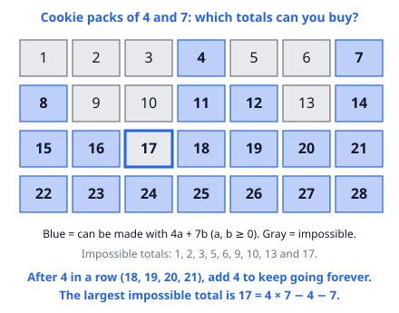
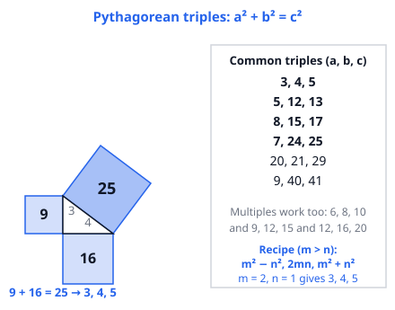
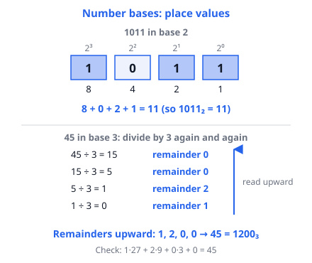

# 🟦 Number Theory Extras  ·  `math.number-theory.misc`
> 📅 Study date: Tue 13 Oct · ⏱️ ~12 min read · 📋 Syllabus: Pythagorean triples, Diophantine equations, Number bases

## 🍳 Start with cookie packs
A shop sells cookies only in packs of **3** and packs of **5**. Can you buy exactly **14** cookies? Yes: 3 packs of 3 and 1 pack of 5 (3·3 + 5 = 14). Can you buy exactly **7**? Try it: 3 + 3 = 6, 5, 3 + 5 = 8. No way. Questions like "which whole-number combinations make this total?" are called **Diophantine equations**: equations where only **whole numbers** are allowed as answers. Today you also meet two more number-theory tools: **right triangles with whole-number sides** and **writing numbers in other bases**.

**Not exactly like shopping:** in a real shop you could also buy 0 packs of something. In math, we say clearly whether 0 is allowed (usually "non-negative" or "positive").

## 🖼️ Big picture

Three different ideas, one habit: **look for structure and test small cases**. Diophantine equations ask "which whole numbers fit?". **Pythagorean triples** are whole-number sides of a right triangle. **Number bases** change what "10" means.

## 💡 Core ideas
1. **Linear Diophantine equation** ax + by = c (a, b, c whole numbers, x and y must be whole). It has a solution **exactly when gcd(a, b) divides c**. Example: 6x + 9y = c only works if c is a multiple of 3, because 3 divides 6x + 9y.
2. **How to find solutions.** Find **one** solution by testing (or by working with remainders), then slide: if (x, y) works, so does **(x + b/g, y − a/g)** where g = gcd(a, b). For 3x + 5y = 41: y = 1, 4, 7 give x = 12, 7, 2 (each time y goes up 3 and x goes down 5).
3. **Counting with limits.** If x and y must be **positive** (or non-negative), the sliding stops. List the possibilities for the **bigger** coefficient's variable, since there are fewer. Packs of **a and b** (with no common factor): the **largest total you cannot make is ab − a − b**. For 4 and 7 that is 17 (see the picture).
4. **Pythagorean triples** are whole numbers with **a² + b² = c²**. Memorize: **(3, 4, 5), (5, 12, 13), (8, 15, 17), (7, 24, 25)**, also (20, 21, 29) and (9, 40, 41). Any **multiple** works too: (6, 8, 10), (9, 12, 15). Recipe: for whole numbers m > n, the triple is **(m² − n², 2mn, m² + n²)**.
5. **Number bases.** In base b the digits are 0 to b − 1, and the place values are **1, b, b², b³, …**. So 1011₂ = 8 + 0 + 2 + 1 = 11. To convert **from base 10**, divide by b again and again, and read the remainders **from the bottom up**.
6. **Base habits.** In base b, the numeral **"10" means b**. A digit can **never be b or more**. Binary is the kitchen-scale idea: weights 1, 2, 4, 8, 16 g can make **any** total from 1 to 31 g, using each weight at most once.

> 🍳 **Why binary works on a scale:** every whole number from 1 to 31 is **one** sum of different powers of 2 (1, 2, 4, 8, 16). So five weights are enough. A weight is either on the pan (digit 1) or not (digit 0).

## 🧮 HUSO-style examples

**Example 1.** 🍳 A bakery sells cookies only in packs of 4 and packs of 7. What is the largest number of cookies that **cannot** be bought exactly?

(A) 11  (B) 13  (C) 17  (D) 18  (E) 28

Steps:
1. List what you can make: 4, 7, 8, 11, 12, 14, 15, 16, then 18 = 4 + 14 and 19 = 12 + 7, 20, 21.
2. Four numbers in a row (18, 19, 20, 21) can be made. Adding a pack of 4 to each gives the next four, and so on. So **everything from 18 up** can be made.
3. Check 17: take away 0, 1 or 2 packs of 7 and you are left with 17, 10 or 3. None is a multiple of 4, so 17 is impossible.
4. The largest impossible number is **17**. **Answer: (C).** (Rule: 4 · 7 − 4 − 7 = 17.)
5. Traps: (B) 13 is impossible too, but it is not the largest. (A) 11 can be made (4 + 7). (D) 18 can be made (4 + 7 + 7). (E) 28 = 4 · 7 is just the product.

**Example 2.** In base b, the numeral 132 stands for the same number as 42 in base 10. What is b?

(A) 4  (B) 5  (C) 6  (D) 7  (E) 8

Steps:
1. 132 in base b means 1 · b² + 3 · b + 2.
2. Set b² + 3b + 2 = 42, so b² + 3b − 40 = 0.
3. Factor: (b + 8)(b − 5) = 0, so b = 5 (a base cannot be −8).
4. Check: 25 + 15 + 2 = 42 ✓, and the digit 3 is allowed in base 5. **Answer: (B).**
5. (C) 6 gives 36 + 18 + 2 = 56, too big.

## ⚠️ Common traps
- **Forgetting the gcd test.** 6x + 9y = 50 has no whole-number solution at all, since 3 does not divide 50. Do this check first.
- **Not respecting "positive".** The slide (x + 5, y − 3) keeps going forever on integers, but with positive x and y it stops quickly. Count only the allowed ones.
- **Triples need a right angle.** 6, 8, 10 works, but 6, 8, 11 does not. Test with a² + b² = c², with c the longest side. Also do not just "guess" 15, 20, 26: 225 + 400 = 625, not 676.
- **Base slips:** reading the remainders from the top down (they go bottom up), and using a digit that is too big for the base.

## ✏️ Redraw from memory
Close this page and draw in 5 minutes:
- [ ] The number grid for packs of 4 and 7 with 17 marked.
- [ ] The right triangle 3-4-5 with squares 9, 16, 25.
- [ ] Four Pythagorean triples with the biggest one, 7-24-25.
- [ ] The boxes for 1011 in base 2 with place values 8, 4, 2, 1.
- [ ] The division ladder that turns 45 into base 3.

Compare with the page and circle what you missed in red.

## 🎥 Watch / try
- [Diophantine Equation: ax+by=gcd(a,b)](https://www.youtube.com/watch?v=FjliV5u2IVw) — Socratica · 9:43 · watch how gcd decides whether a solution exists
- [Pythagorean Triples](https://www.youtube.com/watch?v=nePN6hPoLCg) — The Organic Chemistry Tutor · 8:59 · watch how to spot the common triples and their multiples
- [Number Systems Introduction - Decimal, Binary, Octal & Hexadecimal](https://www.youtube.com/watch?v=FFDMzbrEXaE) — The Organic Chemistry Tutor · 10:57 · watch the place values and the conversions both ways

## ✅ Check your understanding (5 questions)
Do them without looking at the page. You are **READY** if you get at least 4 of 5.

**1.** 🍳 A chef packs 41 muffins into boxes. Every box holds either 3 or 5 muffins, every box is full, and she uses at least one box of each size. In how many different ways can she do this?

(A) 1  (B) 2  (C) 3  (D) 4  (E) 8

**2.** 🏊 A rectangular pool has a diagonal of 26 m and a length of 24 m. What is its perimeter, in meters?

(A) 34  (B) 50  (C) 52  (D) 68  (E) 136

**3.** What is the number 50 (in base 10) when written in base 4?

(A) 203  (B) 302  (C) 320  (D) 322  (E) 230

**4.** 🍳 A kitchen balance has weights of 1, 2, 4, 8 and 16 grams, and each weight can be used at most once. To weigh exactly 27 grams of flour, how many weights are needed?

(A) 2  (B) 3  (C) 4  (D) 5  (E) 6

**5.** For which of the following values of c does the equation 6x + 9y = c have **no** solution in integers x and y?

(A) 50  (B) 12  (C) 21  (D) 30  (E) 45

Answer key & explanations

1. **(C) 3.** 3x + 5y = 41 with x, y ≥ 1. Try y = 1, 2, 3, …: 41 − 5y must be a positive multiple of 3. y = 1: 36 → x = 12. y = 4: 21 → x = 7. y = 7: 6 → x = 2. Other y fail (y = 10 would make x negative). That is **3** ways. (D) 4 would include y = 10 (x = −3).
2. **(D) 68.** The triple is 10, 24, 26 (5-12-13 doubled), so the width is 10. Perimeter = 2 · (24 + 10) = 68. Check: 24² + 10² = 576 + 100 = 676 = 26². (A) 34 is half the perimeter. (B) 50 = 24 + 26. (E) 136 doubles the right answer.
3. **(B) 302.** 50 = 3 · 16 + 0 · 4 + 2, so the digits are 3, 0, 2. Check: 48 + 0 + 2 = 50. (A) 203 reads the digits backwards. (C) 320 = 56 and (D) 322 = 58 are too big.
4. **(C) 4.** 27 = 16 + 8 + 2 + 1, which is 11011 in base 2. That is four 1s, so **four** weights. (D) 5 uses all the weights. (B) 3 is too few: the best three weights are 16 + 8 + 4 = 28, which skips 27.
5. **(A) 50.** gcd(6, 9) = 3, and 6x + 9y is always a multiple of 3. The values 12, 21, 30 and 45 are multiples of 3 (for example 12 = 6 · 2 + 9 · 0, 21 = 6 · 2 + 9 · 1), but 50 is not.

