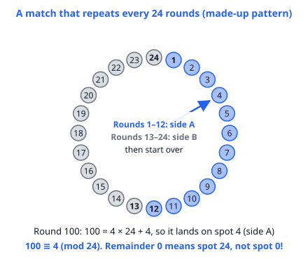
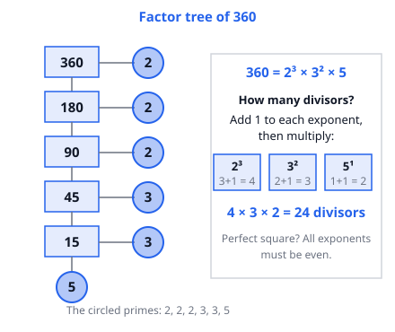

# 🟦 Modular Arithmetic  ·  `math.number-theory.modular`
> 📅 Study date: Tue 13 Oct · ⏱️ ~12 min read · 📋 Syllabus: Congruences, Prime factorization

## 🎮 Start with switching sides
In a Valorant match your team plays attack for the first half and defense for the second half, and the sides swap after round 12. Suppose the pattern just keeps repeating: rounds 1–12 on side A, rounds 13–24 on side B, rounds 25–36 on side A again, and so on. (The real game has overtime rules, so this is a made-up pattern.) On which side are you in round 100? You do not need to count 100 rounds. You only need to know **where round 100 lands in the 24-round cycle**. That is exactly what **modular arithmetic** does: it keeps only the **remainder**.

**Not exactly like the game:** a real match ends long before round 100. We use big numbers only to show that you do not need to count.

## 🖼️ Big picture

A clock is the best picture: after the last spot you **wrap around** to the start. Modular arithmetic is clock arithmetic with any size of clock. The second tool, **prime factorization**, breaks a number into its prime building blocks, like taking a recipe apart into basic ingredients.

## 💡 Core ideas
1. **Congruence.** **a ≡ b (mod m)** means a and b leave the **same remainder** when divided by m. Equivalent: **m divides (a − b)**. Example: 100 ≡ 4 (mod 24), and 17 ≡ −3 (mod 20). A remainder is always from 0 to m − 1.
2. **You can do + − × on remainders.** If a ≡ b and c ≡ d (mod m), then a + c ≡ b + d, a − c ≡ b − d, **a · c ≡ b · d**, and **aᵏ ≡ bᵏ**. So to find 17 · 23 mod 5, use 2 · 3 = 6 ≡ 1. **Careful with division:** you cannot always cancel. 2 · 3 ≡ 2 · 6 (mod 6) but 3 ≢ 6.
3. **Powers repeat in cycles.** Powers of 2 mod 7: 2, 4, 1, 2, 4, 1, … (cycle length 3). Last digits of powers of 7: 7, 9, 3, 1, 7, … (cycle length 4). Find the cycle, then use the **remainder of the exponent** divided by the cycle length. The last digit of n is just **n mod 10**.
4. **Divisibility checks.** By 2, 5, 10: look at the last digit. By **3 or 9**: add the digits. By 4: the last two digits. By 11: alternately add and subtract the digits. These are all congruence facts. For example 10 ≡ 1 (mod 9), so a number leaves the same remainder as its digit sum.
5. **Prime factorization.** Every whole number greater than 1 is a **product of primes in exactly one way** (apart from order). Use a factor tree: split into two factors until all are primes. Note: **1 is not a prime**.
6. **What you get from the factorization.** If n = p^a · q^b · r^c, then the number of positive **divisors is (a + 1)(b + 1)(c + 1)**. The number n is a **perfect square** exactly when **all exponents are even**. For gcd take the smaller exponents, for lcm the larger ones.

## 🧮 HUSO-style examples

**Example 1.** Suppose a team plays on side A in rounds 1–12, side B in rounds 13–24, and then the pattern repeats forever (side A in rounds 25–36, and so on). Which of the following rounds is played on the same side as round 100?

(A) 61  (B) 70  (C) 85  (D) 96  (E) 108

Steps:
1. The cycle length is 24. Find 100 mod 24: 100 = 4 × 24 + 4, so round 100 sits at **spot 4**. Spots 1–12 are side A, so it is side A.
2. Now find the spot of each option: 61 = 2 × 24 + 13 (spot 13, side B). 70 = 2 × 24 + 22 (spot 22, side B). 85 = 3 × 24 + 13 (spot 13, side B).
3. 96 = 4 × 24 + **0**. Remainder 0 means the **last** spot, 24 (side B), not a "spot 0".
4. 108 = 4 × 24 + 12, spot 12, **side A**. **Answer: (E).**

**Example 2.** 🍳 A cook has 360 identical cookies. She wants to put them into boxes with the **same number of cookies in every box**, using **more than 1 box** and **more than 1 cookie per box**. How many different numbers of boxes can she choose?

(A) 6  (B) 22  (C) 23  (D) 24  (E) 358

Steps:
1. A number of boxes works exactly when it divides 360. So count the divisors of 360.
2. Factor: 360 = 2³ · 3² · 5.
3. Divisors: (3 + 1)(2 + 1)(1 + 1) = 4 · 3 · 2 = 24.
4. Remove 1 box (cookies per box would be 360, fine, but "more than 1 box" forbids it) and 360 boxes (1 cookie per box is forbidden). That leaves 24 − 2 = **22**. **Answer: (B).**
5. Traps: (D) 24 counts all divisors. (C) 23 removes only one end. (A) 6 adds the exponents instead of multiplying (3 + 2 + 1).

## ⚠️ Common traps
- **Remainder 0 is the last spot, not "spot 0".** If a cycle is numbered 1 to 24, then 96 is spot 24.
- **Wrong cycle start.** Powers of 2 mod 7 start with 2¹ = 2, not 2⁰. For 2¹⁰⁰: 100 mod 3 = 1, so the answer is the first value of the cycle (2).
- **Dividing in a congruence.** You may add, subtract and multiply freely, but dividing can break things. Check every time, or multiply by something instead.
- **Divisor counting:** forgetting the **+1** (the exponent 0 counts), and forgetting that 1 and the number itself are divisors too.

## ✏️ Redraw from memory
Close this page and draw in 5 minutes:
- [ ] A 24-spot clock with sides A and B and the spot for round 100.
- [ ] The factor tree of 360 and its divisor-count rule with the +1.
- [ ] Three rules for congruences (add, multiply, power) and one warning about division.
- [ ] The cycle of last digits of powers of 7.
- [ ] The test for a perfect square from the prime exponents.

Compare with the page and circle what you missed in red.

## 🎥 Watch / try
- [What does a ≡ b (mod n) mean? Basic Modular Arithmetic, Congruence](https://www.youtube.com/watch?v=6dZLq77gSGU) — blackpenredpen · 5:45 · watch how "same remainder" and "n divides the difference" are the same idea
- [How does Modular Arithmetic work?](https://www.youtube.com/watch?v=5OjZWSdxlU0) — Tom Rocks Math · 11:19 · watch the clock pictures and the examples
- [Prime factorization](https://www.youtube.com/watch?v=ZKKDTfHcsG0) — Khan Academy · 4:09 · watch how the factor tree ends only in primes

## ✅ Check your understanding (5 questions)
Do them without looking at the page. You are **READY** if you get at least 4 of 5.

**1.** What is the remainder when 2¹⁰⁰ is divided by 7?

(A) 1  (B) 2  (C) 3  (D) 4  (E) 6

**2.** 🎮 Five players take turns being the scout. Player 1 is the scout in round 1, player 2 in round 2, and so on up to player 5 in round 5. Then player 1 is the scout again in round 6, and the order repeats. Which player is the scout in round 2030?

(A) Player 1  (B) Player 2  (C) Player 3  (D) Player 4  (E) Player 5

**3.** 🍳 A cook packs cookies in bags of 3 and has 2 left over. She packs the same cookies in bags of 5 and has 3 left over. What is the smallest positive number of cookies she could have?

(A) 5  (B) 11  (C) 8  (D) 13  (E) 23

**4.** What is the sum of the distinct prime factors of 1001?

(A) 11  (B) 13  (C) 24  (D) 31  (E) 1001

**5.** What is the smallest positive integer k such that 72k is a perfect square?

(A) 2  (B) 3  (C) 6  (D) 8  (E) 12

Answer key & explanations

1. **(B) 2.** 2³ = 8 ≡ 1 (mod 7), so the powers repeat every 3 steps. 100 = 33 · 3 + 1, so 2¹⁰⁰ ≡ 2¹ = 2. (D) 4 would be the answer for exponent 2 (or 101). (A) 1 forgets the leftover exponent.
2. **(E) Player 5.** The scout is the player number (n mod 5), with remainder 0 meaning player 5. 2030 = 406 · 5 + 0, so it is **player 5**, not "player 0". (A) Player 1 would be right for round 2026 or 2031, one step off.
3. **(C) 8.** The numbers with remainder 2 out of 3: 2, 5, 8, 11, … The numbers with remainder 3 out of 5: 3, 8, 13, … The first number in both lists is **8** (8 = 2·3 + 2 and 8 = 1·5 + 3). (A) 5 leaves 0 when packed in 5s. (B) 11 leaves 1 in 5s. (D) 13 leaves 1 when packed in 3s. (E) 23 works too, but it is not the smallest.
4. **(D) 31.** 1001 = 7 · 11 · 13, and all three are prime. Sum = 7 + 11 + 13 = 31. (C) 24 forgets the 7. (E) 1001 is not a sum of its primes.
5. **(A) 2.** 72 = 2³ · 3². For a perfect square every exponent must be even, so we need one more 2. k = 2 gives 144 = 12². (D) 8 also makes a square (576 = 24²) but it is not the smallest.

