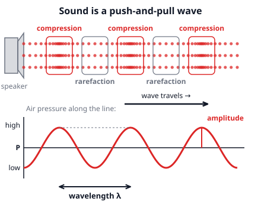
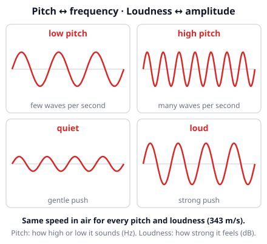
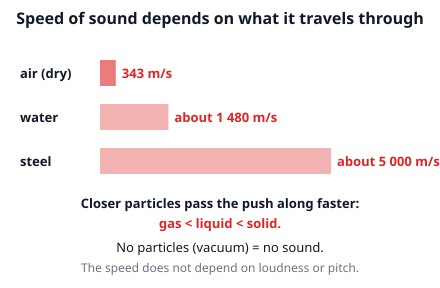
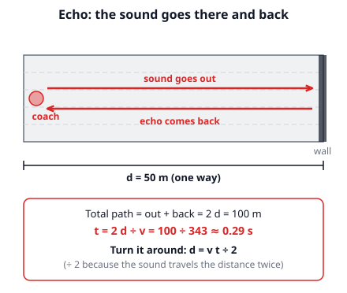

# 🟥 Sound  ·  `physics.acoustics.sound`
> 📅 Study date: Sat 31 Oct · ⏱️ ~12 min read · 📋 Syllabus: Sound, Loudness, Pitch and frequency, Longitudinal waves, Reflection of waves

## 🎮 Start with footsteps
In a shooter game, an enemy's footsteps get quieter when they are far away, and you can tell from which side they come. Real sound has rules too. Suppose a map were as big as a real city and a shot were fired **686 m** away. You would see the flash right away, but hear the bang **2 seconds later**, because sound is slow (about 343 m/s). This page explains what sound is, why it has a **pitch** and a **loudness**, and how it **bounces** (echoes).

## 🖼️ Big picture

## 💡 Core ideas
1. **Sound is a longitudinal wave.** Something **vibrates** (a speaker, a vocal cord) and pushes the air next to it. That air pushes the next air, and so on. In a **longitudinal wave** the particles move **back and forth along the same line the wave travels**. They bunch up in **compressions** (high pressure) and spread out in **rarefactions** (low pressure). The particles only jiggle in place: the *pattern* travels, not the air itself. Sound **needs a medium** (air, water, a wall). There is no sound in empty space.
2. **Wave numbers.** **Wavelength λ** is the distance from one compression to the next. **Frequency f** is how many waves pass per second, in **hertz (Hz)**. The **period T** is the time for one wave: **T = 1/f**. Speed, wavelength and frequency are tied together by **v = λ f**.
3. **Speed of sound.** In dry air it is about **343 m/s** (it is given on the exam sheet). It is faster in liquids (about **1 480 m/s** in water) and in solids (about **5 000 m/s** in steel), because the particles are closer and pass the push on faster. The speed depends on the **medium**, not on how loud or how high the sound is. For a steady speed, **distance = v × time**.
4. **Pitch ↔ frequency.** A higher **frequency** sounds like a higher **pitch**. People hear about **20 Hz to 20 000 Hz**. In the same medium, a higher f means a shorter λ (because v stays the same). When a source moves toward you, you hear a slightly higher pitch than when it moves away (the **Doppler effect**, like a passing ambulance).
5. **Loudness ↔ amplitude.** A bigger **amplitude** (a stronger push) carries more energy per second per area (the **intensity**) and sounds louder. Loudness is measured in **decibels (dB)**: every **+10 dB** means **10 times** the intensity. In open space, if you go **twice as far** from a small source, the intensity becomes **4 times smaller**, because the same energy is spread over a bigger area.
6. **Reflection and echo.** Sound bounces off hard, smooth surfaces (walls, cliffs) and the **angle in equals the angle out**. A reflection that arrives late enough to hear separately (about 0.1 s later or more) is an **echo**. The sound travels to the wall **and back**, so the total path is **2d**, so **d = v t ÷ 2**. Soft things (curtains, foam) absorb sound instead.

> 🌀 **Analogy:** a sound wave is like a squeeze moving along a stretched Slinky: each coil only moves a little back and forth, but the squeeze runs all the way down. **The difference:** the coils of a Slinky are connected, while air particles are not. They bump into each other, and a louder sound does not make the wave faster, only stronger.

## 🧮 HUSO-style examples

**Example 1.** 🎮 A speaker plays a steady note of frequency 686 Hz in air. What is the wavelength? (Speed of sound 343 m/s.)

(A) 0.25 m  (B) 0.50 m  (C) 2.0 m  (D) 343 m  (E) 240 000 m

Steps:
1. Use **v = λ f**, so **λ = v ÷ f**.
2. λ = 343 ÷ 686 = **0.50 m**. **Answer: (B).**
3. Bonus: the period is T = 1 ÷ 686 ≈ 0.0015 s = 1.5 ms. Check: v = λ ÷ T = 0.50 ÷ 0.00146 ≈ 343 m/s.
4. Traps: (C) 2.0 m flips the formula (686 ÷ 343). (E) 240 000 m multiplies v by f.

**Example 2.** 🏊 A coach claps at one end of an empty indoor pool hall. The far wall is 50 m away. How long after the clap does the coach hear the echo? (Speed of sound 343 m/s.)

(A) 0.073 s  (B) 0.15 s  (C) 0.29 s  (D) 0.58 s  (E) 6.9 s

Steps:
1. The sound goes to the wall **and back**: total distance = 2 × 50 = 100 m.
2. Time = distance ÷ speed = 100 ÷ 343 ≈ **0.29 s**. **Answer: (C).**
3. Sense check: 0.29 s is more than 0.1 s, so the coach hears a separate echo, not just a longer clap.
4. Traps: (B) 0.15 s forgets the trip back. (A) 0.073 s divides the distance by 2 instead of doubling it. (D) 0.58 s doubles twice. (E) 6.9 s divides 343 by 50, which turns the formula upside down.

## ⚠️ Common traps
- **"Louder means faster."** No. In the same medium all sounds travel at the same speed. Loudness changes the amplitude, pitch changes the frequency.
- **Frequency stays, wavelength changes.** When sound goes from air into water, its **frequency stays the same** (it is set by the source) but the speed, and so the **wavelength**, changes.
- **Forgetting the round trip.** For echoes, the sound covers the distance twice. d = v t **÷ 2**.
- **Mixing up the wave types.** In sound the particles move **along** the direction of travel (longitudinal). Do not draw them moving up and down like a rope wave.

## ✏️ Redraw from memory
Close the page and draw in 5 minutes:
- [ ] A row of dots with two compressions and a rarefaction, plus the wavelength between two compressions.
- [ ] A pressure graph under it, lined up, with the amplitude marked.
- [ ] Two waveforms for a low and a high pitch (same amplitude) and two for quiet and loud (same frequency).
- [ ] The formulas v = λ f, T = 1/f and d = v t ÷ 2, with the speed of sound in air.
- [ ] A speaker, a wall and the path of an echo with the total path 2d.

Compare with the page and mark what you missed in red.

## 🎥 Watch / try
- [Sound: Wavelength, Frequency and Amplitude](https://www.youtube.com/watch?v=TsQL-sXZOLc) — Science Sauce · 5:49 · connect pitch to frequency and loudness to amplitude
- [Measuring Speed of Sound Using Echoes](https://www.youtube.com/watch?v=1wrD4JLgb1c) — vt.physics · 2:39 · notice why the distance is counted twice
- [Sound Waves](https://phet.colorado.edu/en/simulations/sound-waves) — PhET simulation · interactive · change the frequency and amplitude and watch the compressions

## ✅ Check your understanding (5 questions)
Do these without looking at the material. You are **READY** if you get at least 4 of 5 right. Use the speed of sound in air = 343 m/s and in water ≈ 1 480 m/s.

**1.** In a sound wave traveling through air from a speaker to your ear, what do the air particles do?

(A) They move up and down, at right angles to the wave.  (B) They travel all the way from the speaker to your ear.  (C) They vibrate back and forth along the direction the wave travels.  (D) They move around in circles.  (E) They stay completely still.

**2.** 🎮 Suppose a footstep is heard with intensity I from 5 m away in open space. What is the intensity at 10 m away?

(A) I/4  (B) I/2  (C) I  (D) 2I  (E) 4I

**3.** 🏊 A coach's whistle makes a sound of frequency 1 000 Hz in air. The sound goes into the pool and travels through the water. What is its wavelength in the water?

(A) 0.34 m  (B) 0.68 m  (C) 1.48 m  (D) 4.3 m  (E) 1 480 000 m

**4.** A tuning fork vibrates 20 times in 0.050 s. What is the wavelength of the sound it makes in air?

(A) 1.2 m  (B) 17 m  (C) 137 000 m  (D) 0.86 m  (E) 0.0025 m

**5.** A hiker shouts toward a cliff and hears the echo 1.2 s later. How far away is the cliff?

(A) 103 m  (B) 206 m  (C) 412 m  (D) 286 m  (E) 823 m

Answer key & explanations

1. **(C).** Sound is a longitudinal wave: the particles vibrate back and forth along the direction of travel, making compressions and rarefactions. (A) describes a transverse wave, like a shaken rope. (B) is wrong because the particles do not travel; only the pattern does.
2. **(A) I/4.** In open space the energy spreads over a sphere with area proportional to distance². Twice the distance gives 2² = 4 times the area, so the intensity is 4 times smaller. (B) I/2 assumes it just halves. (E) 4I turns it upside down.
3. **(C) 1.48 m.** The frequency does not change when sound enters water, so λ = v ÷ f = 1 480 ÷ 1 000 = 1.48 m. (A) 0.34 m is the wavelength in air (343 ÷ 1 000), i.e. you forgot that the speed changed. (B) 0.68 m flips the formula (1 000 ÷ 1 480). (D) 4.3 m divides the two speeds (1 480 ÷ 343) and ignores f. (E) 1 480 000 m multiplies v by f.
4. **(D) 0.86 m.** f = 20 ÷ 0.050 = 400 Hz, so λ = v ÷ f = 343 ÷ 400 ≈ 0.86 m. (A) 1.2 m flips the formula (400 ÷ 343). (B) 17 m uses 0.050 s as if it were the period (343 × 0.050). (C) 137 000 m takes f = 0.050 ÷ 20 = 0.0025 Hz. (E) 0.0025 m is the period of one vibration in seconds, not a wavelength.
5. **(B) 206 m.** The echo covers the distance twice: d = v t ÷ 2 = 343 × 1.2 ÷ 2 ≈ 206 m. (C) 412 m forgets the ÷ 2. (A) 103 m halves twice. (D) 286 m divides 343 by 1.2. (E) 823 m multiplies by 2 instead of dividing.

