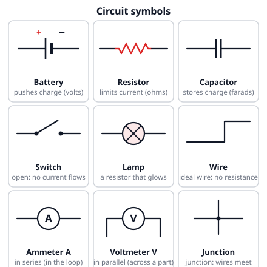
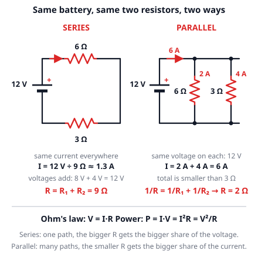
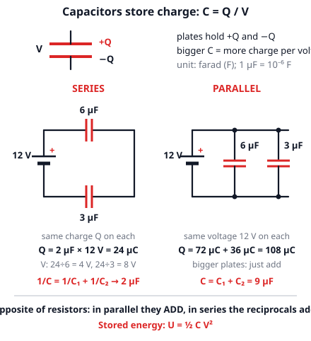
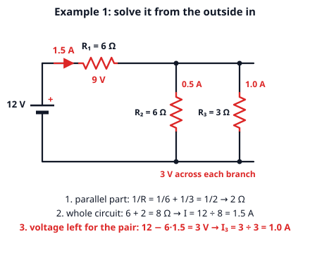

# 🟥 Circuits  ·  `physics.electromagnetism.circuits`
> 📅 Study date: Thu 15 Oct · ⏱️ ~12 min read · 📋 Syllabus: Resistors, Capacitors, Batteries, Ohm's law, power

## 🍳 Start with a toaster and a kettle
It is breakfast. You plug the toaster and the kettle into the same wall socket and switch both on. Click: the whole kitchen goes dark. Each appliance alone is fine, but together they ask for too much **current** and the safety switch (the **breaker**) cuts the power. Why does the current **add up**? Because the two appliances are connected **side by side** to the same socket, which is called a **parallel** circuit. By the end of this page you can predict the click with a pencil.

## 🖼️ Big picture

## 💡 Core ideas
1. **Current, voltage, battery.** **Current I** is how much charge flows past a point each second: **I = q/t**, in amperes (A = coulombs per second). **Voltage V** (in volts) is the "push" that each charge gets from the battery. An ideal **battery** keeps its voltage fixed (its **emf**, the voltage it supplies) and pushes charge around the loop. The circuit decides how big the current is. In one loop the current is the **same everywhere**, because charge is not used up. What *is* used up is the **energy** (it turns into heat and light).
2. **Ohm's law: V = IR.** The **resistance R** (in ohms, Ω) says how hard it is for current to get through: more R means less current for the same voltage. A wire's resistance is **R = ρL/A**: **longer** → more, **thicker** (bigger cross-section A, the area you see if you cut the wire) → less. ρ (rho) depends on the material. For example, 10 m of copper wire with a cross-section of 1 mm² has R ≈ 0.17 Ω.
3. **Resistors in series and parallel.** In **series** (one path) the current is the same and the voltages add: **R = R₁ + R₂ + …**. In **parallel** (side-by-side paths) every branch gets the same voltage and the currents add: **1/R = 1/R₁ + 1/R₂ + …**. Parallel always gives **less** than the smallest branch (6 Ω ∥ 3 Ω = 2 Ω), because you opened another road for the current.
4. **Power and energy: P = IV = I²R = V²/R.** Power is the energy used each second, in watts (W = joules per second). The energy over a time t is **E = P · t**. Use the form that fits: in **series** the current is shared, so use **I²R**; in **parallel** the voltage is shared, so use **V²/R**.
5. **Batteries.** Batteries in **series** add their voltages (two 1.5 V cells → 3 V). A battery gives a voltage; it does not choose the current, the rest of the circuit does. A battery is empty when its chemical energy is used up.
6. **Capacitors** store charge on two plates: **C = Q/V** (unit: farad, F; a μF is 10⁻⁶ F). In **parallel** the capacitances **add**: **C = C₁ + C₂** (more plate area). In **series** the **reciprocals add**: **1/C = 1/C₁ + 1/C₂**, and the **charge Q is the same** on each. That is the **opposite** of resistors. The stored energy is **U = ½CV²**: a 10 μF capacitor at 6 V holds ½ · 10 × 10⁻⁶ · 6² = 180 μJ.

> 💧 **Analogy:** a circuit is like a water loop: the battery is the pump, the current is the flow, the voltage is the pressure, and a thin pipe is a resistor. **The difference:** water can leak out of a pipe, but in a circuit the same charge goes round and round. Only the energy is used up.

## 🧮 HUSO-style examples

**Example 1.** A 12 V battery is connected to a 6 Ω resistor R₁ in series with a **parallel pair**: R₂ = 6 Ω and R₃ = 3 Ω. What current flows through R₃?

(A) 0.5 A  (B) 1.0 A  (C) 1.5 A  (D) 2.0 A  (E) 4.0 A

Steps:
1. Parallel pair first: 1/R = 1/6 + 1/3 = 1/2, so the pair acts like **2 Ω**.
2. Now everything is in series: R = 6 + 2 = **8 Ω**, so the total current is I = 12 ÷ 8 = **1.5 A**.
3. The 6 Ω resistor R₁ takes 6 · 1.5 = 9 V, so **3 V** is left for the pair. Both branches get 3 V.
4. R₃: I = V/R = 3 ÷ 3 = **1.0 A**. **Answer: (B).** (Check: R₂ gets 3 ÷ 6 = 0.5 A, and 0.5 + 1.0 = 1.5 A. ✓)
5. Traps: (C) 1.5 A is the total current, not the current in one branch. (A) 0.5 A is the current in R₂. (D) 2.0 A is 12 V ÷ 6 Ω, using the full battery voltage on a 6 Ω resistor. (E) 4.0 A is 12 V ÷ 3 Ω, the full battery voltage on R₃.

**Example 2.** 🍳 A toaster (880 W) and a kettle (1760 W) are both plugged into a 220 V circuit with a 10 A breaker (suppose). When both are on, what is the total current?

(A) 4 A  (B) 6 A  (C) 8 A  (D) 12 A  (E) 32 A

Steps:
1. For each appliance P = IV, so I = P/V. Toaster: 880 ÷ 220 = **4 A**. Kettle: 1760 ÷ 220 = **8 A**.
2. Side-by-side (parallel) branches share the same 220 V, and their currents **add**: 4 + 8 = **12 A**. **Answer: (D).**
3. That is more than 10 A, so the breaker trips: click! (Run the kettle alone, 8 A, and it is fine.)
4. Traps: (A) 4 A is the toaster alone and (C) 8 A is the kettle alone. (B) 6 A averages the two. (E) 32 A multiplies them.

## ⚠️ Common traps
- **Adding resistors the same way in series and parallel.** In parallel the total is **smaller** than the smallest resistor. A quick check: 6 Ω ∥ 3 Ω must be less than 3 Ω.
- **Giving each resistor the full battery voltage.** In series the battery voltage is **shared** (V₁ + V₂ = V). Only parallel branches each get the full V.
- **Thinking current is used up.** The current is the same before and after a resistor in one loop. The **voltage** drops across it.
- **Capacitor rules copied from resistors.** For capacitors, **parallel adds** and **series uses reciprocals**. Check your answer: two capacitors in series must give **less** than the smaller one. Also watch for μ: 4 μF = 4 × 10⁻⁶ F.

## ✏️ Redraw from memory
Close the page and draw in 5 minutes:
- [ ] The symbols for a battery (long line is +), a resistor, a capacitor, a switch, an ammeter and a voltmeter.
- [ ] A series circuit and a parallel circuit with a 12 V battery and a 6 Ω and a 3 Ω resistor, with the currents.
- [ ] The formulas V = IR, P = IV = I²R = V²/R, R = ρL/A and E = Pt.
- [ ] The R rules for series and parallel, and the capacitor rules next to them (they are opposite).
- [ ] The kitchen picture: two appliances in parallel on a socket, with the currents adding up to 12 A.

Compare with the page and mark what you missed in red.

## 🎥 Watch / try
- [Resistors In Series and Parallel Circuits - Keeping It Simple!](https://www.youtube.com/watch?v=dEuBykX5_B4) — The Organic Chemistry Tutor · 10:52 · see the same current in series and the same voltage in parallel
- [Capacitors in Series and Parallel](https://www.youtube.com/watch?v=BIPi0vXdssE) — Eugene Khutoryansky · 4:58 · watch how the plates and the charges change in each arrangement
- [Circuit Construction Kit: DC](https://phet.colorado.edu/en/simulations/circuit-construction-kit-dc) — PhET · simulation · build the two circuits from this page and measure the currents

## ✅ Check your understanding (5 questions)
Do these without looking at the material. You are **READY** if you get at least 4 of 5 right.

**1.** A copper wire has resistance R. A second copper wire is twice as long and has twice the cross-sectional area. What is the resistance of the second wire?

(A) R/4  (B) R/2  (C) R  (D) 2R  (E) 4R

**2.** A 12 Ω resistor and a 4 Ω resistor are connected in parallel to a 12 V battery. What is the total current from the battery?

(A) 0.75 A  (B) 1.0 A  (C) 1.5 A  (D) 3.0 A  (E) 4.0 A

**3.** 🍳 A kettle is rated 1100 W when connected to 220 V. What is the resistance of its heating element?

(A) 0.023 Ω  (B) 5.0 Ω  (C) 44 Ω  (D) 220 Ω  (E) 242,000 Ω

**4.** 🎮 Suppose a wireless game controller has a light strip with a resistance of 3.0 Ω. It is powered by two ideal 1.5 V batteries connected in series. What current flows through the light strip?

(A) 0.5 A  (B) 1.0 A  (C) 1.5 A  (D) 3.0 A  (E) 4.5 A

**5.** A 4.0 μF capacitor and a 12 μF capacitor are connected in series across an 8.0 V battery. What is the charge on the 4.0 μF capacitor?

(A) 2.7 μC  (B) 24 μC  (C) 32 μC  (D) 96 μC  (E) 128 μC

Answer key & explanations

1. **(C) R.** R = ρL/A. Twice the length doubles R, twice the area halves R, so they cancel: R stays the same. (D) 2R forgets the area. (B) R/2 forgets the length. (E) 4R says that both changes make R bigger. (A) R/4 says that both make R smaller.
2. **(E) 4.0 A.** Each branch has the full 12 V: 12 ÷ 12 = 1 A and 12 ÷ 4 = 3 A. The currents add: 1 + 3 = 4 A. (The same answer comes from R = 12·4 ÷ 16 = 3 Ω, I = 12 ÷ 3 = 4 A.) (A) 0.75 A treats them as being in series (16 Ω). (B) 1.0 A is the 12 Ω branch only. (C) 1.5 A uses the average 8 Ω. (D) 3.0 A is the 4 Ω branch only.
3. **(C) 44 Ω.** P = V²/R, so R = V²/P = 220² ÷ 1100 = 48400 ÷ 1100 = 44 Ω. (A) 0.023 turns the formula upside down (P ÷ V²). (B) 5.0 is the current, I = P/V = 5 A, not a resistance. (D) 220 is just the voltage. (E) 242,000 multiplies P · V.
4. **(B) 1.0 A.** Batteries in series add: 1.5 + 1.5 = 3.0 V. I = V/R = 3.0 ÷ 3.0 = 1.0 A. (A) 0.5 A uses one battery only (1.5 ÷ 3.0). (C) 1.5 A reads the battery voltage as a current. (D) 3.0 A reads the combined voltage as a current. (E) 4.5 A multiplies 1.5 · 3.0.
5. **(B) 24 μC.** In series: 1/C = 1/4 + 1/12 = 4/12, so C = 3.0 μF. Q = CV = 3.0 · 8.0 = 24 μC, and the same charge sits on **each** capacitor. (A) 2.7 μC adds the reciprocals but forgets to flip them back (1/3 μF · 8 V). (C) 32 μC gives the full 8 V to the 4.0 μF (4 · 8). (D) 96 μC gives the full 8 V to the 12 μF (12 · 8). (E) 128 μC uses the parallel rule (16 μF · 8 V).

