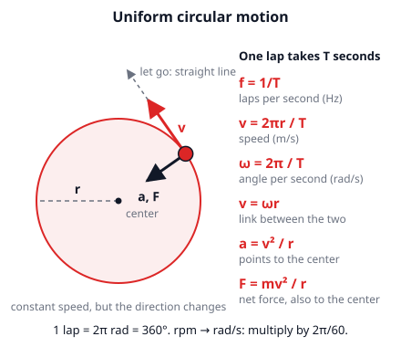
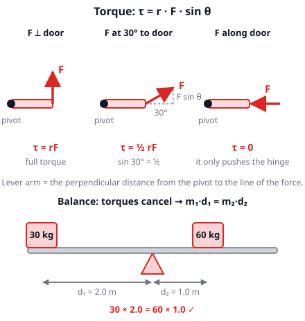
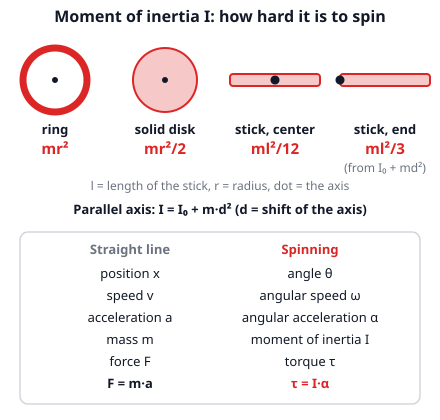

# 🟥 Circular Motion & Rotation  ·  `physics.mechanics.circular-rotation`
> 📅 Study date: Thu 15 Oct · ⏱️ ~12 min read · 📋 Syllabus: Circular motion, Rotation, torque, moment of inertia

## 🍳 Start with a salad spinner
You wash lettuce, drop it in a salad spinner and crank the handle. A few seconds later the water is in the bowl and the leaves stay in the basket. Why? The basket wall keeps **pushing the leaves toward the center**, so they move in a circle. The water drops slip out through the holes and fly off in **straight lines**. A circle is not "natural" for anything: something has to keep pulling or pushing it inward.

## 🖼️ Big picture

## 💡 Core ideas
1. **Uniform circular motion** means a constant **speed** on a circle. One lap takes the **period T**. The speed is **v = 2πr / T** (circumference ÷ time). The **frequency** is **f = 1/T** (laps per second). The **angular velocity** is **ω = 2π/T** (radians per second; one lap = 2π radians = 360°), so **v = ωr**.
2. **The speed is constant, but the velocity is not.** Velocity includes direction, and the direction keeps turning. So there is an acceleration, the **centripetal acceleration** **a = v²/r**, pointing to the **center**.
3. **Centripetal force** is just the name for the **net force toward the center**: **F = mv²/r**. It is not a new force. Tension, friction, a wall's push or gravity can play this role. Do not draw an extra "centripetal force" arrow on top of the real forces. Double the speed → **4×** the force needed.
4. **Rotation copies straight-line motion.** Swap each straight-line quantity for its spinning twin: position x → angle θ, speed v → ω, acceleration a → α, mass m → **moment of inertia I**, force F → **torque τ**. Newton's second law becomes **τ = Iα** (picture 3 below).
5. **Torque** is a "turning push": **τ = r · F · sin θ**, in N·m. Here r is the distance from the pivot to where you push, and θ is the angle between r and F. Only the part of the force that is **perpendicular** to the bar turns it. Pushing along the bar gives 0. Something does not rotate (or spins at constant ω) when the torques cancel: **m₁d₁ = m₂d₂** on a seesaw.
6. **Moment of inertia I** says how hard an object is to spin. It depends on the mass **and where the mass is**: mass far from the axis counts a lot (r²). From the reference sheet: **ring I = mr²**, **solid disk I = mr²/2**, **stick through its center I = ml²/12**. To move the axis a distance d away from the center, use the **parallel axis rule I = I₀ + md²**. For a stick about its **end**: ml²/12 + m(l/2)² = **ml²/3**.

> 🎢 **Analogy:** rotation is "straight-line physics in a new costume": the same laws with new letters. **The difference:** a mass has one m, but one object has **many** moments of inertia, because I depends on which axis you spin it around.

## 🧮 HUSO-style examples

**Example 1.** 🍳 The basket of a salad spinner has radius 0.10 m and turns 2 times per second. What is the centripetal acceleration of a leaf touching the wall?

(A) 0.4 m/s²  (B) 1.6 m/s²  (C) 12.6 m/s²  (D) 16 m/s²  (E) 158 m/s²

Steps:
1. The frequency is f = 2 Hz, so one lap takes T = 1/f = 0.5 s.
2. Speed: v = 2πr/T = 2π · 0.10 ÷ 0.5 ≈ 1.26 m/s.
3. Acceleration: a = v²/r = 1.26² ÷ 0.10 ≈ **15.8 m/s²**, so about **16 m/s²**. **Answer: (D).** That is about 1.6 times g: the leaves feel a strong push from the wall.
4. Traps: (A) uses "2" as if it were ω in rad/s (2² · 0.10 = 0.4). (B) forgets to divide by r (v² ≈ 1.6). (C) is v/r, which is just ω. (E) is ω² without the "× r".

**Example 2.** A uniform thin stick of mass 0.60 kg and length 1.0 m can spin about a pivot at one **end**. A steady force of 3.0 N pushes the other end, perpendicular to the stick. What is its initial angular acceleration?

(A) 5.0 rad/s²  (B) 7.5 rad/s²  (C) 10 rad/s²  (D) 15 rad/s²  (E) 60 rad/s²

Steps:
1. Torque: τ = rF sin 90° = 1.0 · 3.0 = 3.0 N·m (r is the whole length, because the force is at the far end).
2. Moment of inertia about the end: I = ml²/12 + m(l/2)² = 0.05 + 0.15 = 0.20 kg·m².
3. τ = Iα, so α = 3.0 ÷ 0.20 = **15 rad/s²**. **Answer: (D).**
4. Traps: (E) uses I about the center, 0.05. (A) uses I = ml² = 0.60. (B) uses r = l/2 for the torque (1.5 ÷ 0.20). (C) uses the disk formula ml²/2 = 0.30.

## ⚠️ Common traps
- **"Centrifugal force" pushing outward.** For the lettuce there is only the wall pushing **inward**. If the push stops, the leaf flies off in a **straight line**, not outward along the radius.
- **Speed constant ≠ no acceleration.** Anything that changes direction accelerates, so the net force on a body in a circle is never zero.
- **Using the wrong distance in a torque.** What counts is the part of the force **perpendicular** to the bar (F sin θ), or the **lever arm**. A push along the bar gives zero torque.
- **Wrong axis for I.** ml²/12 is only for the axis through the **center** of a stick. For another axis add md². Also convert **rpm or rev/s into rad/s** (× 2π) before using ω.

## ✏️ Redraw from memory
Close the page and draw in 5 minutes:
- [ ] A circle with a dot on it, the **velocity** arrow along the tangent and the **acceleration** arrow to the center.
- [ ] The formulas for v (two ways), ω, a and F in circular motion.
- [ ] A bar with a pivot, a force at an angle, and the lever arm; write τ = rF sin θ.
- [ ] A ring, a disk and a stick (center and end) with their I formulas.
- [ ] The two-column table: straight line ↔ spinning, ending with F = ma ↔ τ = Iα.

Compare with the page and mark what you missed in red.

## 🎥 Watch / try
- [Uniform Circular Motion and Centripetal Force](https://www.youtube.com/watch?v=SZj6DuB0vvo) — Professor Dave Explains · 6:12 · see why the acceleration points to the center
- [Rotational Inertia](https://www.youtube.com/watch?v=W9fPGXyvrVM) — Bozeman Science · 5:38 · notice how mass far from the axis makes spinning harder
- [Torque](https://phet.colorado.edu/en/simulations/torque) — PhET · simulation · push the bar at different spots and angles and watch the balance

## ✅ Check your understanding (5 questions)
Do these without looking at the material. You are **READY** if you get at least 4 of 5 right.

**1.** A point on the rim of a wheel of radius 0.50 m makes one full turn every 2.0 s. What is its speed?

(A) 0.25 m/s  (B) 0.79 m/s  (C) 1.6 m/s  (D) 3.1 m/s  (E) 6.3 m/s

**2.** 🍳 A leaf is carried around in a salad spinner. The cook doubles the speed of the leaf (same basket). How does the force that the wall must exert on the leaf change?

(A) It becomes half as large  (B) It stays the same  (C) It becomes 2 times as large  (D) It becomes 4 times as large  (E) It becomes 8 times as large

**3.** A wrench is 0.30 m long. You pull the end with a force of 50 N, and the force makes an angle of 30° with the wrench. What is the torque about the bolt at the other end?

(A) 7.5 N·m  (B) 13 N·m  (C) 15 N·m  (D) 25 N·m  (E) 167 N·m

**4.** A uniform stick of mass 1.2 kg and length 1.0 m spins about an axis at one end. What is its moment of inertia about that axis?

(A) 0.1 kg·m²  (B) 0.3 kg·m²  (C) 0.4 kg·m²  (D) 0.6 kg·m²  (E) 1.2 kg·m²

**5.** 🏊 A seesaw by the pool is balanced. A 40 kg swimmer sits 1.5 m from the pivot. Her 50 kg friend sits on the other side. How far from the pivot is the friend?

(A) 0.8 m  (B) 1.2 m  (C) 1.5 m  (D) 1.9 m  (E) 3.0 m

Answer key & explanations

1. **(C) 1.6 m/s.** v = 2πr/T = 2π · 0.50 ÷ 2.0 = π/2 ≈ 1.57 m/s. (A) 0.25 forgets the 2π (r/T). (B) 0.79 uses half the circumference (πr/T). (D) 3.1 is 2πr without dividing by T. (E) 6.3 multiplies by T instead of dividing.
2. **(D) It becomes 4 times as large.** F = mv²/r, so F grows with v². Double v → 2² = 4 times the force. (C) is what you would get if F were proportional to v.
3. **(A) 7.5 N·m.** τ = rF sin θ = 0.30 · 50 · sin 30° = 0.30 · 50 · 0.5 = 7.5 N·m. (B) 13 uses cos 30° instead of sin 30°. (C) 15 forgets sin θ (it is the torque if the force were perpendicular). (D) 25 is 50 · sin 30° and forgets the distance r. (E) 167 is F ÷ r.
4. **(C) 0.4 kg·m².** I = ml²/12 + m(l/2)² = 0.1 + 0.3 = 0.4 (this is ml²/3). (A) 0.1 is the stick about its **center**. (B) 0.3 is only the m d² part, without I₀. (D) 0.6 is ml²/2, the disk formula. (E) 1.2 is ml², all the mass at distance l.
5. **(B) 1.2 m.** Balance: 40 · 1.5 = 50 · d, so d = 60 ÷ 50 = 1.2 m (g cancels on both sides). (A) 0.8 is 40 ÷ 50 and forgets the 1.5. (C) 1.5 would only balance if the masses were equal. (D) 1.9 flips the ratio (1.5 · 50 ÷ 40 = 1.875): the heavier friend must sit **closer**, not farther.

