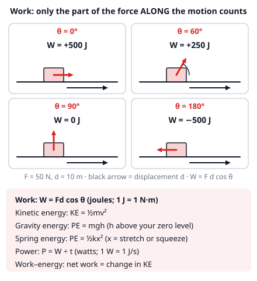
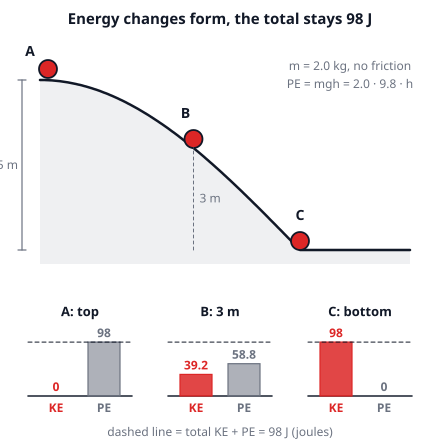
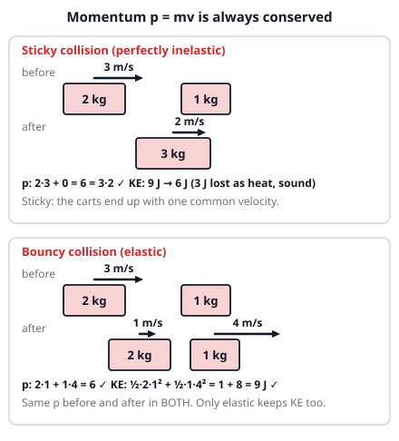
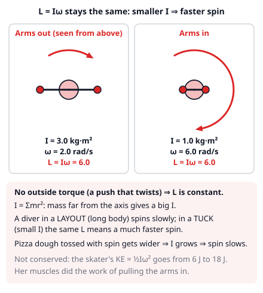

# 🟥 Conservation Laws  ·  `physics.mechanics.conservation`
> 📅 Study date: Thu 15 Oct · ⏱️ ~12 min read · 📋 Syllabus: Conservation of energy, Conservation of momentum, Conservation of angular momentum

## 🎮 Start with an ability orb
Suppose (made-up numbers!) you throw an ability orb at 10 m/s from a ledge 4.9 m above the ground. You can throw it straight up, straight sideways, or straight down. Which throw hits the ground fastest? Surprise: **they all hit at the same speed**, 14 m/s (ignoring air). You do not need any arcs or angles to see why. You only need to follow one number that never changes: the orb's **energy**. Physics has three of these "bookkeeping" quantities that stay constant when nothing interferes: **energy**, **momentum**, and **angular momentum** (the spinning kind). They are some of the most powerful shortcuts in all of physics.

## 🖼️ Big picture

## 💡 Core ideas
1. **Work and the energy types.** **Work** is force times the distance moved *along the force*: **W = Fd cos θ**, where θ is the angle between the force and the motion (unit: joule, 1 J = 1 N·m). It is positive when the force helps the motion, 0 at 90°, negative when it opposes the motion. **Energy** is the ability to do work and has no direction. **Kinetic energy** (motion): **KE = ½mv²**. **Gravity energy**: **PE = mgh**. **Spring energy**: **PE = ½kx²** (k = spring stiffness in N/m, x = how far it is stretched or squeezed).
2. **Conservation of energy.** Energy is never created or destroyed, only moved around or changed in form. If only gravity and springs act (no friction), the **mechanical energy** KE + PE stays the same, so **KE gained = PE lost**. Friction and air drag turn mechanical energy into heat: the total is still conserved, but KE + PE goes down. The **work–energy rule**: net work on an object = its change in KE.
3. **Power** is how fast work is done: **P = W ÷ t** (unit: watt, 1 W = 1 J/s). Same work in half the time means twice the power.
4. **Momentum.** **p = mv** (kg·m/s) is a **vector**. A force acting for a time changes it: **impulse = FΔt = Δp**. If there is **no net outside force** on a system, its **total momentum stays constant**: add up all the mv before (with signs for direction) and it equals the sum after. A swimmer pushing off a wall, a rocket, a recoil: all momentum conservation.
5. **Collisions.** In **every** collision with no outside force, **momentum is conserved**. In an **elastic** collision KE is conserved too (bouncy, nothing lost). In an **inelastic** collision some KE becomes heat and sound. In a **perfectly inelastic** collision the objects stick: **v = (m₁v₁ + m₂v₂) ÷ (m₁ + m₂)** and the most KE is lost. Elastic shortcut (one dimension): they separate at the *same speed* they approached.
6. **Angular momentum.** **L = Iω**. **ω** (omega) is the spin rate in rad/s and **I** is the **moment of inertia**: how hard it is to spin, bigger when mass is farther from the axis (for a small mass: **I = mr²**). With **no outside torque** (twisting push), **L stays constant**: so if I gets smaller, ω gets bigger by the same factor. That is why a diver tucks and a skater pulls in her arms.

> 🧠 **The difference:** momentum and energy are *both* conserved in a bouncy collision, but only **momentum** is conserved in a sticky one. Momentum is a vector (direction matters), energy is not.

## 🧮 HUSO-style examples

**Example 1.** 🏊 A 40 kg child starts from rest at the top of a water slide that is 4.9 m high. She reaches the bottom moving at 8.0 m/s. How much mechanical energy was turned into heat by friction and water?

(A) 640 J  (B) 1280 J  (C) 1920 J  (D) 3200 J  (E) 0 J

Steps:
1. Energy at the top: she is at rest, so only gravity energy: PE = mgh = 40 · 9.8 · 4.9 = 1920.8 J.
2. Energy at the bottom (take the bottom as h = 0): only KE = ½mv² = ½ · 40 · 8.0² = 1280 J.
3. Mechanical energy lost = 1920.8 − 1280 = 640.8 J ≈ **640 J**. **Answer: (A).** This energy is not gone: it heated the water and the slide.
4. The traps: (B) 1280 is the final KE, (C) 1920 is the starting PE, (D) 3200 adds the two, and (E) 0 would only be true on a frictionless slide.

**Example 2.** A 3.0 kg tray slides at 4.0 m/s along a smooth counter and sticks to a 1.0 kg tray that was at rest. How much kinetic energy is lost?

(A) 0 J  (B) 6 J  (C) 12 J  (D) 18 J  (E) 24 J

Steps:
1. The trays stick, so use conservation of momentum: 3.0 · 4.0 + 1.0 · 0 = (3.0 + 1.0) · v, so 12 = 4.0v and v = 3.0 m/s.
2. KE before = ½ · 3.0 · 4.0² = 24 J. KE after = ½ · 4.0 · 3.0² = 18 J.
3. KE lost = 24 − 18 = **6 J**. **Answer: (B).**
4. The traps: (A) assumes KE is conserved (only true when they bounce perfectly); (C) 12 is the momentum 12 kg·m/s mistaken for joules; (D) 18 is the KE left; (E) 24 is the KE at the start.

## ⚠️ Common traps
- **"Energy is conserved" does not mean "KE + PE is conserved".** With friction, KE + PE drops because heat appears. Use KE + PE = constant only for smooth tracks, free fall and springs.
- **Momentum is a vector.** Two equal carts moving toward each other have total momentum 0. Choose a direction as + and give leftward motion a minus sign.
- **Sticky is not elastic.** Momentum is conserved in all collisions, but KE only in elastic ones. Never set KE before = KE after in a collision where things stick.
- **Do not forget the square.** KE = ½mv² grows with v² (double the speed, four times the energy), but momentum mv only doubles. And in L = Iω, I must change by the same factor that ω changes the other way.

## ✏️ Redraw from memory
Close this page, take a sheet of paper, and draw in 5 minutes:
- [ ] A **track with a ball** at the top, middle and bottom, and **KE/PE bar charts** for each place with a dashed line for the total.
- [ ] A force at four angles (0°, 60°, 90°, 180°) and the sign of the **work** each time.
- [ ] A **sticky collision** and an **elastic collision** with the numbers: momentum before = after in both, KE only in one.
- [ ] A **skater with arms out and arms in** with I, ω and L = Iω written next to each.
- [ ] The **formula list**: W = Fd cos θ, KE, PE = mgh, spring PE, P = W/t, p = mv, L = Iω.

Compare with the pictures above and mark anything you missed in red.

## 🎥 Watch / try
- [Energy Skate Park: Basics (PhET simulation)](https://phet.colorado.edu/en/simulations/energy-skate-park-basics) — PhET Interactive Simulations · interactive · switch on the bar chart and watch KE and PE trade places on a smooth track
- [Elastic and Inelastic Collisions](https://www.youtube.com/watch?v=M2xnGcaaAi4) — Professor Dave Explains · 5:14 · watch which quantity is conserved in each kind of collision
- [Conservation of Angular Momentum](https://www.youtube.com/watch?v=hgcudPr73LU) — Bozeman Science · 5:38 · watch what happens to the spin when the radius shrinks

## ✅ Check your understanding (5 questions)
Do these without looking at the material. You are **READY** if you get at least 4 of 5 right.

**1.** 🎮 Suppose an ability orb is thrown from a ledge 9.8 m above the ground with a speed of 8.0 m/s, in any direction. Ignore air. How fast is it moving when it hits the ground?

(A) 8.0 m/s  (B) 14 m/s  (C) 16 m/s  (D) 22 m/s  (E) 256 m/s

**2.** 🍳 You drag a bag of flour across the floor by pulling a strap with a force of 50 N. The strap is at 60° above the horizontal, and you pull the bag 10 m along the floor. How much work does your pulling force do?

(A) 0 J  (B) 125 J  (C) 250 J  (D) 433 J  (E) 500 J

**3.** A 3.0 kg cart moving at 2.0 m/s hits a 1.0 kg cart at rest. The collision is perfectly elastic. How fast is the 1.0 kg cart moving afterward?

(A) 1.0 m/s  (B) 1.5 m/s  (C) 2.0 m/s  (D) 3.0 m/s  (E) 6.0 m/s

**4.** 🏊 A diver leaves the board spinning at 0.80 revolutions per second in a stretched-out position. She pulls into a tight tuck, which makes her moment of inertia one third of what it was. How fast does she spin now?

(A) 2.4 rev/s  (B) 0.27 rev/s  (C) 0.80 rev/s  (D) 1.4 rev/s  (E) 7.2 rev/s

**5.** 🍳 You carry a 20 kg bag of flour up a staircase to a shelf 3.0 m higher, taking 6.0 s. What average power do you use to lift the bag?

(A) 49 W  (B) 98 W  (C) 392 W  (D) 588 W  (E) 3528 W

Answer key & explanations

1. **(C) 16 m/s.** Mechanical energy is conserved, and the direction does not matter. ½mv² = ½mv₀² + mgh, so v² = v₀² + 2gh = 64 + 2 · 9.8 · 9.8 = 256.1, and v = 16 m/s. (A) 8.0 is the starting speed; (B) 14 is √(2gh) = 13.9 and forgets the starting speed; (D) 22 adds the two speeds (8.0 + 13.9) instead of adding energies; (E) 256 is v² and forgets the square root.
2. **(C) 250 J.** W = Fd cos θ = 50 · 10 · cos 60° = 500 · 0.5 = 250 J. Only the horizontal part of the pull moves the bag along the floor. (E) 500 J ignores the angle; (D) 433 J uses sin 60° instead of cos 60°; (B) 125 J puts in an extra ½ (as if it were the KE formula); (A) 0 J would be right only for a pull at 90°.
3. **(D) 3.0 m/s.** Momentum: 3.0 · 2.0 = 3.0v₁ + 1.0v₂, so 6 = 3v₁ + v₂. Elastic shortcut: they separate at the speed they approached, v₂ − v₁ = 2.0. Substituting v₂ = v₁ + 2: 6 = 4v₁ + 2, so v₁ = 1.0 and v₂ = 3.0 m/s. Check KE: before ½ · 3 · 4 = 6 J; after ½ · 3 · 1 + ½ · 1 · 9 = 1.5 + 4.5 = 6 J ✓. (A) 1.0 is the speed of the *heavy* cart afterward; (B) 1.5 is the speed if they stuck together (6 ÷ 4); (C) 2.0 is the original speed; (E) 6.0 is the total momentum (kg·m/s) mistaken for a speed.
4. **(A) 2.4 rev/s.** No outside torque, so L = Iω is constant. If I becomes I/3, then ω must become 3ω: 3 · 0.80 = 2.4 rev/s. (B) 0.27 divides by 3 instead of multiplying; (C) 0.80 pretends nothing changes; (D) 1.4 is 0.80 · √3 (a square-root mix-up); (E) 7.2 is 0.80 · 9, as if ω depended on 1/I².
5. **(B) 98 W.** Work = the gravity energy gained = mgh = 20 · 9.8 · 3.0 = 588 J. Power = W ÷ t = 588 ÷ 6.0 = 98 W. (D) 588 is the work in joules and forgets to divide by the time; (E) 3528 multiplies by 6.0 instead of dividing; (C) 392 swaps the height and the time (20 · 9.8 · 6.0 ÷ 3.0); (A) 49 puts in an extra ½, as if it were the KE formula.

