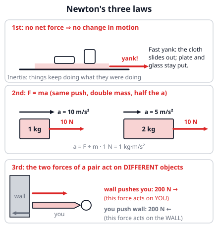
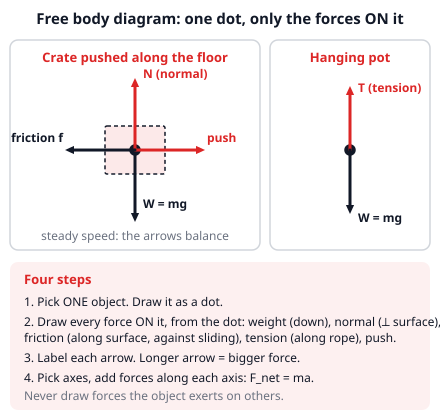
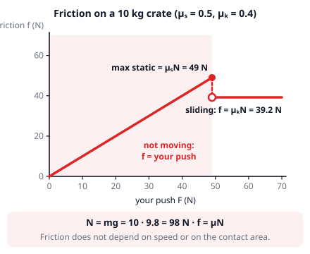
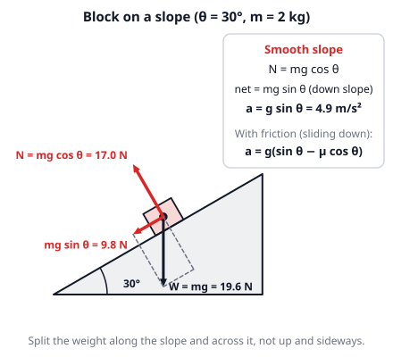
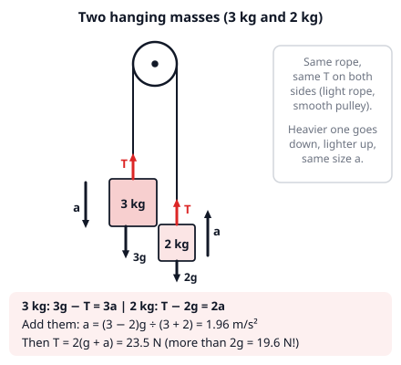

# 🟥 Dynamics  ·  `physics.mechanics.dynamics`
> 📅 Study date: Thu 15 Oct · ⏱️ ~12 min read · 📋 Syllabus: Newton's laws, Friction, Free body diagrams

## 🍳 Start with the tablecloth trick
Cooks and magicians love this one: set a plate and a glass on a tablecloth, then **yank the cloth out fast**. The cloth slides away and the plate and glass stay almost exactly where they were. Why? The cloth's friction only touches them for a split second, so there is no time for the force to change their motion much. Things "want" to keep doing what they were already doing. That is the first of Newton's laws, and this file is about all of them: **forces** (pushes and pulls) and **how they change motion**. The big skill is drawing a **free body diagram**, a picture of all the forces on one object.

## 🖼️ Big picture

## 💡 Core ideas
1. **1st law (inertia).** If the **net force** (all forces added up, with directions) is zero, the velocity does not change: an object at rest stays at rest, and a moving object keeps moving in a straight line at steady speed. **Inertia** is this resistance to change, and **mass** (in kg) measures it.
2. **2nd law: F_net = ma.** A net force causes an acceleration in the *same direction*. The unit is the **newton**: 1 N = 1 kg·m/s². **Weight** is the pull of gravity, a *force*: **W = mg** (about 9.8 N for every kg). **Mass** is "how much stuff" and never changes; weight changes with g (on the Moon g ≈ 1.6 m/s²).
3. **3rd law.** If A pushes on B, then B pushes on A **equally hard in the opposite direction**. The two forces of a pair act on **different objects**, so they never cancel each other. You push the wall, the wall pushes *you*, and you are the one who moves.
4. **Free body diagram (FBD).** Pick one object, draw it as a dot, and draw an arrow from the dot for **every force on it**: weight (down), **normal force** (the surface pushing back, perpendicular to the surface), friction (along the surface), tension (along a rope), pushes. Then write F_net = ma along each axis.
5. **Friction.** It acts along the surface, against sliding. **Static friction** (not sliding yet) matches your push, up to a maximum μₛN. Once sliding, **kinetic friction** is **f = μₖN**, where **N is the normal force** and **μ** (mu) is a "stickiness number". It does not depend on speed or contact area. On a flat floor with no vertical push, N = mg, but not always (elevators, slopes!).
6. **Slopes and ropes.** On a slope at angle θ, split the weight: **mg sin θ** along the slope (pulls it down the slope) and **mg cos θ** into the slope. So **N = mg cos θ**, and on a smooth slope **a = g sin θ**. A light rope over a smooth pulley has the **same tension T on both sides**; a rope can only pull. For two hanging masses, write F = ma for each mass and solve.

> 🧠 **The difference:** "action and reaction" sounds like one happens after the other. They don't: both forces exist at the same moment, and each one is on a different object.

## 🧮 HUSO-style examples

**Example 1.** 🍳 You slide a 5.0 kg pot of stock across a kitchen counter, pushing horizontally with 20 N. The kinetic friction coefficient is μₖ = 0.20. What is the pot's acceleration?

(A) 2.0 m/s²  (B) 3.8 m/s²  (C) 4.0 m/s²  (D) 6.0 m/s²  (E) 10 m/s²

Steps:
1. Draw the FBD: weight 5.0 · 9.8 = 49 N down, normal force up (the pot does not move up or down, so N = 49 N), push 20 N forward, friction backward.
2. Friction: f = μₖN = 0.20 · 49 = 9.8 N.
3. Net force: 20 − 9.8 = 10.2 N forward. Then a = F_net ÷ m = 10.2 ÷ 5.0 = 2.04 ≈ **2.0 m/s²**. **Answer: (A).**
4. The traps: (C) 4.0 ignores friction (20 ÷ 5.0); (D) 6.0 adds the friction instead of subtracting it; (B) 3.8 uses f = μm and forgets g; (E) 10 is the net *force* in newtons, not the acceleration.

**Example 2.** Two masses, 3.0 kg and 2.0 kg, hang from the two ends of a light rope that goes over a smooth pulley. They are released from rest. What is the tension in the rope?

(A) 2.0 N  (B) 20 N  (C) 24 N  (D) 29 N  (E) 49 N

Steps:
1. The heavier mass goes down and the lighter one goes up, both with the same acceleration a, and the rope pulls both with the same tension T.
2. 3.0 kg (down is +): 3.0g − T = 3.0a. 2.0 kg (up is +): T − 2.0g = 2.0a.
3. Add the two equations: T cancels, so 1.0g = 5.0a, which gives a = 9.8 ÷ 5.0 = 1.96 m/s².
4. Put a back into the lighter mass: T = 2.0(g + a) = 2.0 · 11.76 = 23.5 ≈ **24 N**. **Answer: (C).**
5. The traps: (B) 20 is just the lighter weight 2.0g = 19.6 N, but the tension must be *bigger* than that or it could not accelerate upward. (D) 29 is the heavier weight 3.0g. (E) 49 is the total weight. (A) 2.0 is the acceleration number.

## ⚠️ Common traps
- **Forces on the *wrong* object.** An FBD shows only forces *on* your object, never the forces it puts on others. Do not draw both halves of a 3rd-law pair on the same dot.
- **"Normal force = weight" is not a law.** N is whatever keeps the object from sinking into the surface: on a slope it is mg cos θ, and in an accelerating elevator it changes.
- **Friction is not always μN.** While the object is not sliding, friction just equals the push (up to its maximum). Only a *sliding* object has f = μₖN.
- **Mass vs weight.** Kilograms measure mass; newtons measure weight. "A 60 kg astronaut weighs 60 kg" is a mixed-up sentence. And a "net force of zero" does *not* mean "not moving", only "not changing".

## ✏️ Redraw from memory
Close this page, take a sheet of paper, and draw in 5 minutes:
- [ ] A **free body diagram** of a crate pushed along a floor with all four forces labeled and arrows of sensible lengths.
- [ ] A **block on a slope** with W, N, and the two components mg sin θ and mg cos θ.
- [ ] The **friction graph**: friction vs push, with the maximum static friction and the lower kinetic level.
- [ ] **Two masses on a pulley** with T and weight on each mass and the direction of a.
- [ ] The **swimmer and the wall** with the two forces of the 3rd-law pair, each on its own object.

Compare with the pictures above and mark anything you missed in red.

## 🎥 Watch / try
- [Types of forces and free body diagrams](https://www.youtube.com/watch?v=MaabUHLIIXA) — Khan Academy · 8:03 · watch which forces get an arrow and how long each arrow is
- [Introduction to Static and Kinetic Friction](https://www.youtube.com/watch?v=i-DdiI7gFoM) — Flipping Physics · 4:04 · watch why friction grows with the push until the object slips
- [Forces and Motion: Basics (PhET simulation)](https://phet.colorado.edu/en/simulations/forces-and-motion-basics) — PhET Interactive Simulations · interactive · push a crate with and without friction and watch the net force

## ✅ Check your understanding (5 questions)
Do these without looking at the material. You are **READY** if you get at least 4 of 5 right.

**1.** 🏊 You push off the pool wall by pushing on it with a force of 200 N. What is the force of the wall on you?

(A) 0 N, because the wall does not move.  (B) Less than 200 N, because you move and the wall does not.  (C) Exactly 200 N, in the opposite direction.  (D) More than 200 N, because you speed up.  (E) Exactly 200 N, in the same direction as your push.

**2.** An astronaut has a mass of 49 kg on Earth. On the Moon, where g = 1.6 m/s², what are her mass and her weight?

(A) 49 kg and 78 N  (B) 49 kg and 480 N  (C) 8.0 kg and 78 N  (D) 8.0 kg and 480 N  (E) 49 kg and 7.8 N

**3.** A 2.0 kg block slides down a smooth (frictionless) ramp that makes an angle of 30° with the ground. What is the net force on the block along the ramp?

(A) 4.9 N  (B) 9.8 N  (C) 17 N  (D) 20 N  (E) 39 N

**4.** 🍳 A 10 kg sack of flour sits on the kitchen floor. The coefficients of friction are μₛ = 0.50 (static) and μₖ = 0.40 (kinetic). You push it horizontally with 40 N. What is the size of the friction force on the sack?

(A) 0 N  (B) 39 N  (C) 40 N  (D) 49 N  (E) 98 N

**5.** A 60 kg person stands on a bathroom scale in an elevator that is speeding up **upward** at 2.0 m/s². What force does the scale show?

(A) 120 N  (B) 468 N  (C) 588 N  (D) 708 N  (E) 1180 N

Answer key & explanations

1. **(C) Exactly 200 N, in the opposite direction.** 3rd law: the two forces of a pair are always equal in size and opposite in direction, even if one object moves and the other does not. The wall pushes you with 200 N away from the wall. (A) and (B) think a stationary object pushes less; (D) is wrong because speeding up is the *result* of the force, not a change in its size; (E) has the direction wrong.
2. **(A) 49 kg and 78 N.** Mass does not change with place: 49 kg. Weight = mg = 49 · 1.6 = 78.4 N ≈ 78 N. (B) 480 N is her weight on Earth (49 · 9.8 = 480.2 N); (C) 8.0 kg is what you get if you wrongly shrink the mass by the ratio of the g values (49 · 1.6 ÷ 9.8).
3. **(B) 9.8 N.** Along the ramp, the weight component is mg sin 30° = 2.0 · 9.8 · 0.5 = 9.8 N. (A) 4.9 is g sin 30°, the *acceleration* (in m/s²), not a force; (C) 17 N is mg cos 30°, the part of the weight pressing *into* the ramp; (D) 20 N is the whole weight mg = 19.6 N; (E) 39 N comes from dividing by sin 30° instead of multiplying.
4. **(C) 40 N.** First test whether it slides: the maximum static friction is μₛN = 0.50 · 98 = 49 N, which is bigger than your 40 N push. So the sack does not move, and static friction matches the push exactly: 40 N. (B) 39 N is μₖN, used even though the sack is not sliding; (D) 49 N is the *maximum* static friction, not what is needed; (E) 98 N is the weight.
5. **(D) 708 N.** FBD of the person: the scale pushes up with N, gravity pulls down with mg. Up is +: N − mg = ma, so N = m(g + a) = 60 · (9.8 + 2.0) = 708 N. (C) 588 N is the reading at rest (mg); (B) 468 N is m(g − a), the answer for an elevator speeding up *downward*; (A) 120 N is only ma; (E) 1180 N multiplies the weight by a (588 · 2.0 = 1176).

