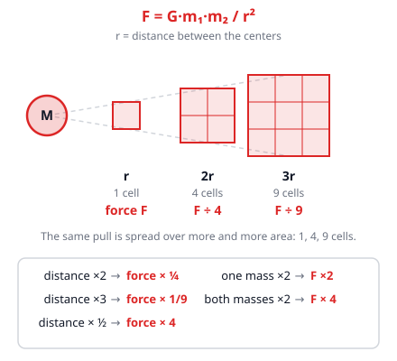
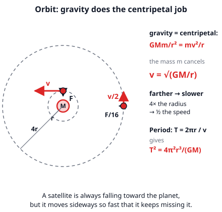
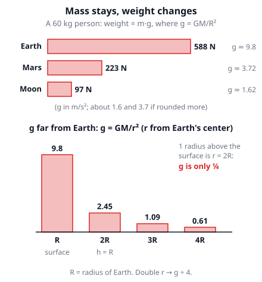

# 🟥 Gravity  ·  `physics.mechanics.gravity`
> 📅 Study date: Thu 15 Oct · ⏱️ ~12 min read · 📋 Syllabus: Newton's law of gravitation

## 🎮 Start with a low-gravity map
Suppose a game has a map on a tiny moon. You press jump and you float up for ages, then drift down slowly. Games fake this, but the real Moon does it for real: with the same push, you would jump about **6 times higher** there. Why does the Moon pull less than Earth, and how much less? One formula answers it, and the same formula keeps the Moon, satellites and planets in their orbits.

## 🖼️ Big picture

## 💡 Core ideas
1. **Newton's law of gravitation: F = G m₁m₂ / r².** Every two masses pull on each other. The pull grows with both masses and gets weaker with the **square of the distance r**, measured **center to center**. **G = 6.674 × 10⁻¹¹ N·m²/kg²** is a tiny number, so you only notice gravity when one of the masses is as huge as a planet. The two pulls are **equal and opposite** (Newton's third law): you pull on Earth as hard as Earth pulls on you.
2. **Inverse square.** Gravity spreads out like light from a lamp. At **2×** the distance the force is **¼**, at **3×** it is **1/9**, at **½** the distance it is **4×**. Double **one** mass → double the force. Double **both** → 4×.
3. **g = GM / r².** Your weight is the pull of the planet on you: mg = GMm/r². Your mass **m cancels**, so every object falls with the same acceleration g. On Earth's surface, r = R (Earth's radius) and g ≈ 9.8 m/s². At a height h above the surface use **r = R + h**, not h.
4. **Other worlds.** g depends on M/R²: a planet with **twice the mass** has **twice the g**, and with **twice the radius** only **¼ of the g**. **Mass** (kg) is how much matter you are made of and never changes. **Weight** (mg, in N) is the pull on you, so it changes from planet to planet. On the Moon g ≈ 1.6 m/s², on Mars g ≈ 3.7 m/s².
5. **Orbits.** A satellite in a circular orbit is moving in a circle, so it needs a centripetal force, and **gravity is that force**: GMm/r² = mv²/r. The satellite's mass cancels and **v = √(GM/r)**. A satellite **farther away moves slower**, and at 4× the radius it moves at ½ the speed. One lap takes T = 2πr/v.
6. **"Weightless" does not mean "no gravity".** At the height of the International Space Station gravity is still about 90 % of its value on the ground. Astronauts float because they and the station are **falling around the Earth together**.

> 💡 **Analogy:** gravity is like the light from a lamp: the farther you are, the more the same amount is spread out, so the less you get per square meter. **The difference:** light can be blocked by a wall, but gravity cannot be shielded, and it always **pulls** (it never pushes).

## 🧮 HUSO-style examples

**Example 1.** At what height above Earth's surface is the acceleration of free fall one quarter of its value on the ground? (Earth's radius is R = 6400 km.)

(A) 1600 km  (B) 3200 km  (C) 6400 km  (D) 12,800 km  (E) 19,200 km

Steps:
1. g = GM/r², so g is proportional to 1/r².
2. One quarter of g means r² must be 4 times bigger, so r must be **2 times** bigger: r = 2R.
3. The distance r is measured from Earth's **center**. The height above the surface is h = r − R = 2R − R = **R = 6400 km**. **Answer: (C).**
4. Traps: (D) 12,800 km is r, not the height. (E) 19,200 km uses "g ∝ 1/r" (4× the distance, so h = 3R). (A) and (B) divide the radius by 4 or by 2 instead of making the distance bigger.

**Example 2.** 🎮 Suppose a game planet has **twice the mass** and **twice the radius** of Earth. A 50 kg player weighs 490 N on Earth. What does she weigh there?

(A) 123 N  (B) 245 N  (C) 490 N  (D) 980 N  (E) 1960 N

Steps:
1. g = GM/R². Twice the mass puts a 2 on top. Twice the radius puts 2² = 4 on the bottom.
2. So g becomes 2/4 = **½** of Earth's value, and the weight is ½ · 490 = **245 N**. **Answer: (B).** Her mass is still 50 kg.
3. Traps: (D) 980 only doubles for the mass. (A) 123 only quarters for the radius. (E) 1960 puts R² on the top instead of the bottom (490 · 4).

## ⚠️ Common traps
- **Using the height instead of the distance from the center.** At 400 km above Earth, r = 6370 + 400 km, not 400 km.
- **Forgetting the square.** Doubling the distance gives ¼ of the force, not ½. The same goes for the orbit speed: it goes as 1/√r, not 1/r.
- **Mixing mass and weight.** Mass is in kg and never changes. Weight is a force in N: W = mg changes with g. "Weightless" astronauts still have mass.
- **Thinking a heavier satellite needs a faster orbit.** The satellite's mass cancels in v = √(GM/r), only the mass of the planet (and the radius) matter.

## ✏️ Redraw from memory
Close the page and draw in 5 minutes:
- [ ] A small planet and three squares at r, 2r and 3r with 1, 4 and 9 cells, and the force at each.
- [ ] The formulas F = Gm₁m₂/r² and g = GM/r², with the 2r → ¼ rule.
- [ ] A planet with an orbit, the velocity arrow along the circle and the gravity arrow to the center.
- [ ] A bar picture of the weight of the same person on Earth, Mars and the Moon.
- [ ] One sentence: why does the satellite's mass not matter in an orbit?

Compare with the page and mark what you missed in red.

## 🎥 Watch / try
- [Newton's Law of Universal Gravitation](https://www.youtube.com/watch?v=kxkFaBG6a-A) — Professor Dave Explains · 8:25 · follow how the force changes with mass and distance
- [Newtonian Gravity: Crash Course Physics #8](https://www.youtube.com/watch?v=7gf6YpdvtE0) — CrashCourse · 9:20 · notice how g and orbits come from the same formula
- [Gravity Force Lab](https://phet.colorado.edu/en/simulations/gravity-force-lab) — PhET · simulation · change the masses and the distance and read the force

## ✅ Check your understanding (5 questions)
Do these without looking at the material. You are **READY** if you get at least 4 of 5 right.

**1.** The distance between the centers of two planets is doubled. What happens to the gravitational force between them?

(A) It becomes 4 times as large  (B) It becomes 2 times as large  (C) It stays the same  (D) It becomes ¼ as large  (E) It becomes ⅛ as large

**2.** 🍳 Two bags of flour, 2.0 kg and 3.0 kg, sit on a table with their centers 0.50 m apart. What is the gravitational force between them? (G = 6.674 × 10⁻¹¹ N·m²/kg²)

(A) 8.0 × 10⁻¹⁰ N  (B) 1.3 × 10⁻⁹ N  (C) 1.6 × 10⁻⁹ N  (D) 6.4 × 10⁻⁹ N  (E) 2.4 × 10¹ N

**3.** Imagine Earth were squeezed to half its radius, but kept the same mass. What would g be at its new surface?

(A) 2.5 m/s²  (B) 4.9 m/s²  (C) 9.8 m/s²  (D) 20 m/s²  (E) 39 m/s²

**4.** Satellite A orbits a planet in a circle of radius r. Satellite B orbits the same planet in a circle of radius 4r. How does the speed of B compare with the speed of A?

(A) ¼ as large  (B) ½ as large  (C) the same  (D) 2 times as large  (E) 4 times as large

**5.** 🎮 Suppose a game character weighs 686 N on a planet where g = 9.8 m/s². On a low-gravity map g = 3.5 m/s². What are the character's mass and weight on that map?

(A) 70 kg and 245 N  (B) 25 kg and 245 N  (C) 70 kg and 686 N  (D) 196 kg and 686 N  (E) 196 kg and 245 N

Answer key & explanations

1. **(D) It becomes ¼ as large.** F ∝ 1/r², and 1/2² = ¼. (A) flips the rule and gives 4×. (B) is what you get if you think the force grows with the distance. (E) ⅛ is 1/2³, a cube instead of a square.
2. **(C) 1.6 × 10⁻⁹ N.** F = G m₁m₂/r² = 6.674 × 10⁻¹¹ · 2.0 · 3.0 ÷ 0.50² = 6.674 × 10⁻¹¹ · 6.0 ÷ 0.25 ≈ 1.6 × 10⁻⁹ N, far too small to feel. (A) 8.0 × 10⁻¹⁰ forgets to square r (it divides by 0.50). (B) 1.3 × 10⁻⁹ adds the masses (5.0) instead of multiplying. (D) 6.4 × 10⁻⁹ squares 0.25 instead of 0.50. (E) 2.4 × 10¹ forgets G (6.0 ÷ 0.25 = 24).
3. **(E) 39 m/s².** g = GM/R². Half the radius puts (½)² = ¼ on the bottom, so g is 4 times larger: 4 · 9.8 ≈ 39 m/s². (A) 2.5 divides by 4 instead of multiplying. (B) 4.9 halves g. (C) 9.8 forgets that the radius changed. (D) 20 doubles g, which uses 1/R instead of 1/R².
4. **(B) ½ as large.** v = √(GM/r). With 4 times the radius, √(1/4) = ½. (A) ¼ uses v ∝ 1/r. (C) says the speed is the same because the planet is the same. (D) 2 and (E) 4 say that farther means faster.
5. **(A) 70 kg and 245 N.** The mass is the same everywhere: m = W ÷ g = 686 ÷ 9.8 = 70 kg. The new weight is mg = 70 · 3.5 = 245 N. (B) 25 kg scales the mass with g (70 · 3.5 ÷ 9.8). (C) 70 kg and 686 N keeps the old weight. (D) 196 kg and 686 N divides the old weight by the new g (686 ÷ 3.5 = 196). (E) 196 kg also uses that wrong mass, with the right weight.

