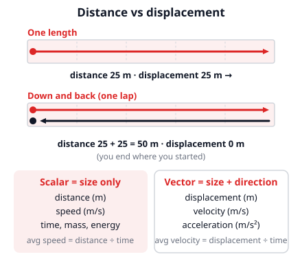
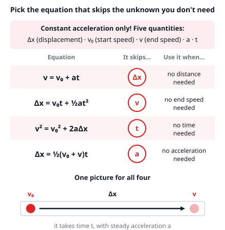
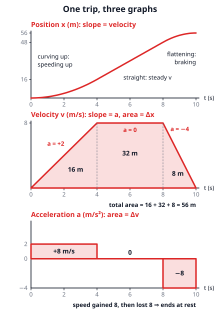
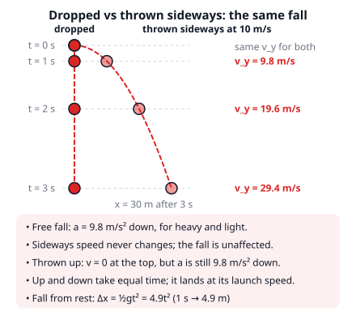
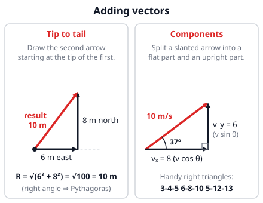

# 🟥 Kinematics  ·  `physics.mechanics.kinematics`
> 📅 Study date: Thu 15 Oct · ⏱️ ~12 min read · 📋 Syllabus: Kinematics, Vector and scalar quantities

## 🏊 Start with a lap in the pool
You swim one full lap of a 25 m pool: down to the far wall and back again. You touch the wall exactly where you started. How far did you swim? **50 m**. How far did you end up from the start? **0 m**. Physics keeps both answers, because they are two different ideas: **distance** (how much path you covered) and **displacement** (where you ended up compared with where you started). If the lap took 40 s, your average *speed* was 50 ÷ 40 = 1.25 m/s, but your average *velocity* was 0. Kinematics is the science of describing motion like this, with pictures and a few equations, *before* asking what causes it.

## 🖼️ Big picture

## 💡 Core ideas
1. **Scalar vs vector.** A **scalar** has a size only (distance, speed, time, mass). A **vector** has a size *and a direction* (displacement, velocity, acceleration, force). **Speed** = distance ÷ time. **Velocity** = displacement ÷ time. Along a line, we show direction with a sign: + for one way, − for the other.
2. **Acceleration** is how fast velocity changes: **a = (v − v₀) ÷ t**, in m/s² ("each second, the velocity changes by this many m/s"). If a and v point the same way you speed up; if they point opposite ways you slow down. The *sign* of a only tells direction, not "faster" or "slower".
3. **Constant-acceleration equations** (only when a stays the same!). The symbol Δ ("delta") means "change in", so Δx is the displacement and v₀ is the starting velocity: **v = v₀ + at**, **Δx = v₀t + ½at²**, **v² = v₀² + 2aΔx**. A fourth one is handy: **Δx = ½(v₀ + v)t** (distance = average velocity × time). Recipe: choose a positive direction, write what you know, and pick the equation that **skips** the quantity you neither know nor want.
4. **Graphs.** On an **x–t** graph the **slope is velocity**. On a **v–t** graph the **slope is acceleration** and the **area under the line is displacement**. On an **a–t** graph the **area is the change in velocity**. A straight line means "constant"; a curve means "changing".
5. **Free fall.** With no air, everything falls with **a = g = 9.8 m/s² downward**, heavy or light. Thrown straight up: it slows by 9.8 m/s every second, stops at the top (v = 0, but a is *still* 9.8 down), then speeds up on the way down. **Projectiles:** sideways and up-down motion are **independent**. Sideways speed stays constant; the vertical part is plain free fall.
6. **Adding vectors.** Draw them **tip to tail**; the **resultant** goes from the first tail to the last tip. For vectors at 90°, use **Pythagoras**: R = √(a² + b²). A slanted vector splits into **components**: vₓ = v cos θ and v_y = v sin θ.

> 🧠 **Tip:** speeds and distances in km/h must become m/s before using these equations: divide by 3.6 (72 km/h = 20 m/s).

## 🧮 HUSO-style examples

**Example 1.** 🎮 Suppose (made-up numbers!) a dash ability speeds you up steadily from 4.0 m/s to 10 m/s in 1.5 s. How far do you move during the dash?

(A) 6.0 m  (B) 9.0 m  (C) 10.5 m  (D) 15 m  (E) 21 m

Steps:
1. Known: v₀ = 4.0 m/s, v = 10 m/s, t = 1.5 s. Wanted: Δx. We do not know a and do not need it, so use the equation that skips a: Δx = ½(v₀ + v)t.
2. Δx = ½ · (4.0 + 10) · 1.5 = ½ · 14 · 1.5 = **10.5 m**. **Answer: (C).**
3. Check the other way: a = (10 − 4) ÷ 1.5 = 4.0 m/s², then Δx = 4.0 · 1.5 + ½ · 4.0 · 1.5² = 6.0 + 4.5 = 10.5 m ✓.
4. The traps: (A) 6.0 is v₀t (as if you never sped up); (D) 15 is vt (as if you had top speed the whole time); (E) 21 forgets the ½; (B) 9.0 is (v − v₀)t.

**Example 2.** 🏊 A diver runs off the end of a diving platform that is 4.9 m above the water. She leaves it moving **horizontally at 2.0 m/s**. Ignore air. How fast is she moving when she hits the water?

(A) 2.0 m/s  (B) 7.8 m/s  (C) 9.8 m/s  (D) 10 m/s  (E) 12 m/s

Steps:
1. Treat the two directions separately. Vertically she starts with 0 vertical speed and falls 4.9 m: 4.9 = ½ · 9.8 · t², so t² = 1 and **t = 1.0 s**.
2. Vertical speed at the water: v_y = gt = 9.8 · 1.0 = 9.8 m/s (down). Horizontal speed has not changed: vₓ = 2.0 m/s.
3. The two parts are at 90°, so combine them with Pythagoras: v = √(2.0² + 9.8²) = √100.04 ≈ **10 m/s**. **Answer: (D).**
4. The traps: (A) is only the horizontal part, (C) only the vertical part, (B) subtracts 9.8 − 2.0, (E) adds 9.8 + 2.0 instead of using Pythagoras.

## ⚠️ Common traps
- **Speed is not velocity, distance is not displacement.** After a lap you have swum 50 m, but your displacement is 0. Average speed can never be negative; average velocity can.
- **Negative acceleration does not always mean "slowing down".** A ball thrown up has a = −9.8 m/s² the whole time (if up is +). Going up it slows down; coming down, with the *same* a, it speeds up. Compare the signs of v and a.
- **At the top of a throw, v = 0 but a ≠ 0.** Gravity does not switch off for a moment.
- **Slope vs area.** On a v–t graph the *slope* is acceleration and the *area* is distance. Do not read the height of the line as the distance. And the equations of idea 3 are for **constant** acceleration only.

## ✏️ Redraw from memory
Close this page, take a sheet of paper, and draw in 5 minutes:
- [ ] A **v–t graph** that speeds up, cruises and brakes. Shade the **area** and write "area = displacement", "slope = acceleration".
- [ ] The **x–t graph** of the same trip (curve up, straight, curve flat) and the rule "slope = velocity".
- [ ] A table of the **three equations** with the quantity each one skips.
- [ ] A ball **dropped** and a ball **thrown sideways**, with dots every second showing equal heights.
- [ ] Two perpendicular vectors added **tip to tail** with the Pythagoras result (3-4-5 or 6-8-10).

Compare with the pictures above and mark anything you missed in red.

## 🎥 Watch / try
- [Why distance is area under velocity-time line](https://www.youtube.com/watch?v=d-_eqgj5-K8) — Khan Academy · 9:26 · watch how the area of a rectangle and a triangle give displacement
- [The Kinematic Equations (Physics)](https://www.youtube.com/watch?v=24x235Nputs) — Dan the Tutor · 5:12 · watch how he picks one equation from the list of knowns
- [The Moving Man (PhET simulation)](https://phet.colorado.edu/en/simulations/moving-man) — PhET Interactive Simulations · interactive · set a velocity or acceleration and watch the x–t, v–t and a–t graphs draw themselves

## ✅ Check your understanding (5 questions)
Do these without looking at the material. You are **READY** if you get at least 4 of 5 right.

**1.** A student walks 5 m east and then 12 m north. What is the total distance she walked, and the size of her displacement?

(A) 13 m and 17 m  (B) 13 m and 13 m  (C) 17 m and 13 m  (D) 17 m and 17 m  (E) 17 m and 7 m

**2.** A scooter starts from rest and speeds up steadily to 12 m/s in 4.0 s. It then keeps going at 12 m/s for another 6.0 s. How far does it travel in these 10 s?

(A) 24 m  (B) 48 m  (C) 72 m  (D) 96 m  (E) 120 m

**3.** 🍳 A spoon falls off the kitchen counter and hits the floor at 4.0 m/s. From what height did it fall? (Ignore air.)

(A) 0.41 m  (B) 0.82 m  (C) 1.6 m  (D) 2.0 m  (E) 8.0 m

**4.** 🎮 Suppose a slide ability carries you forward at 12 m/s and you then slow down steadily, coming to a stop after 36 m. What is the size of your acceleration?

(A) 2.0 m/s²  (B) 3.0 m/s²  (C) 4.0 m/s²  (D) 6.0 m/s²  (E) 12 m/s²

**5.** Two identical balls leave the same height at the same moment. One is simply dropped; the other is thrown horizontally. Ignore air. Which statement is correct?

(A) The dropped ball lands first, because its path is shorter.  (B) The thrown ball lands first, because it moves faster.  (C) The dropped ball lands first, because only gravity acts on it.  (D) It depends on how hard the thrown ball is thrown.  (E) They land at the same time.

Answer key & explanations

1. **(C) 17 m and 13 m.** Distance is the whole path: 5 + 12 = 17 m. Displacement is the straight arrow from start to end; the legs are at 90°, so √(5² + 12²) = √169 = 13 m. (A) swaps the two answers; (D) treats displacement as the path; (E) subtracts the legs, 12 − 5 = 7.
2. **(D) 96 m.** Use the area under the v–t graph. Speeding up: a triangle, ½ · 4.0 · 12 = 24 m. Steady part: a rectangle, 12 · 6.0 = 72 m. Total 24 + 72 = 96 m. (A) 24 is the triangle alone; (B) 48 is the speeding-up part drawn as a full rectangle (12 · 4.0); (C) 72 is the steady part alone; (E) 120 is 12 · 10, as if you were at top speed the whole time.
3. **(B) 0.82 m.** The equation without time is v² = v₀² + 2aΔx with v₀ = 0: Δx = v² ÷ 2g = 16 ÷ 19.6 = 0.82 m. (A) 0.41 is the fall *time* in seconds (4.0 ÷ 9.8); (C) 1.6 is v² ÷ g, forgetting the 2; (D) 2.0 is ½gt without squaring t; (E) 8.0 is v² ÷ 2, forgetting g.
4. **(A) 2.0 m/s².** No time is given, so use v² = v₀² + 2aΔx with v = 0: 0 = 12² + 2a · 36, so a = −144 ÷ 72 = −2.0 m/s². The size is 2.0 m/s² (the minus sign only means "opposite to the motion"). (B) 3.0 is 36 ÷ 12, distance ÷ speed (that is a time-like number, not an acceleration); (C) 4.0 is v² ÷ Δx, forgetting the 2; (D) 6.0 is half of 12, the *average speed*, not an acceleration.
5. **(E) They land at the same time.** The vertical motion is identical for both: start with 0 vertical speed and fall with a = 9.8 m/s². Sideways motion does not change how fast you fall, so the landing time does not depend on the throw (D is wrong). (A) The dropped ball does have the shorter path, but the thrown ball simply moves faster along its longer path, so the times match. (B) The thrown ball does hit with a bigger *speed* (it also has its sideways speed), but it does not land sooner. (C) Gravity pulls on both balls equally.

