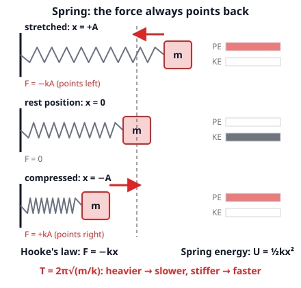
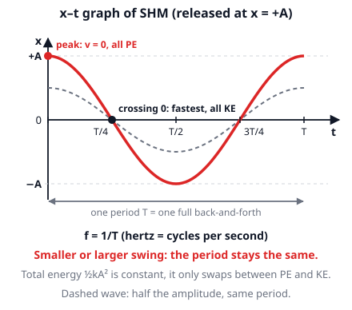
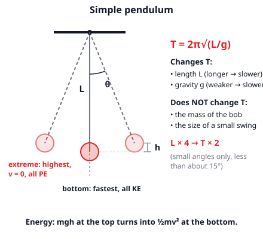

# 🟥 Simple Harmonic Motion  ·  `physics.mechanics.shm`
> 📅 Study date: Thu 15 Oct · ⏱️ ~12 min read · 📋 Syllabus: Springs, Pendulums

## 🏊 Start with a diving board
Stand at the end of a diving board and bounce once. The board bends down, pushes you back up, you go past the middle, it bends the other way, and so on. The bounces slowly get smaller, but the **rhythm stays the same**: up, down, up, down at an even beat. That steady back-and-forth is called **simple harmonic motion (SHM)**. A spring, a swing and a pendulum clock all do it, and one picture explains them all: **a force that always pulls back toward the middle**.

## 🖼️ Big picture

## 💡 Core ideas
1. **Hooke's law: F = −kx.** A spring pulls or pushes back with a force proportional to how far you **stretch or squeeze it from its relaxed length** (x). The constant **k** (in N/m) tells you how **stiff** the spring is. The **minus sign** means the force points **opposite** to the displacement, back toward the middle. A stretched or squeezed spring stores energy **U = ½kx²**.
2. **SHM** is any back-and-forth motion where the restoring force is proportional to the displacement. Words to know: **equilibrium** (the middle, where the force is 0), **amplitude A** (the biggest displacement), **period T** (time for one full back-and-forth), **frequency f = 1/T** (cycles per second, in hertz, Hz).
3. **Mass on a spring: T = 2π√(m/k).** A heavier mass is slower, a stiffer spring is faster. The **amplitude does not matter**: a small bounce and a big bounce take the same time. For a spring hanging down, gravity only moves the middle position, the period is the same formula.
4. **Simple pendulum: T = 2π√(L/g).** L is the length of the string (to the center of the bob), g is gravity. A longer pendulum is slower, and on the Moon (smaller g) it is slower too. The **mass of the bob does not matter**, and the formula works only for **small swings** (under about 15°). Quadruple L → the period doubles.
5. **Energy swaps back and forth.** With no friction the total energy stays the same: at the two **ends** the object has stopped, so everything is **potential energy** (PE); in the **middle** everything is **kinetic energy** (KE) and the speed is the biggest. For a spring: **½kA² = ½mv²max**, so **vmax = A√(k/m)**. For a pendulum: **mgh = ½mv²**.
6. **The x–t graph is a wave.** Plot position against time and you get a smooth wave (picture 2). The **peaks** are the ends (speed 0), the **steepest parts** are where the curve crosses the middle (fastest). The length of one wave along the time axis is the period.

> 🏊 **Analogy:** a swimmer doing laps of exactly the same length at an even pace goes back and forth like SHM. **The difference:** the swimmer turns around by choice and the speed jumps at the wall. In SHM the restoring force grows smoothly with the distance, so the speed changes smoothly too and is **zero** at the ends.

## 🧮 HUSO-style examples

**Example 1.** A 0.50 kg block on a flat, frictionless table is attached to a spring with k = 200 N/m. You pull the block 0.10 m from its rest position and let go. What is its greatest speed?

(A) 1.0 m/s  (B) 2.0 m/s  (C) 4.0 m/s  (D) 20 m/s  (E) 40 m/s

Steps:
1. The energy at the start is all in the spring: ½kA² = ½ · 200 · 0.10² = 1.0 J.
2. The speed is greatest at the middle, where all of that energy has become kinetic: ½mv² = 1.0 J.
3. So v² = 2 · 1.0 ÷ 0.50 = 4.0, and **v = 2.0 m/s**. **Answer: (B).**
4. Bonus: the period is T = 2π√(m/k) = 2π√(0.50/200) ≈ 0.31 s, and it would be the same if you pulled 0.05 m instead.
5. Traps: (A) 1.0 is the energy in joules, not a speed. (C) 4.0 is v² (you forgot the square root). (D) 20 is kA, a force in newtons. (E) 40 is kA/m, the greatest acceleration in m/s².

**Example 2.** What length of simple pendulum has a period of 3.0 s? (Use g = 9.8 m/s² and small swings.)

(A) 0.23 m  (B) 2.2 m  (C) 4.7 m  (D) 7.0 m  (E) 88 m

Steps:
1. Start from T = 2π√(L/g). Divide by 2π: T/2π = √(L/g).
2. Square both sides: (T/2π)² = L/g, so **L = g · T² ÷ (4π²)**.
3. L = 9.8 · 9.0 ÷ 39.48 ≈ **2.2 m**. **Answer: (B).** (A pendulum clock with a 2 s tick-tock cycle is about 1 m long.)
4. Traps: (A) 0.23 forgets g. (C) 4.7 forgets to square T/2π. (D) 7.0 writes 4π² as 4π. (E) 88 forgets the 2π (g · T²).

## ⚠️ Common traps
- **Mixing up T and f.** T is seconds per cycle, f is cycles per second, and f = 1/T. "25 cycles in 60 s" gives f = 25/60, not 60/25.
- **Believing that the amplitude or the mass changes a pendulum's period.** For a pendulum only **L and g** matter. For a spring only **m and k** matter. The amplitude changes neither (for small swings).
- **Greatest speed at the end.** At the ends the object stops for an instant. The speed is greatest in the **middle**. The force and the acceleration are greatest at the **ends**.
- **x is not the length of the spring.** x is how far the spring is stretched or squeezed from its **relaxed** length. Also, ½kx² uses the same x.

## ✏️ Redraw from memory
Close the page and draw in 5 minutes:
- [ ] A block on a spring at three positions (+A, 0, −A) with the force arrow at each.
- [ ] A pendulum with L, the angle and the height h, and what changes T and what does not.
- [ ] The x–t wave with A, T and a mark where the speed is 0 and where it is greatest.
- [ ] The formulas F = −kx, U = ½kx², T = 2π√(m/k), T = 2π√(L/g), f = 1/T.
- [ ] Two small bars (PE and KE) at the end and at the middle.

Compare with the page and mark what you missed in red.

## 🎥 Watch / try
- [Simple Harmonic Motion Introduction via a Horizontal Mass-Spring System](https://www.youtube.com/watch?v=QVkfRELZpK0) — Flipping Physics · 4:00 · watch where the force, speed and energy are biggest
- [Masses & Springs](https://phet.colorado.edu/en/simulations/masses-and-springs) — PhET · simulation · change the mass and the spring stiffness and time the period
- [Pendulum Lab](https://phet.colorado.edu/en/simulations/pendulum-lab) — PhET · simulation · change the length, mass and gravity and see which ones change the period

## ✅ Check your understanding (5 questions)
Do these without looking at the material. You are **READY** if you get at least 4 of 5 right.

**1.** 🏊 A swimmer's arm goes through 25 complete stroke cycles in 60 s. What is the frequency of her stroke?

(A) 0.42 Hz  (B) 2.4 Hz  (C) 25 Hz  (D) 60 Hz  (E) 1500 Hz

**2.** A 2.0 kg mass hangs at rest from a vertical spring and stretches it by 5.0 cm. What is the spring constant k? (Use g = 9.8 m/s².)

(A) 3.9 N/m  (B) 20 N/m  (C) 40 N/m  (D) 392 N/m  (E) 3920 N/m

**3.** A pendulum has a period of 1.5 s. The string is replaced by one that is 4 times as long, and the bob by one that is 3 times as heavy. What is the new period (small swings)?

(A) 1.5 s  (B) 3.0 s  (C) 4.5 s  (D) 6.0 s  (E) 9.0 s

**4.** A block on a spring is released at its largest displacement, +0.30 m. It reaches the opposite end, −0.30 m, for the first time 0.80 s later. What is the period of the motion?

(A) 0.40 s  (B) 0.80 s  (C) 1.2 s  (D) 1.6 s  (E) 3.2 s

**5.** A 0.50 kg pendulum bob is released from rest at a point 0.20 m above its lowest point. What is its speed at the lowest point? (Use g = 9.8 m/s²; ignore friction.)

(A) 0.98 m/s  (B) 1.4 m/s  (C) 2.0 m/s  (D) 3.9 m/s  (E) 9.8 m/s

Answer key & explanations

1. **(A) 0.42 Hz.** f = cycles ÷ time = 25 ÷ 60 ≈ 0.42 Hz. (B) 2.4 is 60 ÷ 25, which is the period in seconds. (C) 25 is just the number of cycles. (E) 1500 multiplies 25 · 60.
2. **(D) 392 N/m.** At rest the spring force balances the weight: kx = mg, so k = mg/x = 2.0 · 9.8 ÷ 0.050 = 392 N/m. (A) 3.9 uses 5.0 as meters instead of centimeters. (B) 20 is the weight mg in newtons, not k. (C) 40 forgets g. (E) 3920 turns 5.0 cm into 0.0050 m.
3. **(B) 3.0 s.** The mass does not matter, and T ∝ √L: √4 = 2, so T = 2 · 1.5 = 3.0 s. (D) 6.0 forgets the square root (4 times). (E) 9.0 also multiplies by 3 for the heavier bob (1.5 · 2 · 3). (C) 4.5 counts only the 3.
4. **(D) 1.6 s.** Going from one end to the opposite end is only **half** a cycle, so T = 2 · 0.80 = 1.6 s. (B) 0.80 reads the half cycle as a full one. (A) 0.40 is a quarter cycle. (C) 1.2 is three quarters of a cycle. (E) 3.2 doubles the answer.
5. **(C) 2.0 m/s.** mgh = ½mv², so the mass cancels and v = √(2gh) = √(2 · 9.8 · 0.20) = √3.92 ≈ 2.0 m/s. (A) 0.98 is the energy in joules (mgh). (B) 1.4 is √(gh), which forgets the 2. (D) 3.9 is 2gh, which forgets the square root. (E) 9.8 is g, an acceleration.

