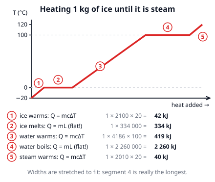
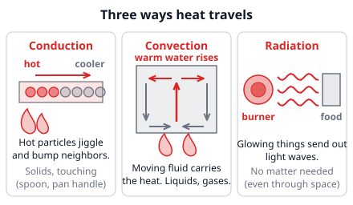
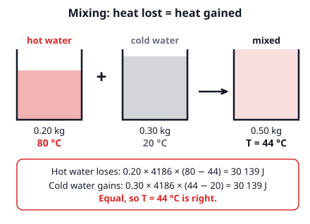

# 🟥 Heat  ·  `physics.thermodynamics.heat`
> 📅 Study date: Sat 24 Oct · ⏱️ ~12 min read · 📋 Syllabus: Heat transfer, Heat capacity, Specific heat, Phases of matter and phase transitions

## 🍳 Start with two pans
Put 1 kg of water in one pan and 1 kg of cooking oil in another, on two identical burners. After a minute the oil is far hotter than the water, even though both got the *same* heat. And when a pot of water boils, the thermometer sits at exactly 100 °C for ages, even though the burner keeps pouring in heat. Why? This page answers both: **how much heat** a thing needs to warm up, and **what heat does when nothing warms up** (a phase change).

## 🖼️ Big picture

## 💡 Core ideas
1. **Heat is energy on the move; temperature is not.** **Temperature** tells how fast the particles jiggle on average (in °C or kelvin). **Heat** (Q, in **joules**) is the energy that flows from a hotter thing to a colder thing. A bathtub of 40 °C water holds far more thermal energy than a cup of 40 °C water, but they have the *same temperature*.
2. **Three ways heat travels.** **Conduction**: hot particles bump their neighbors (a spoon in hot soup). **Convection**: a moving liquid or gas carries the heat (warm soup rises, cool soup sinks). **Radiation**: hot things give off light waves, which need *no* matter (the Sun warms Earth through empty space).
3. **Specific heat.** Different stuff needs different heat to warm up. The **specific heat c** is the heat needed to warm **1 kg by 1 K**. Then **Q = m c ΔT**, with ΔT = T_final − T_start. A change of 1 °C is the same size as a change of 1 K, so you may use °C for ΔT. Water is special: **c = 4186 J/(kg·K)**, about twice cooking oil (≈ 2000), ice (≈ 2100) or steam (≈ 2010).
4. **Heat capacity.** For a whole object, **C = m c** (in J/K) is the heat for **1 K** of warming, so **Q = C ΔT**. Big mass or big c means big C: it is hard to warm up *and* hard to cool down, so a big pool changes temperature slowly.
5. **Mixing (calorimetry).** When things at different temperatures touch and no heat escapes, **heat lost by the hot = heat gained by the cold**. Write that as an equation with the unknown final temperature T and solve. The picture below shows an example.
6. **Phase changes.** Solid → liquid → gas. During melting and boiling the **temperature stays constant**: the heat goes into pulling particles apart, not into making them move faster. **Q = m L**. For water, **L_f = 334 kJ/kg** (melting/freezing) and **L_v = 2.26 MJ/kg** (boiling/condensing). Boiling needs almost 7 times more heat than melting. Freezing and condensing give the same heat *back out*.

> 🥄 **Analogy:** heat is like money moving between two wallets, and temperature is like how "full" each wallet looks. Money (heat) always goes from the fuller one to the emptier one until both look equal. **The difference:** two things at the same temperature do *not* hold equal heat. A pool and a cup can both be 25 °C but the pool holds millions of times more energy.

## 🧮 HUSO-style examples

**Example 1.** 🍳 A cook pours 0.30 kg of cold water at 20 °C into 0.20 kg of hot water at 80 °C. No heat escapes. What is the final temperature?

(A) 40 °C  (B) 44 °C  (C) 50 °C  (D) 56 °C  (E) 60 °C

Steps:
1. Hot water loses heat: Q_lost = 0.20 × c × (80 − T). Cold water gains: Q_gained = 0.30 × c × (T − 20).
2. Set them equal. Both are water, so c cancels: 0.20 (80 − T) = 0.30 (T − 20).
3. 16 − 0.20 T = 0.30 T − 6, so 22 = 0.50 T and T = **44 °C**. **Answer: (B).**
4. Sense check: there is *more* cold water, so the result must be closer to 20 °C than to 80 °C. 44 is.
5. Trap: (C) 50 °C is the plain average of 20 and 80, which ignores the different masses. (D) 56 °C swaps the masses.

**Example 2.** 🍳 A 0.10 kg ice cube at 0 °C is dropped into 0.50 kg of water at 40 °C. No heat escapes. Use c = 4186 J/(kg·K) and L_f = 334 kJ/kg. What is the final temperature?

(A) 0 °C  (B) 15 °C  (C) 20 °C  (D) 24 °C  (E) 33 °C

Steps:
1. First ask: *does all the ice melt?* The water can give up 0.50 × 4186 × 40 = 83 720 J while cooling to 0 °C. Melting all the ice needs only 0.10 × 334 000 = 33 400 J. So **all the ice melts** and some heat is left over.
2. Now the ice (as melted water) has to warm from 0 °C to T. Heat lost by the warm water = melting heat + warming heat of the melted ice: 0.50 × 4186 × (40 − T) = 33 400 + 0.10 × 4186 × T.
3. 83 720 − 2093 T = 33 400 + 418.6 T, so 50 320 = 2511.6 T and T ≈ **20 °C**. **Answer: (C).**
4. Traps: (E) 33 °C forgets the latent heat (treats the ice like 0 °C water). (D) 24 °C remembers the melting but forgets that the melted ice also has to warm up. (A) 0 °C would be right only if there were not enough heat to melt all the ice.

## ⚠️ Common traps
- **Using Q = mcΔT during a phase change.** While ice melts or water boils the temperature does not change, so ΔT = 0. Use **Q = mL** there.
- **Mixing up L_f and L_v.** Melting 1 kg of ice takes 334 kJ. Boiling 1 kg of water takes 2 260 kJ. Pick the right one.
- **Wrong units.** c is per **kilogram**. 250 g is 0.25 kg. Heat comes out in joules, not kJ, unless you divide by 1000.
- **Averaging temperatures.** The final temperature is *weighted* by mass × specific heat, not the plain average.

## ✏️ Redraw from memory
Close the page and draw in 5 minutes:
- [ ] The heating curve: axes (T vs heat added), five parts, with the two **flat** parts at 0 °C and 100 °C.
- [ ] Which parts use Q = mcΔT and which use Q = mL. Which flat part is longer, and why?
- [ ] The three ways heat travels, one tiny sketch each, with a kitchen example.
- [ ] The formulas Q = mcΔT, C = mc and Q = mL, with the values for water (c, L_f, L_v).
- [ ] The mixing rule in one line: heat lost = heat gained.

Compare with the page and mark what you missed in red.

## 🎥 Watch / try
- [Heat Capacity, Specific Heat, and Calorimetry](https://www.youtube.com/watch?v=yhNHJ7WdT8A) — Professor Dave Explains · 4:14 · watch how the calorimetry equation is set up
- [Phase Changes, Heats of Fusion and Vaporization, and Phase Diagrams](https://www.youtube.com/watch?v=oc0ypeDELb0) — Professor Dave Explains · 4:51 · look at the flat parts of the heating curve
- [Heat Transfer – Conduction, Convection and Radiation](https://www.youtube.com/watch?v=Me60Ti0E_rY) — Next Generation Science · 3:15 · find an example of each way in a kitchen

## ✅ Check your understanding (5 questions)
Do these without looking at the material. You are **READY** if you get at least 4 of 5 right. Use c(water) = 4186 J/(kg·K), L_f = 334 kJ/kg, L_v = 2.26 MJ/kg.

**1.** 🍳 The same amount of heat is given to 1.0 kg of water and to 1.0 kg of cooking oil (c ≈ 2000 J/(kg·K)). The water warms by 10 °C. About how much does the oil warm?

(A) 5 °C  (B) 10 °C  (C) 21 °C  (D) 42 °C  (E) 84 °C

**2.** How much heat is needed to melt 0.25 kg of ice that is already at 0 °C?

(A) 334 kJ  (B) 565 kJ  (C) 1 336 kJ  (D) 83.5 J  (E) 83.5 kJ

**3.** 🏊 Sunshine warms a small paddling pool holding 200 kg of water from 20 °C to 25 °C. How much heat did the water absorb?

(A) 4.2 MJ  (B) 0.84 MJ  (C) 0.021 MJ  (D) 4 200 MJ  (E) 21 MJ

**4.** Water on a stove is boiling steadily at 100 °C. The flame is still on and the temperature does not rise. What happens to the heat that enters the water?

(A) It makes the molecules move faster, so the water gets hotter than 100 °C.  (B) It is used up heating the pot to more than 100 °C.  (C) No heat enters: the flame has no effect once the water boils.  (D) It pulls the molecules apart (liquid → gas), so the temperature stays at 100 °C.  (E) It makes each molecule smaller, so they escape as steam.

**5.** How much heat is needed to change 0.10 kg of ice at 0 °C into water at 20 °C?

(A) 8.4 kJ  (B) 41.8 kJ  (C) 33.4 kJ  (D) 418 kJ  (E) 234 kJ

Answer key & explanations

1. **(C) 21 °C.** The water took Q = 1.0 × 4186 × 10 = 41 860 J. The oil gets the same Q: ΔT = Q ÷ (m c) = 41 860 ÷ (1.0 × 2000) ≈ 21 °C. Oil has a smaller c, so it warms about twice as much (that is why the oil pan is hotter in the hook). (B) 10 °C wrongly assumes the same temperature rise. (A) 5 °C multiplies by the ratio of c's instead of dividing.
2. **(E) 83.5 kJ.** Q = mL = 0.25 × 334 000 = 83 500 J = 83.5 kJ. (A) 334 kJ forgets to multiply by the mass. (B) 565 kJ uses L_v (boiling) instead of L_f. (C) 1 336 kJ divides by the mass instead of multiplying. (D) 83.5 J is the right number with the wrong unit.
3. **(A) 4.2 MJ.** Q = mcΔT = 200 × 4186 × 5 = 4 186 000 J ≈ 4.2 MJ. (B) 0.84 MJ forgets ΔT. (C) 0.021 MJ forgets the mass. (D) 4 200 MJ uses grams (200 000) with a c that is per kilogram. (E) 21 MJ uses 25 instead of the change ΔT = 5.
4. **(D).** During boiling the heat goes into pulling the molecules away from each other (potential energy). Their average speed, and so the temperature, stays the same until all the liquid has turned to steam.
5. **(B) 41.8 kJ.** Two steps: melt: 0.10 × 334 000 = 33 400 J. Warm the melted water from 0 °C to 20 °C: 0.10 × 4186 × 20 = 8 372 J. Total = 41 772 J ≈ 41.8 kJ. (A) 8.4 kJ forgets the melting. (C) 33.4 kJ forgets the warming. (D) 418 kJ uses 1.0 kg instead of 0.10 kg. (E) 234 kJ uses L_v instead of L_f.

