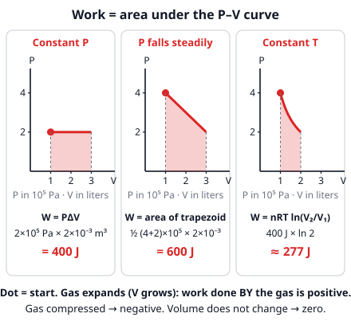
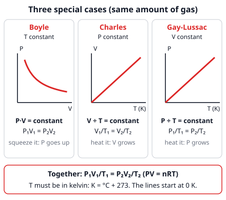
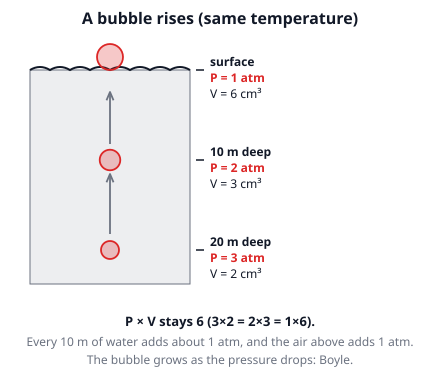

# 🟥 Ideal gas and gas work  ·  `physics.thermodynamics.ideal-gas`
> 📅 Study date: Sat 24 Oct · ⏱️ ~12 min read · 📋 Syllabus: Ideal gas law, Work done by a gas

## 🏊 Start with a diver's bubble
A diver 20 m under water breathes out a small bubble, only 2 cm³. As it floats up, it grows to **three times** that size by the time it pops at the surface. Nothing was added to the bubble, so what changed? The **pressure** around it dropped, and gas always reacts to pressure, temperature and volume together. This page gives you the one equation that links them, and shows how a gas can do **work**, like pushing a piston in an engine or the lid of a pot.

## 🖼️ Big picture

## 💡 Core ideas
1. **Four things describe a gas.** **Pressure P** (push per area, in **pascals**, Pa = N/m²; 1 atm ≈ 1.0 × 10⁵ Pa), **volume V** (in **m³**; 1 L = 10⁻³ m³ and 1 cm³ = 10⁻⁶ m³), **temperature T** and the **amount n** in **moles**. One **mole** is 6.022 × 10²³ particles (**Avogadro's number N_A**), so N = n N_A. An **ideal gas** is a gas whose particles are far apart and only bounce off the walls and each other.
2. **The ideal gas law: P V = n R T.** **R = 8.315 J/(mol·K)** is given on the exam sheet. Use **SI units** (Pa, m³, K). **T must be in kelvin: T = °C + 273.** Check: Pa × m³ = N·m = joules.
3. **Special cases.** Keep the amount n fixed. **Boyle** (T constant): **P₁V₁ = P₂V₂**. **Charles** (P constant): **V₁/T₁ = V₂/T₂**. **Gay-Lussac** (V constant): **P₁/T₁ = P₂/T₂**. In all three, kelvin is a must, but pressure and volume units only need to be the *same on both sides* (atm, L, cm³ are fine).
4. **P–V diagram.** Every point is one state of the gas. A **horizontal** line is constant pressure, a **vertical** line is constant volume, and a **curve P = constant ÷ V** is constant temperature (an **isotherm**). An arrow shows which way the gas goes.
5. **Work done by a gas.** At constant pressure, **W = P ΔV** (in J, with P in Pa and V in m³). In general, **W = the area under the curve** on the P–V diagram. If the gas **expands**, W is positive (the gas pushes on the outside). If it is **compressed**, W is negative. If V does not change, **W = 0**.
6. **Constant temperature (isothermal).** The area under a curve is not a rectangle, so use the formula **W = n R T ln(V₂/V₁)**. **ln** is the "natural log" button on your calculator. Handy: ln 2 ≈ 0.693 and ln 1 = 0. Work out the number inside the bracket first.

> 🌧️ **Analogy:** pressure is like rain on a tin roof: a huge number of tiny hits that feel like one steady push. Heating the gas makes the hits harder and more often. **The difference:** raindrops all fall in one direction, but gas particles move in every direction, so the pressure pushes on *all* walls equally.

## 🧮 HUSO-style examples

**Example 1.** 🏊 At 20 m depth the pressure is 3 atm (1 atm from the air above the pool plus 2 atm from the water). A diver's bubble there has volume 2.0 cm³. It rises to the surface (1 atm). The water temperature is the same all the way up. What is the volume of the bubble at the surface?

(A) 0.67 cm³  (B) 2.0 cm³  (C) 4.0 cm³  (D) 6.0 cm³  (E) 5.0 cm³

Steps:
1. Same gas and same T, so use Boyle: P₁V₁ = P₂V₂.
2. 3 atm × 2.0 cm³ = 1 atm × V₂.
3. V₂ = 6 ÷ 1 = **6.0 cm³**. **Answer: (D).** The pressure fell to a third, so the volume tripled.
4. Traps: (A) 0.67 cm³ turns the ratio upside down (2 × 1 ÷ 3). (C) 4.0 cm³ forgets that the air adds 1 atm, so it uses 2 atm at 20 m. (E) 5.0 cm³ adds instead of multiplying (2 + 3).

**Example 2.** 🍳 Suppose a rigid sealed pot holds only air at 20 °C and 1.0 atm. You heat it to 120 °C. What is the pressure of the air now?

(A) 0.75 atm  (B) 1.3 atm  (C) 2.0 atm  (D) 6.0 atm  (E) 3.0 atm

Steps:
1. The pot is rigid and sealed, so V and n are constant. That is **Gay-Lussac**: P₁/T₁ = P₂/T₂.
2. **Kelvin first:** T₁ = 20 + 273 = 293 K and T₂ = 120 + 273 = 393 K.
3. P₂ = P₁ × T₂/T₁ = 1.0 × 393 ÷ 293 ≈ **1.3 atm**. **Answer: (B).**
4. Traps: (D) 6.0 atm uses 120 ÷ 20 with the Celsius numbers. (A) 0.75 atm flips the ratio (293 ÷ 393).
5. Back to the kitchen: a real pressure cooker also holds steam. The extra pressure pushes on the water surface and makes it **harder for water to boil**, so the water must reach about 120 °C before it boils. Hotter water cooks food faster.

## ⚠️ Common traps
- **Celsius in the gas law.** 0 °C is *not* zero. Always add 273 first. A ratio like 120/20 is meaningless.
- **Wrong volume units.** In P V = n R T and W = P ΔV, V must be in **m³**: 1 L = 0.001 m³. (In Boyle/Charles ratios any volume unit is fine.)
- **Using V instead of ΔV for work.** Work depends on the *change* in volume, V₂ − V₁.
- **Sign of the work.** Expanding gas → positive work by the gas. Compressing → negative. A **constant volume** process has **zero** work, even if the pressure changes a lot.

## ✏️ Redraw from memory
Close the page and draw in 5 minutes:
- [ ] A P–V diagram with axes labeled. Draw a horizontal line (constant P) and shade the work area under it.
- [ ] A sloping line and a curved isotherm on the same axes, and shade the area under each.
- [ ] The three small graphs: P vs V curve (Boyle), V vs T line, P vs T line (both start at 0 K).
- [ ] P V = n R T with the units of each letter and the value of R.
- [ ] One sentence: when is the work positive, negative, or zero?

Compare with the page and mark what you missed in red.

## 🎥 Watch / try
- [The ideal gas law (PV = nRT)](https://www.youtube.com/watch?v=qObcdZj8YTM) — Khan Academy · 6:19 · follow the unit conversions in the example
- [Work Done by a Gas: W = pΔV and Area Under a p-V Graph](https://www.youtube.com/watch?v=xbVnAKcM-TI) — kineticcanvas · 3:31 · see why work is an area
- [Gas Properties](https://phet.colorado.edu/en/simulations/gas-properties) — PhET simulation · interactive · pump in gas, change T or V and watch P (try keeping one of the three fixed)

## ✅ Check your understanding (5 questions)
Do these without looking at the material. You are **READY** if you get at least 4 of 5 right. Use R = 8.315 J/(mol·K) and 1 atm ≈ 1.0 × 10⁵ Pa.

**1.** A balloon holds 2.0 L of air at 1.0 × 10⁵ Pa and 27 °C. How many moles of air are in it?

(A) 0.020 mol  (B) 0.080 mol  (C) 0.89 mol  (D) 80 mol  (E) 800 mol

**2.** A gas expands at a constant pressure of 1.5 × 10⁵ Pa from 2.0 L to 5.0 L. How much work does the gas do?

(A) 300 J  (B) 750 J  (C) 1 050 J  (D) 450 000 J  (E) 450 J

**3.** On a P–V diagram, a gas goes along a straight line from (V = 2.0 L, P = 3.0 × 10⁵ Pa) to (V = 6.0 L, P = 1.0 × 10⁵ Pa). How much work does the gas do?

(A) 800 J  (B) 1 200 J  (C) 400 J  (D) 1 600 J  (E) 800 000 J

**4.** 🍳 A sealed, flexible bag of air has a volume of 600 cm³ at 27 °C. You put it in a warm oven at 177 °C. The bag stretches, so the pressure stays the same. What is its new volume?

(A) 400 cm³  (B) 750 cm³  (C) 900 cm³  (D) 10 000 cm³  (E) 3 900 cm³

**5.** 1.0 mol of an ideal gas at a constant 27 °C expands until its volume has doubled. (Use ln 2 = 0.693.) How much work does the gas do?

(A) −1 729 J  (B) 156 J  (C) 2 495 J  (D) 1 729 J  (E) 4 990 J

Answer key & explanations

1. **(B) 0.080 mol.** n = PV ÷ (RT) with V = 2.0 L = 2.0 × 10⁻³ m³ and T = 27 + 273 = 300 K: n = (1.0 × 10⁵ × 2.0 × 10⁻³) ÷ (8.315 × 300) = 200 ÷ 2494.5 ≈ 0.080 mol. (C) 0.89 mol uses 27 instead of 300 K. (D) 80 mol uses V = 2.0 without converting liters to m³.
2. **(E) 450 J.** W = PΔV = 1.5 × 10⁵ × (5.0 − 2.0) × 10⁻³ = 1.5 × 10⁵ × 3.0 × 10⁻³ = 450 J. (A) 300 J uses only V₁. (B) 750 J uses only V₂. (C) 1 050 J adds the volumes (7.0 L). (D) 450 000 J forgets to convert liters to m³.
3. **(A) 800 J.** The work is the area under the line, a trapezoid: average pressure = (3.0 + 1.0) ÷ 2 = 2.0 × 10⁵ Pa, ΔV = 4.0 × 10⁻³ m³, so W = 2.0 × 10⁵ × 4.0 × 10⁻³ = 800 J. (B) 1 200 J uses the top pressure only (3.0 × 10⁵). (C) 400 J uses the bottom pressure only. (D) 1 600 J forgets the ½ in the trapezoid (it adds the two pressures instead of averaging). (E) 800 000 J forgets to convert liters.
4. **(C) 900 cm³.** Charles: V₂ = V₁ × T₂/T₁ with T₁ = 300 K and T₂ = 450 K: 600 × 450 ÷ 300 = 900 cm³. (A) 400 cm³ flips the ratio. (B) 750 cm³ adds the 150 °C change to the volume. (D) 10 000 cm³ converts only the top temperature (600 × 450 ÷ 27). (E) 3 900 cm³ uses both temperatures in °C (600 × 177 ÷ 27).
5. **(D) 1 729 J.** Isothermal: W = nRT ln(V₂/V₁) = 1.0 × 8.315 × 300 × ln 2 = 2494.5 × 0.693 ≈ 1 729 J. (A) −1 729 J has the wrong sign (the gas expands, so it does positive work). (B) 156 J uses 27 instead of 300 K. (C) 2 495 J forgets the ln. (E) 4 990 J multiplies by 2 (the volume ratio) instead of by ln 2.

