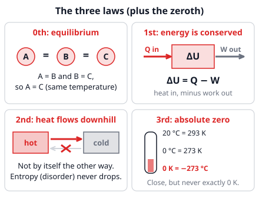
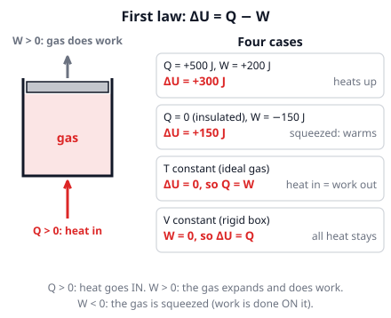

# 🟥 Laws of thermodynamics  ·  `physics.thermodynamics.laws`
> 📅 Study date: Sat 31 Oct · ⏱️ ~12 min read · 📋 Syllabus: Three laws of thermodynamics

## 🍳 Start with a cup of coffee
A cup of hot coffee on the kitchen counter slowly cools down. Have you ever seen a cold cup of coffee heat *itself* up while the kitchen gets colder? Never. Yet that would not break the rule "energy is never lost". And your fridge keeps food cold in a warm kitchen, but if you touch the back of it, it is warm. These everyday facts are the **laws of thermodynamics**: simple rules about heat, work and energy that no machine can ever beat.

## 🖼️ Big picture

## 💡 Core ideas
1. **Zeroth law (thermal equilibrium).** Two things **touching** end up at the **same temperature** and then no net heat flows (thermal equilibrium). If A is in equilibrium with B, and B with C, then **A and C are in equilibrium too**. That is why a thermometer works: it settles to the temperature of what it touches.
2. **First law: ΔU = Q − W.** Energy is conserved. **U** is the **internal energy** (the energy of the jiggling particles). **Q** is the heat **added to** the gas and **W** is the work done **by** the gas. So heat in raises U, and work out lowers U. For an **ideal gas**, U depends only on temperature, so at **constant T, ΔU = 0 and Q = W**. At **constant volume, W = 0 and ΔU = Q**. If no heat flows (**insulated**), Q = 0 and ΔU = −W.
3. **Second law: the one-way street.** Heat flows **by itself** only from **hot to cold**. To move heat from cold to hot (a **fridge**) you must supply **work**. Another way to say it: the **entropy** (a measure of disorder) of an isolated system **never decreases**. Mixing, cooling down and breaking are easy; the reverse never happens on its own.
4. **Heat engine and efficiency.** An engine takes heat **Q_h** from a hot source, turns some of it into work **W**, and must throw the rest **Q_c** into a cold place (h = hot, c = cold). **W = Q_h − Q_c**. **Efficiency e = W ÷ Q_h**, always **less than 1** (less than 100%). A perfect engine is impossible.
5. **The Carnot limit.** The best possible engine between a hot and a cold temperature has **e = 1 − T_c/T_h**, with temperatures in **kelvin**. A bigger temperature difference allows a better engine. Real engines are worse.
6. **Third law: absolute zero.** The coldest possible temperature is **0 K = −273.15 °C**. You can get closer and closer but can **never reach exactly 0 K** with a finite number of steps. A **fridge** moves heat out of the cold box and dumps it, plus the work it used, into the kitchen: **Q_h = Q_c + W**.

> 🛏️ **Analogy:** entropy is like a bedroom. Mess appears by itself, but tidying needs effort (work). **The difference:** you *can* tidy a room, so does disorder really never decrease? Yes, it does in the room, but your body gives off heat while you tidy, so the **total** disorder of you + room + air still goes up. The second law is about the *whole* system.

## 🧮 HUSO-style examples

**Example 1.** A gas in a cylinder is squeezed: the surroundings do **600 J of work on the gas**, and at the same time the gas **loses 200 J of heat** to the cooler walls. What is the change in internal energy ΔU of the gas?

(A) −800 J  (B) −400 J  (C) +400 J  (D) +800 J  (E) +600 J

Steps:
1. Get the signs right. Heat **leaves** the gas, so **Q = −200 J**.
2. Work is done **on** the gas, so the work done **by** the gas is **W = −600 J**.
3. ΔU = Q − W = −200 − (−600) = **+400 J**. **Answer: (C).**
4. Sense check: the gas received 600 J of work and gave away 200 J of heat, so it keeps 400 J.
5. Traps: (A) −800 J uses W = +600 J (work *by* the gas). (D) +800 J uses Q = +200 J. (E) +600 J forgets the heat.

**Example 2.** 🍳 Suppose an engine takes **1000 J** of heat from a hot source at **227 °C** and gives its waste heat to air at **27 °C**. What is the **most** work it could possibly do?

(A) 119 J  (B) 400 J  (C) 600 J  (D) 881 J  (E) 1000 J

Steps:
1. Kelvin first: T_h = 227 + 273 = 500 K and T_c = 27 + 273 = 300 K.
2. The best possible efficiency is the Carnot limit: e = 1 − T_c/T_h = 1 − 300/500 = **0.40**.
3. W = e × Q_h = 0.40 × 1000 = **400 J**. **Answer: (B).** The other 600 J must be dumped into the cold air.
4. Traps: (D) 881 J puts the Celsius numbers in the formula (1 − 27/227). (A) 119 J uses 27/227 as the efficiency. (C) 600 J is T_c/T_h = 0.6, which is the *wasted* share, not the useful share. (E) 1000 J would be a 100% engine, which the second law forbids.

## ⚠️ Common traps
- **Sign of W.** In ΔU = Q − W, **W is work done BY the gas**. If the surroundings squeeze the gas, W is **negative** (so −W adds energy).
- **Celsius in efficiency.** Use **kelvin** in e = 1 − T_c/T_h, always.
- **"Energy is conserved, so anything goes."** Not true: the first law allows many things that the second law forbids (a cold coffee heating itself, an engine with no waste heat).
- **100% efficient.** Even a perfect, frictionless engine cannot turn all the heat into work. It must dump some heat into the cold place.

## ✏️ Redraw from memory
Close the page and draw in 5 minutes:
- [ ] The four laws as four little boxes, each with a symbol or a mini picture (A = B = C; ΔU; hot → cold; 0 K).
- [ ] A cylinder with a piston, with arrows for Q in and W out, and the formula ΔU = Q − W with all signs.
- [ ] A heat engine: hot box, engine circle, cold box, arrows Q_h, W, Q_c, and the formula for e.
- [ ] A thermometer scale with 0 °C = 273 K and 0 K = −273 °C.
- [ ] One sentence: why can a fridge move heat from cold to hot?

Compare with the page and mark what you missed in red.

## 🎥 Watch / try
- [The First Law of Thermodynamics: Internal Energy, Heat, and Work](https://www.youtube.com/watch?v=O7HwhkYt6YU) — Professor Dave Explains · 5:44 · practice the signs of Q and W
- [The Second Law of Thermodynamics: Heat Flow, Entropy, and Microstates](https://www.youtube.com/watch?v=MrwW4w2nAMc) — Professor Dave Explains · 7:44 · see why heat flow is a one-way street
- [What is the Second Law of Thermodynamics?](https://www.youtube.com/watch?v=mGDJO2M7RBg) — The Royal Institution · 4:08 · listen for the idea of entropy as disorder

## ✅ Check your understanding (5 questions)
Do these without looking at the material. You are **READY** if you get at least 4 of 5 right.

**1.** 🏊 You hold a thermometer in the pool until its reading stops changing. Which law says that the reading is the temperature of the water?

(A) The first law (energy is conserved)  (B) The second law (entropy never decreases)  (C) The third law (absolute zero cannot be reached)  (D) The zeroth law (thermal equilibrium)  (E) Boyle's law

**2.** A gas in a well-insulated cylinder expands and does 250 J of work on a piston. No heat enters or leaves. What is the change in internal energy of the gas?

(A) −250 J  (B) +250 J  (C) 0 J  (D) +500 J  (E) −500 J

**3.** 🍳 A cup of hot coffee sits in a cool kitchen. Which of these can **not** happen by itself?

(A) The coffee cools down.  (B) The kitchen air warms up a tiny bit.  (C) Heat flows from the coffee to the air.  (D) The coffee and the air end at the same temperature.  (E) The coffee gets hotter while the air gets cooler, with the total energy unchanged.

**4.** A heat engine takes 1 200 J of heat from a hot source and does 300 J of work. How much heat does it release to the cold place?

(A) 300 J  (B) 900 J  (C) 1 200 J  (D) 1 500 J  (E) 4 800 J

**5.** Which statement about absolute zero (0 K) is correct?

(A) It is 0 °C.  (B) It is −100 °C.  (C) It is about −273 °C, and it can never be reached exactly.  (D) A strong enough freezer can cool things below it.  (E) At 0 K a gas has no mass.

Answer key & explanations

1. **(D) The zeroth law.** The thermometer is in equilibrium with the water, and the reading shows the thermometer's own temperature, so the water has the same temperature. (A) is about energy, (B) about the direction of heat flow, (C) about absolute zero.
2. **(A) −250 J.** ΔU = Q − W = 0 − 250 = −250 J. The gas spends its own internal energy to do the work, so it cools. (B) +250 J has the wrong sign. (C) 0 J forgets that the work still has to come from somewhere.
3. **(E).** Energy would still be conserved, so the first law is happy, but heat would flow from cold to hot without any work. The second law forbids that. (A) to (D) are all normal: heat flows from hot to cold until the temperatures are equal.
4. **(B) 900 J.** Energy in = energy out: Q_h = W + Q_c, so Q_c = 1 200 − 300 = 900 J. (A) 300 J is the work. (C) 1 200 J is the heat taken in. (D) 1 500 J adds the work instead of subtracting. (E) 4 800 J divides 1 200 by the efficiency 0.25.
5. **(C).** 0 K = −273.15 °C. The third law says that you can get close but never exactly there in a finite number of steps. (A) is the freezing point of water, and (B) is just a wrong number.

